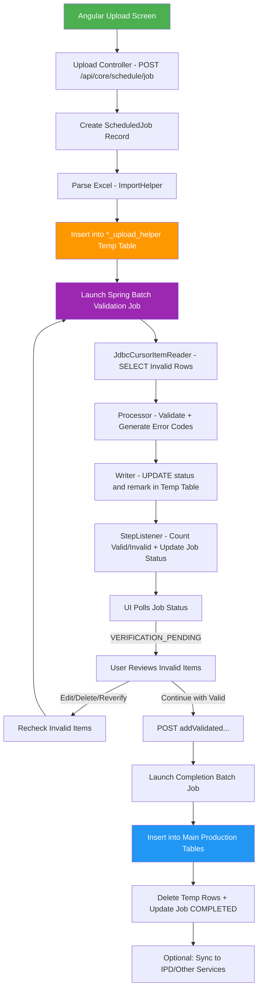
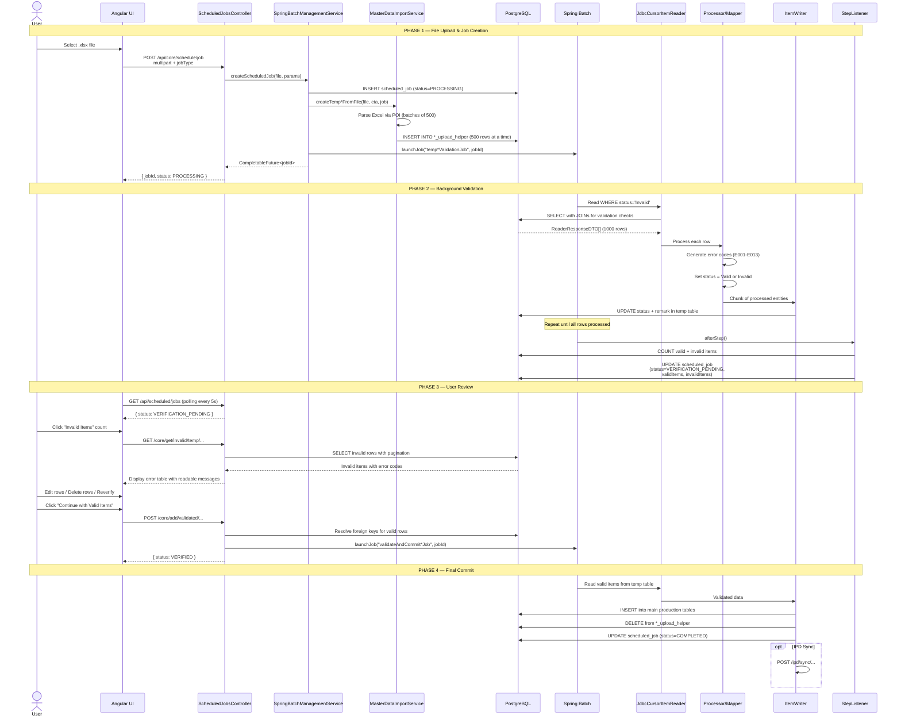
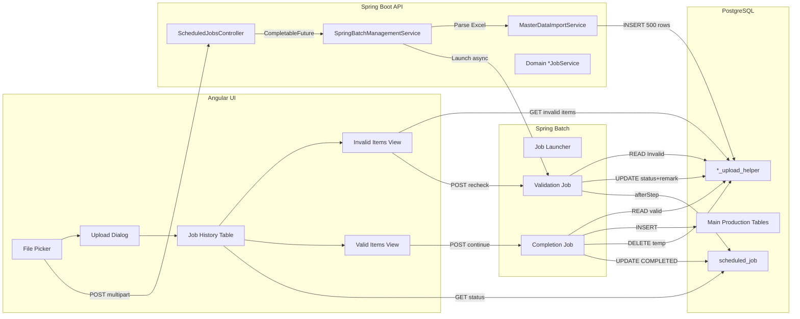
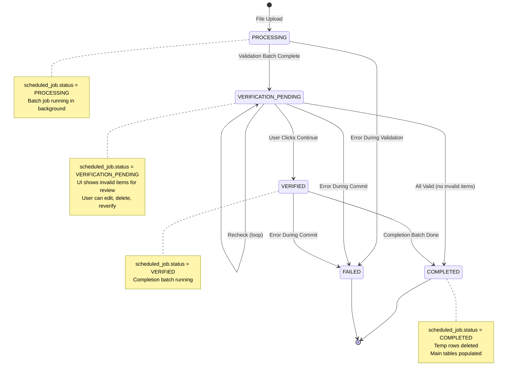
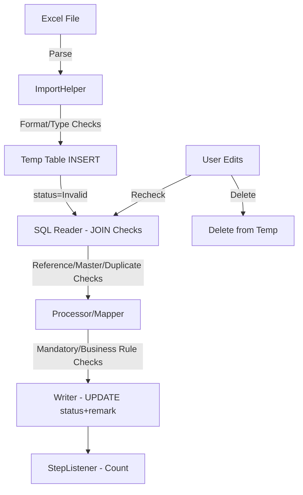
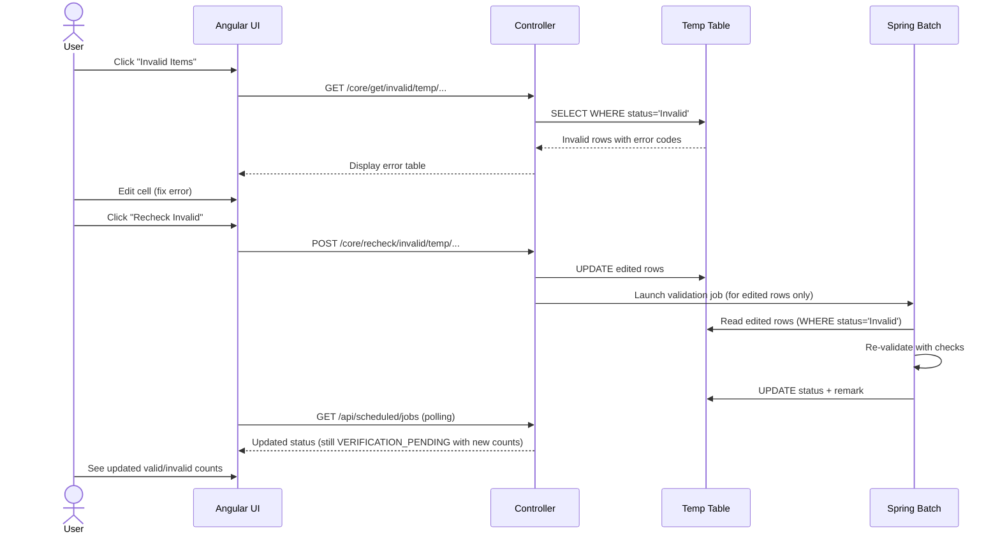

# Core Upload Framework Architecture

> **Master Reference Document for All Upload Modules**
> Last Updated: 2026-06-17

> **Resource classification (2026-10-13 reorg audit):** §1-11 and §15 are KNOWLEDGE
> (architecture/lifecycle/API facts — what IS). §12 "Clean Code Standards" is a STANDARD
> (mandatory rules). §13 "Adding New Upload Module" and §14 "AI Agent Development Guide" are a
> SKILL (step-by-step how-to). Left as one file rather than physically split — this document is
> large, actively used, and internally consistent; splitting it risked losing cross-section
> context for a classification-only concern. Treat the section boundaries above as the de facto
> split when citing or extending this doc. See `shared/reports/` for the full audit.

---

## Table of Contents

1. [Executive Summary](#1-executive-summary)
2. [High Level Architecture](#2-high-level-architecture)
3. [Upload Framework Components](#3-upload-framework-components)
4. [Complete Upload Lifecycle](#4-complete-upload-lifecycle)
5. [UI Architecture](#5-ui-architecture)
6. [API Documentation](#6-api-documentation)
7. [Data Flow Analysis](#7-data-flow-analysis)
8. [Job Status Lifecycle](#8-job-status-lifecycle)
9. [Validation Framework](#9-validation-framework)
10. [Error Handling Strategy](#10-error-handling-strategy)
11. [Reverification Flow](#11-reverification-flow)
12. [Clean Code Standards](#12-clean-code-standards)
13. [Adding New Upload Module](#13-adding-new-upload-module)
14. [AI Agent Development Guide](#14-ai-agent-development-guide)
15. [Folder Structure](#15-folder-structure)

---

## 1. Executive Summary

### What is the Upload Framework?

The Upload Framework is a **standardized, enterprise-grade bulk data ingestion pipeline** that enables users to upload Excel files containing master data, transactional data, and configuration data into the system. It is built on **Spring Batch** with a **multi-step validation pipeline** and provides real-time feedback through the Angular UI.

### Why It Exists

- **Consistency**: Every upload follows the same flow — upload, validate, review, commit — regardless of the data type.
- **Data Quality**: Multi-layered validation (mandatory fields, reference integrity, business rules, duplicates) ensures only clean data enters production tables.
- **User Control**: Users can review invalid records, correct errors, and selectively commit valid data before final processing.
- **Auditability**: Every upload creates a `ScheduledJob` record tracking who uploaded what, when, and the outcome.
- **Scalability**: Spring Batch chunk processing (1000 items per transaction) handles large files efficiently.
- **Separation of Concerns**: Temporary staging tables isolate upload data from production until validation passes.

### Problems It Solves

| Problem | Solution |
|---------|----------|
| Data entry errors at scale | Multi-layered validation with error codes |
| Downtime during bulk imports | Async processing with background jobs |
| No audit trail for uploads | `ScheduledJob` entity tracks everything |
| Invalid data corrupting production | Temp tables + validation before commit |
| Inconsistent upload UX across modules | Standardized UI components (tabs, pagination, error display) |
| Hard to add new uploads | Standardized architecture (Reader → Processor → Writer → Listener) |

### How All Uploads Follow a Common Architecture

Every upload module in the system follows this identical pattern:

1. **UI** collects the file and calls `POST /api/core/schedule/job`
2. **Backend** parses Excel into a `*_upload_helper` temp table
3. **Spring Batch** validates rows in chunks (Reader → Processor → Writer)
4. **StepListener** counts valid/invalid and updates `ScheduledJob` status
5. **User** reviews invalid items, edits/deletes, and rechecks
6. **User** clicks "Continue" to trigger final commit to main tables
7. **Completion Job** reads valid temp rows and inserts into production tables
8. **Temp table** is cleaned up after successful commit

---

## 2. High Level Architecture

### End-to-End Flow



### Technology Stack

| Layer | Technology |
|-------|-----------|
| Frontend | Angular, PrimeNG (TabView, Table, FileUpload, Dialog) |
| API Layer | Spring Boot REST Controllers |
| Async Processing | CompletableFuture + ThreadPoolTaskExecutor |
| Batch Processing | Spring Batch (Job → Step → Reader → Processor → Writer → Listener) |
| Database | PostgreSQL (temp tables + production tables) |
| File Parsing | Apache POI (Excel .xlsx) |
| Caching | Redis (for reference data lookups) |

---

## 3. Upload Framework Components

### Backend Components

#### 3.1 Controllers

| Controller | Service | Purpose | APIs |
|------------|---------|---------|------|
| `ScheduledJobsController` | `SpringBatchManagementService` | **Primary upload orchestrator** — handles all file uploads, job queries, invalid item management, recheck, delete, cancel | `POST addScheduledJob`, `GET searchScheduledJob`, `DELETE deleteAllTempInvalidItems`, `DELETE cancelScheduledJob`, plus domain-specific endpoints |
| `MasterDataImportController` | `MasterDataImportService` | Legacy import for PRICE_BOOK, TAX, CUSTOMER_VISIT_TYPE | `POST master/data/import` |
| `DataFileImportController` | `FileImportService` | Jobs framework for clinical/RCM imports | Generic import endpoints |
| `PriceBookAssignmentController` | `PriceBookAssignmentJobService` | Price book assignment specific operations | `POST addValidatedPriceBookAssignments`, `GET invalid`, `POST recheck` |
| `VendorUploadBatchController` | `VendorUploadService` | Vendor master upload (inventory-service) | `POST /vendor/excel/upload-batch`, `GET upload-data`, `POST sync` |
| `OpeningStockUploadController` | `OpeningStockUploadService` | Opening stock upload (inventory-service) | `POST opening/stock/upload`, `POST verify`, `POST sync` |
| `AlternateItemUploadController` | `AlternateItemUploadService` | Alternate item upload (inventory-service) | `POST batch/upload`, `POST validate`, `POST sync` |
| `ConsultationConfigUploadController` | `IPConsultationConfigUploadService` | IP consultation pricing upload (ipd-service) | Batch upload endpoints |
| `InsuranceImportController` | `InsuranceImportService` | Insurance import (rcm-service) | Upload, jobs, detail, reconcile |

#### 3.2 Core Services

| Service | Responsibility | Dependencies |
|---------|---------------|-------------|
| `SpringBatchManagementService` | **Central orchestrator** — creates jobs, dispatches to domain services, manages recheck/commit flows | `ScheduledJobService`, domain-specific `*JobService` instances |
| `SpringBatchService` | Launches individual Spring Batch jobs asynchronously | `JobLauncher`, `JobRepository` |
| `ScheduledJobService` | CRUD operations on `ScheduledJob` entity | `ScheduledJobRepository` |
| `MasterDataImportService` | Parses Excel files via POI, writes to temp `*_upload_helper` tables | Domain-specific `*ImportHelper` classes |
| `FileImportService` | Generic file import pipeline (jobs framework) | `DataImportJobRepository`, `DataImportRowRepository` |

#### 3.3 Domain-Specific Job Services

Each upload module has a dedicated `*JobService` that handles:

| Service | Entity Type | Responsibility |
|---------|------------|---------------|
| `CatalogueJobService` | `CATALOGUE_ITEM` | Temp table ops, validation, JDBC batch insert for catalogue items |
| `PackageJobService` | `PACKAGE` | Package temp table operations and validation |
| `PriceBookJobService` | `PRICE_BOOK_ITEM` | Price book item temp table operations |
| `PriceBookAssignmentJobService` | `PRICE_BOOK_ASSIGNMENT` | Price book assignment upload/validate/commit |
| `InventoryItemUploadJobService` | `INVENTORY_ITEM` | Inventory item validation and commit |
| `PackageDrugUploadService` | `PACKAGE_DRUG` | Package drug upload |
| `PatientExcelUploadJobService` | `PATIENT_DEMOGRAPHY` | Patient demographic upload to main table |
| `DDCUploadJobService` | `DDC` | Drug data upload |
| `SerialNoConfigJobService` | `SERIAL_NO_CONFIG` | Serial number config upload |
| `CapabilityConfigJobService` | `CAPABILITY` | Capability config upload |
| `CustomerMasterJobService` | `CUSTOMER_MASTER` | Customer master upload |
| `ReasonMasterJobService` | `REASON_MASTER` | Reason master upload |
| `EquipmentJobService` | `EQUIPMENT` | Equipment upload |
| `ItemCodeMapperJobService` | `ITEM_CODE_MAPPER` | Item code mapper upload |
| `ChargeGroupJobService` | `CHARGE_GROUP_UPLOAD` | Charge group upload |
| `ItemLocationUploadJobService` | `ITEM_LOCATION_UPLOAD` | Item-location mapping upload |
| `OPPhysConsultUploadJobService` | `OP_PHYS_CONSULT` | OP physician consult config upload |
| `CatalogueItemLanguageJobService` | `CATALOGUE_ITEM_LANGUAGE` | Catalogue item language upload |
| `ClinicalCodeSetValueLanguageJobService` | `CLINICAL_CODE_SET_VALUE_LANGUAGE` | Clinical code set language upload |
| `I18nMessageJobService` | `I18N_MESSAGE` | I18n message (word translation) upload |
| `SystemMasterLanguageJobService` | `SYSTEM_MASTER_LANGUAGE` | System master language upload |
| `MasterDataLanguageJobService` | `CUSTOMER_MASTER_LANGUAGE`, `REASON_MASTER_LANGUAGE`, `ORDERABLE_DRUG_LANGUAGE` | Common master data language upload |
| `OrganizationUploadService` | `ORGANIZATION` | Organization upload |
| `UomDrugUploadReaderService` | `DRUG_UOM` | UOM drug upload |
| `RouteUploadhelperService` | `DRUG_ROA` | Route drug upload |
| `CatalogueItemAliasService` | `CATALOGUE_ITEM_ALIAS` | Catalogue item alias upload |
| `ReceiverSiteCredentialsMapperJobService` | `RECEIVER_SITE_CREDENTIALS` | Receiver site credentials upload |
| `RegionalActivityCodeMapperJobService` | `REGIONAL_ACTIVITY_CODES_IMPORT` | Regional activity code upload |

#### 3.4 Import Helpers (Excel → Temp Table)

Each upload type has an `*ImportHelper` class that uses Apache POI to parse Excel:

| Helper | Entity | Excel Columns |
|--------|--------|---------------|
| `CatalogueItemImportHelper` | `CatalogueItemUploadHelper` | Item code, description, UOM, category, etc. |
| `PackageDataImportHelper` | `PackageUploadHelper` | Package code, name, items, etc. |
| `PriceBookDataImportHelper` | `PriceBookItemUploadHelper` | Price book columns |
| `PriceBookAssignmentImportHelper` | `PriceBookAssignmentUploadHelper` | 17 columns (contract, care settings, type, org, receiver, network, site, etc.) |
| `SerialNoConfigImportHelper` | `SerialNoConfigUploadHelper` | Serial number config columns |
| `CapabilityImportHelper` | `CapabilityUploadHelper` | Capability columns |
| `CustomerMasterImportHelper` | `CustomerMasterUploadHelper` | Customer master columns |
| `ReasonMasterImportHelper` | `ReasonMasterUploadHelper` | Reason master columns |
| `EquipmentImportHelper` | `EquipmentUploadHelper` | Equipment columns |
| `ItemCodeMapperImportHelper` | `ItemCodeMapperUploadHelper` | Item code mapper columns |
| `EmployeeImportHelper` | `EmployeeUploadHelper` | Employee columns |
| `UserImportHelper` | `UserUploadHelper` | User columns |
| `ItemLocationImportHelper` | `ItemLocationUploadHelper` | Item-location columns |
| `OrganizationImportHelper` | `OrganizationUploadHelper` | Organization columns |
| `ClinicalCodeSetValueLanguageImportHelper` | `ClinicalCodeSetValueLanguageUploadHelper` | Clinical code language columns |
| `CatalogueItemLanguageImportHelper` | `CatalogueItemLanguageUploadHelper` | Catalogue item language columns |
| `I18nMessageImportHelper` | `I18nMessageUploadHelper` | i18n message columns |
| `SystemMasterLanguageImportHelper` | `SystemMasterLanguageUploadHelper` | System master language columns |
| `CommonMasterDataLanguageImportHelper` | Various language helpers | Common master language columns |
| `ReceiverSiteCredentialsMpperImportHelper` | `SiteInsReceiverConfigUploadHelper` | Receiver site credentials columns |
| `RegionalActivityCodeMapperImportHelper` | `RegionalClinicalCodeUploadHelper` | Regional activity code columns |

#### 3.5 Mappers

Mappers transform reader response DTOs into upload helper entities with validation:

| Mapper | Input DTO | Output Entity | Responsibility |
|--------|-----------|--------------|----------------|
| `PriceBookAssignmentMapper` | `PriceBookAssignmentReaderResponseDTO` | `PriceBookAssignmentUploadHelper` | Generate error codes (E001-E013), determine Valid/Invalid status |
| `CatalogueMapper` | `TempCatalogueItemReaderResponseDTO` | `CatalogueItemUploadHelper` | Validate catalogue item fields |
| `FinanceMapper` | `TempPriceBookItemReaderResponseDTO` | `PriceBookItemUploadHelper` | Validate price book fields |
| `SerialNoConfigMapper` | `SerialNoConfigReaderResponseDTO` | `SerialNoConfigUploadHelper` | Validate serial number config |
| `CustomerMasterMapper` | `CustomerMasterReaderResponseDTO` | `CustomerMasterUploadHelper` | Validate customer master |
| `CapabilityConfigMapper` | `CapabilityConfigReaderResponseDTO` | `CapabilityUploadHelper` | Validate capability config |
| `EquipmentMapper` | `EquipmentReaderResponseDTO` | `EquipmentUploadHelper` | Validate equipment |
| `PackageMapper` | `TempPackageReaderResponseDTO` | `PackageUploadHelper` | Validate package data |

### Spring Batch Components

#### Job & Step Definitions

All batch jobs are defined in `BatchConfiguration.java` (core-service, ~2900 lines):

```java
// VALIDATION JOB PATTERN (example: Price Book Assignment)
@Bean
public Job tempPriceBookAssignmentValidationJob() {
    return new JobBuilder("tempPriceBookAssignmentValidationJob", jobRepository)
        .start(tempPriceBookAssignmentProcessingStep()).build();
}

@Bean
public Step tempPriceBookAssignmentProcessingStep() {
    return new StepBuilder("tempPriceBookAssignmentProcessingStep", jobRepository)
        .<ReaderResponseDTO, UploadHelperEntity>chunk(1000, transactionManager)
        .reader(cursorReader)
        .processor(processor())
        .writer(writer())
        .listener(new StepListener(jobService, domainJobService))
        .build();
}

// COMPLETION JOB PATTERN (example: Price Book Assignment)
@Bean
public Job createPriceBookAssignmentFromTempJob() {
    return new JobBuilder("createPriceBookAssignmentFromTempJob", jobRepository)
        .start(createPriceBookAssignmentFromTempStep()).build();
}

@Bean
public Step createPriceBookAssignmentFromTempStep() {
    return new StepBuilder("createPriceBookAssignmentFromTempStep", jobRepository)
        .<JDBCPostDTO, JDBCPostDTO>chunk(1000, transactionManager)
        .reader(cursorValidatedReader)
        .processor(validatedProcessor())
        .writer(mainTableWriter())
        .listener(new CompletionStepListener(jobService, domainJobService, producerService, eventsMapper))
        .build();
}
```

#### Readers

| Reader Type | Usage |
|-------------|-------|
| `JdbcCursorItemReader` | Most common — reads temp table with SQL joins for validation checks (e.g., `cursorPriceBookAssignmentReader`) |
| Custom `ItemReader` | Excel streaming readers for large files (e.g., `InventoryItemExcelReader`, `PatientDemographicStreamingExcelReader`) |

**Reader Pattern (JdbcCursorItemReader)**:
```sql
SELECT *
FROM price_book_assignment_upload_helper temp
  INNER JOIN price_book_assignment_type ON ...
  INNER JOIN organization ON ...
  -- ... more JOINs for validation
WHERE temp.scheduled_job_id = ?
  AND temp.status = 'Invalid'
```

The reader performs SQL-level validation checks via JOINs and conditionals, returning a `ReaderResponseDTO` with check columns (e.g., `mandatoryCheck`, `priceBookAssignmentTypeCheck`).

#### Processors

Processors call mapper methods to generate error codes and determine Valid/Invalid status:

```java
@Bean
public ItemProcessor<ReaderResponseDTO, UploadHelperEntity> processor() {
    return (readerData) -> mapper.mapFromReader(readerData);
}
```

#### Writers

| Writer | Operation |
|--------|-----------|
| Validation Writer | `UPDATE *_upload_helper SET status=?, remark=?, updated_on=NOW() WHERE id=?` |
| Completion Writer | `INSERT INTO main_table ...` (via domain repository `save()`) |

#### Listeners

| Listener | Purpose | Runs After |
|----------|---------|------------|
| `ValidatedPriceBookAssignmentStepListener` | Counts valid/invalid items, updates `ScheduledJob` status to `VERIFICATION_PENDING` | Validation Step |
| `PriceBookAssignmentStepListener` | Cleans up temp rows, updates `ScheduledJob` status to `COMPLETED`, triggers IPD sync | Completion Step |
| `ValidatedTempCatalogueItemsStepListener` | Same pattern for catalogue items | Validation Step |
| `CatalogueItemStepListener` | Same pattern for catalogue completion | Completion Step |
| `ValidatedInventoryItemsStepListener` | Same pattern for inventory | Validation Step |
| `InventoryItemFileReadStepListener` | Same pattern for inventory completion | Completion Step |
| (30+ more listeners) | One per upload type | Each has Validation + Completion listener |

### Repository Layer

#### Upload Repositories (Temp Table Access)

| Repository | Temp Table | Key Methods |
|------------|-----------|-------------|
| `PriceBookAssignmentUploadHelperRepository` | `price_book_assignment_upload_helper` | `findByScheduledJobIdAndStatusOrderByIdAsc()`, `saveAll()`, `deleteByScheduledJobId()` |
| `ICatalogueItemUploadHelperRepository` | `catalogue_item_upload_helper` | `findByScheduledJobIdAndStatus()`, `saveAll()` |
| `IPackageUploadHelperRepository` | `package_upload_helper` | `findByScheduledJobId()`, `saveAll()` |
| `IPriceBookItemUploadHelperRepository` | `price_book_item_upload_helper` | Standard CRUD |
| `InventoryItemUploadHelperRepository` | `inventory_item_upload_helper` | Standard CRUD |
| `ISerialNoConfigUploadHelperRepository` | `serial_no_config_upload_helper` | Standard CRUD |
| `ICapabilityConfigUploadHelperRepository` | `capability_upload_helper` | Standard CRUD |
| `ICustomerMasterUploadHelperRepository` | `customer_master_upload_helper` | Standard CRUD |
| `IReasonMasterUploadHelperRepository` | `reason_master_upload_helper` | Standard CRUD |
| `IEquipmentUploadHelperRepository` | `equipment_upload_helper` | Standard CRUD |
| `IItemCodeMapperUploadHelperRepository` | `item_code_mapper_upload_helper` | Standard CRUD |
| `IChargeGroupUploadHelperRepository` | `charge_group_upload_helper` | Standard CRUD |
| `IItemLocationUploadHelperRepository` | `item_location_upload_helper` | Standard CRUD |
| `IOrganizationUploadHelperRepository` | `organization_upload_helper` | Standard CRUD |
| `IPatientDemographyUploadHelperRepository` | `patient_demography_upload_helper` | Standard CRUD |
| `IEmployeeUploadHelperRepository` | `employee_upload_helper` | Standard CRUD |
| `IUserUploadHelperRepository` | `user_upload_helper` | Standard CRUD |
| `IDonorUploadHelperRepository` | `donor_upload_helper` | Standard CRUD |
| `I18nMessageUploadHelperRepository` | `i18n_message_upload_helper` | Standard CRUD |
| `SystemMasterLanguageUploadHelperRepository` | `system_master_language_upload_helper` | Standard CRUD |
| `ICatalogueItemLanguageUploadHelperRepository` | `catalogue_item_language_upload_helper` | Standard CRUD |
| `IClinicalCodeSetValueLanguageUploadHelperRepository` | `clinical_code_set_value_language_upload_helper` | Standard CRUD |
| `IReasonMasterLanguageUploadHelperRepo` | `reason_master_language_upload_helper` | Standard CRUD |
| `ICustomerMasterLanguageUploadHelperRepo` | `customer_master_language_upload_helper` | Standard CRUD |
| `IOrderableDrugLanguageUploadHelperRepo` | `orderable_drug_language_upload_helper` | Standard CRUD |
| `ISiteInsReceiverConfigUploadHelperRepository` | `site_ins_receiver_config_upload_helper` | Standard CRUD |
| `IRegionalClinicalCodeUploadHelperRepository` | `regional_clinical_code_upload_helper` | Standard CRUD |
| `PayerMappingUploadHelperRepository` | `payer_mapping_upload_helper` | Standard CRUD |
| `PackageDrugUploadHelperRepository` | `package_drug_upload_helper` | Standard CRUD |
| `RouteDrugUploadHelperRepository` | `route_drug_upload_helper` | Standard CRUD |

#### Job Tracking Repository

| Repository | Table | Purpose |
|------------|-------|---------|
| `IScheduledJobRepository` | `scheduled_job` | Tracks all upload jobs — status, counts, dates, user |

#### Main Entity Repositories

Each upload type has its own main table repository (e.g., `ContractPriceBookAssignmentRepository`, `CatalogueItemRepository`, `PackageRepository`, etc.) used by completion writers.

### Database Tables

#### ScheduledJob Table

```sql
CREATE TABLE scheduled_job (
    id                  BIGSERIAL PRIMARY KEY,
    entity_id           BIGINT,
    entity_type         VARCHAR(50) NOT NULL,    -- JobEntityType enum
    name                TEXT,                      -- Original filename
    file_path           VARCHAR(500),
    job_status          VARCHAR(30) NOT NULL,     -- JobStatus enum
    start_date          TIMESTAMP,
    end_date            TIMESTAMP,
    total_items         BIGINT,
    valid_items         BIGINT,
    invalid_items       BIGINT,
    -- CustomerTransactionAttribute (embedded)
    currency_unit       VARCHAR(10),
    customer_id         BIGINT,
    customer_business_id BIGINT,
    site_id             BIGINT,
    username            VARCHAR(100),
    language_identifier VARCHAR(50)
);
```

#### Temp Table Pattern (Example: Price Book Assignment)

```sql
CREATE TABLE price_book_assignment_upload_helper (
    id                              BIGSERIAL PRIMARY KEY,
    scheduled_job_id                BIGINT REFERENCES scheduled_job(id),
    -- All 17 Excel columns
    contract_name                   VARCHAR(200),
    contract_description            TEXT,
    care_settings                   VARCHAR(10),
    price_book_assignment_type_identifier_code VARCHAR(50),
    is_default                      BOOLEAN,
    organization_identifier         VARCHAR(100),
    receiver_identifier             VARCHAR(100),
    network_identifier              VARCHAR(100),
    site_id                         BIGINT,
    bed_category_id                 BIGINT,
    activated_from                  DATE,
    valid_till                      DATE,
    price_book_id                   BIGINT,
    patient_category_identifier     VARCHAR(100),
    is_rate_revision                BOOLEAN,
    percentage                      FLOAT,
    revision_in                     VARCHAR(100),
    -- Validation fields
    status                          VARCHAR(10) DEFAULT 'Invalid',  -- Valid | Invalid
    remark                          TEXT,                            -- Error codes
    -- Audit
    created_by                      VARCHAR(100),
    created_on                      TIMESTAMP,
    updated_by                      VARCHAR(100),
    updated_on                      TIMESTAMP
);
```

#### Common Temp Table Columns

Every `*_upload_helper` table has:

| Column | Type | Purpose |
|--------|------|---------|
| `id` | BIGSERIAL | Primary key |
| `scheduled_job_id` | BIGINT | FK to `scheduled_job` |
| `status` | VARCHAR(10) | `Valid` or `Invalid` (default: `Invalid`) |
| `remark` | TEXT | Error codes (e.g., `E001-ContractName E006 E010`) |
| `created_by` | VARCHAR(100) | Username |
| `created_on` | TIMESTAMP | Creation timestamp |
| `updated_by` | VARCHAR(100) | Last modifier |
| `updated_on` | TIMESTAMP | Last modification timestamp |
| *(domain-specific columns)* | Various | One column per Excel template field |

---

## 4. Complete Upload Lifecycle

### Detailed Sequence Diagram



---

## 5. UI Architecture

### Reference Component: Package Drug Upload

**File**: `projects/masters/src/lib/module/tools/package-drug-upload/package-drug-upload.component.ts`

### Angular Component Structure

```typescript
@Component({
  selector: 'app-package-drug-upload',
  standalone: true,
  imports: [
    CommonModule, FormsModule, TranslateModule, TableModule,
    ToastModule, ButtonModule, ConfirmDialogModule, DialogModule,
    TabViewModule, CardModule, FileUploadModule, TooltipModule,
    LtPaginationComponent, UploadInstructionsComponent
  ],
  templateUrl: './package-drug-upload.component.html',
  styleUrls: ['./package-drug-upload.component.scss'],
  providers: [DatePipe, ConfirmationService, MessageService, LtPaginatorService]
})
export class PackageDrugUploadComponent implements OnInit, ApiCallBack { ... }
```

### Key Properties

| Property | Type | Purpose |
|----------|------|---------|
| `uploadDialog` | `boolean` | Controls upload file dialog visibility |
| `isUploadInProgress` | `boolean` | Shows upload progress spinner |
| `fileToUpload` | `any` | Selected file reference |
| `UploadURL` | `any` | Constructed upload endpoint URL |
| `showJobDetailsDialog` | `boolean` | Controls job details dialog |
| `temparoryDataPage` | `boolean` | Toggles between job list and invalid/valid items view |
| `validAndInnvalid` | `GeneralEnum[]` | Valid and invalid item counts |
| `items` | `MenuItem[]` | Tab menu items |
| `activeItem` | `MenuItem` | Currently selected tab |

### UI Tabs Pattern

#### Jobs Tab (History)
Displays upload history with columns:

| Column | Description |
|--------|------------|
| Job Number | `scheduledJobId` |
| File Name | Original uploaded filename |
| Status | Color-coded badge (PROCESSING/VERIFICATION_PENDING/VERIFIED/COMPLETED/FAILED) |
| Valid Items | Count of valid records (clickable) |
| Invalid Items | Count of invalid records (clickable) |
| Uploaded By | Username |
| Uploaded Date | `initiatedOn` timestamp |

**Actions**: View Details, Reverify, Delete, Cancel

#### Invalid Items Tab
Displays records with `status = 'Invalid'`:

| Column | Description |
|--------|------------|
| Row Number | Sequential row number |
| Data Fields | All Excel columns (editable via cell editor) |
| Error Message | Human-readable error codes (mapped from `remark` column) |
| Status | Invalid |

**Actions**:
- Edit Row (pencil icon → cell editor → save)
- Delete Row (trash icon → DELETE single item)
- Delete All Invalid (button → DELETE all invalid for job)
- Reverify (button → POST recheck with edited data)

#### Valid Items Tab
Displays records with `status = 'Valid'`:

| Column | Description |
|--------|------------|
| Row Number | Sequential row number |
| Data Fields | All Excel columns (read-only) |
| Status | Valid |

**Action**: Continue with Valid Items (triggers final commit)

### UI Component List (All Upload Modules)

| Component | Location | Module |
|-----------|----------|--------|
| `PackageDrugUploadComponent` | `masters/tools/package-drug-upload/` | Masters |
| `PriceBookAssignmentUploadComponent` | `masters/tools/price-book-assignment-upload/` | Masters |
| `CatalogueAliasUploadComponent` | `masters/tools/catalogue-alias-upload/` | Masters |
| `CatalogueCodeUploadComponent` | `masters/tools/catalogue-code-upload/` | Masters |
| `CatalogueCategoryUploadComponent` | `masters/tools/catalogue-category-upload/` | Masters |
| `CatalogueItemLanguageUploadComponent` | `masters/tools/catalogue-item-language-upload/` | Masters |
| `ChargeGroupUploadComponent` | `masters/tools/charge-group-upload/` | Masters |
| `ClinicalCodeSetValueLanguageUploadComponent` | `masters/tools/clinical-code-set-value-language-upload/` | Masters |
| `CustomerMasterUploadComponent` | `masters/tools/customer-master-upload/` | Masters |
| `CustomerMasterLanguageUploadComponent` | `masters/tools/customer-master-language-upload/` | Masters |
| `DemographicsUploadComponent` | `masters/tools/demographics-upload/` | Masters |
| `EquipmentUploadComponent` | `masters/tools/equipment-upload/` | Masters |
| `ItemCodeMapperUploadComponent` | `masters/tools/item-code-mapper-upload/` | Masters |
| `OPPhysConsultUploadComponent` | `masters/tools/op-phys-consult-upload/` | Masters |
| `OrderableDrugLanguageUploadComponent` | `masters/tools/orderable-drup-language-upload/` | Masters |
| `PackageItemUploadComponent` | `masters/tools/package-item-upload/` | Masters |
| `PayerMappingUploadComponent` | `masters/tools/payer-mapping-upload/` | Masters |
| `ReasonMasterUploadComponent` | `masters/tools/reason-master-upload/` | Masters |
| `ReasonMasterLanguageUploadComponent` | `masters/tools/reason-master-language-upload/` | Masters |
| `SerialNoConfigUploadComponent` | `masters/tools/serial-no-config-upload/` | Masters |
| `SystemMasterLanguageUploadComponent` | `masters/tools/system-master-language-upload/` | Masters |
| `WordTranslationUploadComponent` | `masters/tools/word-translation/` | Masters |
| `VendorsUploadComponent` | `masters/tools/vendors-upload/` | Masters |
| `UserUploadComponent` | `masters/tools/user-upload/` | Masters |
| `OrganizationUploadComponent` | `masters/tools/organization-upload/` | Masters |
| `EmployeeUploadComponent` | `masters/tools/employee-upload/` | Masters |
| `InsuranceNetworkUploadComponent` | `masters/tools/insurance-network-upload/` | Masters |
| `InventoryItemUploadComponent` | `inventory/modules/item-upload/` | Inventory |
| `ItemLocationUploadComponent` | `inventory/modules/store-item-mapping/` | Inventory |
| `GrnExcelUploadComponent` | `inventory/modules/dirct-grn/` | Inventory |
| `PatientDemographicsUploadComponent` | `patient-lib/patient-demographics-upload/` | Patient |
| `PbmDrugUploadComponent` | `settings/module/pbm-setting/pbm-drug-upload/` | Settings |
| `InsuranceImportComponent` | `revenue-cycle-management/transactions/insurance-import/` | RCM |
| `PayerAdvancesImportComponent` | `revenue-cycle-management/transactions/account-receivable/` | RCM |
| `DiagnosisCodesImportComponent` | `revenue-cycle-management/system-settings/templates/` | RCM |
| `RegionalFormularyCodeImportComponent` | `revenue-cycle-management/system-settings/regional-settings/` | RCM |
| `RegionalActivityCodesImportComponent` | `revenue-cycle-management/system-settings/regional-settings/` | RCM |
| `RecSiteCredImportComponent` | `revenue-cycle-management/central-settings/receiver-settings/` | RCM |
| `ApplicableReceiversImportComponent` | `revenue-cycle-management/central-settings/site-settings/` | RCM |
| `ApplicableNetworksImportComponent` | `revenue-cycle-management/central-settings/site-settings/` | RCM |
| `CatalogRegFrmlyCodeImportComponent` | `revenue-cycle-management/central-settings/catalog-reg-code-mapping/` | RCM |
| `CatalogRegConCodeImportComponent` | `revenue-cycle-management/central-settings/catalog-reg-code-mapping/` | RCM |
| `CatalogRegActCodeImportComponent` | `revenue-cycle-management/central-settings/catalog-reg-code-mapping/` | RCM |
| `PreferredMedListTemplateImportComponent` | `revenue-cycle-management/system-settings/` | RCM |
| `AuthRequiredListTemplateImportComponent` | `revenue-cycle-management/system-settings/` | RCM |
| `PostArReceiptsUploadDialogComponent` | `revenue-cycle-management/account-receivables/` | RCM |

### Upload Services (HTTP)

| Service | File | Purpose |
|---------|------|---------|
| `VendorUploadService` | `masters/data/service/vendor-upload/` | Vendor upload APIs |
| `ChargeGroupUploadService` | `masters/module/tools/charge-group-upload/` | Charge group upload APIs |
| `CatalogueItemLanguageUploadService` | `masters/module/tools/catalogue-item-language-upload/` | Catalogue item language APIs |
| `ClinicalCodeSetLanguageUploadService` | `masters/module/tools/clinical-code-set-value-language-upload/` | Clinical code set language APIs |
| `CommonMasterDataLanguageUploadService` | `masters/module/tools/reason-master-language-upload/` | Shared language upload APIs |
| `SystemMasterLanguageUploadService` | `masters/module/tools/system-master-language-upload/` | System master language APIs |
| `WordTranslationUploadService` | `masters/module/tools/word-translation/` | i18n word translation APIs |
| `ItemLocationUploadService` | `inventory/Data/services/item-location-upload/` | Item-location upload APIs |
| `InsuranceImportService` | `revenue-cycle-management/Service/` | Insurance import APIs |
| `CentralExcelImportService` | `revenue-cycle-management/Service/central-settings/` | Central settings import APIs |
| `ExcelImportService` | `src/app/base/excel-import/` | Generic core Excel import APIs |

---

## 6. API Documentation

### 6.1 Upload File (Create Scheduled Job)

```
POST /api/core/schedule/job
```

**Query Parameters**:

| Parameter | Type | Required | Description |
|-----------|------|----------|-------------|
| `currencyUnit` | String | Yes | Currency unit (e.g., "INR") |
| `customerId` | Long | Yes | Customer ID |
| `customerBusinessId` | Long | Yes | Customer business ID |
| `siteId` | Long | Yes | Site ID |
| `username` | String | Yes | Current user |
| `jobType` | String | Yes | Entity type (see `JobEntityType` enum) |
| `entityId` | Long | Optional | Specific entity ID |
| `languageIdentifier` | String | Optional | Language identifier for language uploads |

**Request**: `Content-Type: multipart/form-data` — Excel file binary

**Response**:
```json
{
  "code": 200,
  "data": 12345,
  "message": "OK"
}
```

### 6.2 Get Scheduled Jobs History

```
GET /api/core/scheduled/jobs/history
    ?entityId={jobType}
    &customerBusinessId={id}
```

**Response**:
```json
{
  "data": [
    {
      "scheduledJobId": 12345,
      "jobName": "PRICE_BOOK_ASSIGNMENT_UPLOAD.xlsx",
      "jobStatus": "COMPLETED",
      "totalValidItems": 50,
      "totalInvalidItems": 5,
      "createdBy": "user123",
      "initiatedOn": "2026-06-17T10:30:00Z",
      "startDate": "2026-06-17T10:30:05Z",
      "endDate": "2026-06-17T10:35:20Z"
    }
  ]
}
```

### 6.3 Get Invalid Items

```
GET /core/get/invalid/temp/price/book/assignments
    ?scheduledJobId={id}
    &pageNo={page}
    &pageSize={size}
```

**Response**:
```json
{
  "data": {
    "content": [
      {
        "id": 1,
        "contractName": "",
        "careSettings": "IP",
        "remark": "E001-ContractName E006",
        "scheduledJobId": 12345
      }
    ],
    "page": {
      "currentPageSize": 500,
      "totalElements": 10
    }
  }
}
```

### 6.4 Recheck Invalid Items

```
POST /core/recheck/invalid/temp/price/book/assignments
```

**Request**:
```json
{
  "invalidItems": [
    {
      "id": 1,
      "contractName": "Corrected Name",
      "careSettings": "IP",
      "priceBookAssignmentTypeIdentifierCode": "SP",
      "siteId": 3,
      "activatedFrom": "2026-06-17",
      "priceBookId": 338
    }
  ],
  "siteId": 3
}
```

**Response**:
```json
{
  "code": 200,
  "data": true,
  "message": "Recheck initiated"
}
```

### 6.5 Delete All Invalid Items

```
DELETE /core/delete/all/invalid/items
    ?scheduledJobId={id}
    &jobType={jobType}
```

**Response**:
```json
{
  "code": 200,
  "data": null,
  "message": "Invalid items deleted"
}
```

### 6.6 Add Validated Items (Continue with Valid)

```
POST /core/add/validated/price/book/assignments
Content-Type: application/json
```

**Request**:
```json
{
  "siteId": 3,
  "scheduledJobId": 12345,
  "username": "user123"
}
```

**Response**:
```json
{
  "code": 200,
  "data": 12345,
  "message": "OK"
}
```

### 6.7 Cancel Scheduled Job

```
DELETE /api/core/scheduled/job/{jobId}
```

**Response**:
```json
{
  "code": 200,
  "data": null,
  "message": "Job cancelled"
}
```

### 6.8 Get Validation Counts

```
GET /api/core/get/validations/count
    ?entityId={id}
    &entityType={jobType}
```

**Response**:
```json
{
  "validCount": 50,
  "invalidCount": 5
}
```

### 6.9 Delete Single Invalid Item

```
DELETE /core/delete/invalid/item
    ?scheduledJobId={id}
    &itemId={itemId}
    &jobType={jobType}
```

### 6.10 Get Valid Items

```
GET /core/get/valid/temp/price/book/assignments
    ?scheduledJobId={id}
    &pageNo={page}
    &pageSize={size}
```

---

## 7. Data Flow Analysis

### Complete Data Flow Diagram



### Data Transformation Points

| Step | Input | Transformation | Output |
|------|-------|---------------|--------|
| Excel Parse | `.xlsx` file | Apache POI cell extraction | `*_upload_helper` rows (status=Invalid) |
| Validation Reader | Temp table rows | SQL JOINs for reference checks | `ReaderResponseDTO` with check columns |
| Validation Processor | `ReaderResponseDTO` | Error code generation, status determination | `UploadHelperEntity` with status + remark |
| Validation Writer | Processed entities | `UPDATE` temp table | Updated temp rows |
| Completion Reader | Valid temp rows | SELECT valid items | `JDBCPostDTO` |
| Completion Processor | Valid DTOs | Entity mapping | Main table entities |
| Completion Writer | Main entities | `INSERT` into production | Production rows |

---

## 8. Job Status Lifecycle

### Status Definitions

| Status | Description | Trigger |
|--------|-------------|---------|
| `PROCESSING` | Job is being created, file parsed, and validation batch running | After file upload |
| `VERIFICATION_PENDING` | Validation complete; user must review invalid items | After validation batch completes |
| `VERIFICATION_APPROVED` | User has approved for processing (optional intermediate state) | User action |
| `VERIFIED` | User clicked "Continue with Valid Items"; completion batch running | After user confirms |
| `COMPLETED` | All valid items committed to main tables; temp rows deleted | After completion batch |
| `FAILED` | An error occurred during processing | On exception |

### State Diagram



### Status Transitions in Code

```
PROCESSING
   ↓  ValidatedPriceBookAssignmentStepListener.afterStep()
   ↓  UPDATE scheduled_job SET job_status='VERIFICATION_PENDING',
   ↓    valid_items=?, invalid_items=?, end_date=NOW()
VERIFICATION_PENDING
   ↓  User clicks "Continue with Valid Items"
   ↓  UPDATE scheduled_job SET job_status='VERIFIED'
VERIFIED
   ↓  PriceBookAssignmentStepListener.afterStep()
   ↓  UPDATE scheduled_job SET job_status='COMPLETED', end_date=NOW()
COMPLETED
```

---

## 9. Validation Framework

### Validation Types

| Type | Where | Description | Example |
|------|-------|-------------|---------|
| **Mandatory Fields** | Mapper/Processor | Check required fields are non-null | `contractName IS NOT NULL` |
| **Reference Checks** | SQL Reader (JOINs) | Verify foreign key references exist | `site_id` exists in `site` table |
| **Master Data Checks** | SQL Reader (JOINs) | Verify master data identifiers exist | `priceBookAssignmentTypeCode` exists in `price_book_assignment_type` |
| **Duplicate Checks** | SQL Reader (SELECT COUNT) | Check for duplicate records | Same contract name + overlapping date range |
| **Business Rule Checks** | Mapper/Processor | Complex business logic | Insurance type requires Receiver + Network |
| **Cross-Entity Checks** | Mapper/Processor | Rules spanning multiple entities | OP + SelfPay + Default=false requires Patient Category |
| **Format Checks** | ImportHelper (Excel Parse) | Validate cell data types | Date format DD-MM-YYYY, numeric fields |
| **Uniqueness Checks** | SQL Reader | Ensure no conflicts with existing data | Contract name uniqueness within site |

### Validation Error Codes (Price Book Assignment Example)

| Code | Condition | Display Message |
|------|-----------|-----------------|
| `E001-ContractName` | `contractName` null/blank | Contract Name is missing |
| `E001-CareSettings` | `careSettings` null/blank | Care Settings is missing |
| `E001-AssignmentType` | `priceBookAssignmentTypeIdentifierCode` null/blank | Assignment Type Code is missing |
| `E001-SiteId` | `capturedSiteId` null | Site Id is missing |
| `E001-ActivatedFrom` | `activatedFrom` null | Activated From date is missing |
| `E001-PriceBookId` | `priceBookId` null | Price Book Id is missing |
| `E002` | `priceBookAssignmentTypeCheck == INVALID` | Assignment Type Code not found in system |
| `E003` | `organizationIdentifierCheck == INVALID` | Organization Identifier not found |
| `E004` | `receiverIdentifierCheck == INVALID` | Receiver Identifier not found |
| `E005` | `networkIdentifierCheck == INVALID` | Network Identifier not found |
| `E006` | `siteIdCheck == INVALID` | Site Id not valid |
| `E007` | `bedCategoryIdCheck == INVALID` | Bed Category Id not valid |
| `E008` | `priceBookIdCheck == INVALID` | Price Book Id not found |
| `E009` | `patientCategoryIdentifierCheck == INVALID` | Patient Category Identifier not found |
| `E010` | `contractDuplicateCheck == INVALID` | Duplicate contract (same name + overlapping date range) |
| `E011` | `defaultFlagCheck == INVALID` | Multiple defaults for same site (Self-Pay allows only one) |
| `E012` | `insuranceMandatoryCheck == INVALID` | Insurance type requires Receiver + Network |
| `E013` | `opSelfpayPatientcategoryCheck == INVALID` | OP + SelfPay + Default=false requires Patient Category |

### Where Validations Occur



### Validation Check SQL Pattern (Reader)

```sql
SELECT
    temp.*,
    -- Mandatory field check
    CASE WHEN temp.contract_name IS NOT NULL
         AND temp.care_settings IS NOT NULL
         AND temp.price_book_assignment_type_identifier_code IS NOT NULL
         AND temp.site_id IS NOT NULL
         AND temp.activated_from IS NOT NULL
         AND temp.price_book_id IS NOT NULL
         THEN 'VALID' ELSE 'INVALID' END AS mandatory_check,
    -- Reference checks via JOINs
    CASE WHEN pbat.id IS NOT NULL THEN 'VALID' ELSE 'INVALID' END AS type_check,
    CASE WHEN org.id IS NOT NULL THEN 'VALID' ELSE 'INVALID' END AS org_check,
    -- ... more checks
    -- Duplicate check
    (SELECT COUNT(*) FROM contract_price_book_assignment existing
     WHERE existing.contract_name = temp.contract_name
     AND existing.activated_from <= temp.valid_till
     AND existing.valid_till >= temp.activated_from
     AND existing.site_id = temp.site_id) AS duplicate_count
FROM price_book_assignment_upload_helper temp
LEFT JOIN price_book_assignment_type pbat ON temp.price_book_assignment_type_identifier_code = pbat.identifier_code
LEFT JOIN organization org ON temp.organization_identifier = org.identifier_code
-- ... more JOINs
WHERE temp.scheduled_job_id = ?
  AND temp.status = 'Invalid'
```

---

## 10. Error Handling Strategy

### Error Categories

| Category | Source | Handling |
|----------|--------|----------|
| **File Format Errors** | Invalid Excel structure, wrong columns | Return 400 immediately; UI shows alert |
| **Empty File** | No data rows | Return 400 immediately |
| **File Too Large** | >10MB | UI rejects before upload |
| **Validation Errors** | Invalid data in rows | Stored in `remark` column; status=Invalid |
| **System Errors** | DB connection, Spring Batch failure | Job status → FAILED; error logged |
| **Batch Processing Errors** | Exception during chunk processing | Step execution fails; job marked FAILED |
| **Database Errors** | Constraint violations, FK violations | Transaction rollback; job error state |
| **IPD Sync Errors** | Cross-service communication failure | Logged but non-blocking for CORE commit |

### Error Code Patterns by Upload Type

| Upload Type | Error Code Pattern | File |
|-------------|-------------------|------|
| Price Book Assignment | `E001-*`, `E002`-`E013` | `price-book-assignment-upload-error-codes.ts` (implied) |
| Organization | `E001`-`E012` | `organization-upload-error-codes.ts` |
| Payer Mapping | `E001`-`E006` | `payer-mapping-upload-error-codes.ts` |
| Route Drug | `E001`-`E005` | `route-upload-error-codes.ts` |
| Patient Demographics | `PD001`-`PD028` | `patient-demographics-upload-error-codes.ts` |
| Catalogue Alias | `E001`-`E006` | `catalogue-alias-upload-error-codes.ts` |

### Retry Logic

| Operation | Retry | Notes |
|-----------|-------|-------|
| File upload | No | User must re-upload |
| Batch validation | Automatic (Spring Batch) | Chunk-level retry on transient DB errors |
| Recheck invalid items | User-initiated | User edits and re-submits |
| IPD sync | Logged + manual retry | Non-blocking for CORE commit |
| Completion commit | Spring Batch retry | Chunk-level retry on transient errors |

---

## 11. Reverification Flow

### Why Reverification Exists

Reverification allows users to **correct invalid records without re-uploading the entire file**. After initial validation marks rows as `Invalid`, the user can:

1. Edit individual cells in the UI
2. Click "Recheck" to re-validate only the edited rows
3. See updated error codes or successful validation

### Reverification Sequence



### Data Movement During Reverification

```
BEFORE RECHECK:
  Row 1: status=Invalid, remark="E001-ContractName E006"
  Row 2: status=Invalid, remark="E010"
  Row 3: status=Valid, remark=""

USER EDITS Row 1 (fixes contract name):
  Row 1: status=Invalid (unchanged), remark="E001-ContractName E006" (unchanged until recheck)

USER CLICKS "Recheck":
  API: Updates Row 1 in temp table with new values
  Batch: Re-validates Row 1
  Result:
  Row 1: status=Valid, remark=""  ← Now valid!
  Row 2: status=Invalid, remark="E010"  ← Still invalid

COUNTS UPDATED:
  validCount: 50 → 51
  invalidCount: 5 → 4
```

---

## 12. Clean Code Standards

### Class Standards

| Rule | Limit | Action When Exceeded |
|------|-------|---------------------|
| Maximum class size | 500 lines | Extract services, validators, helpers |
| Maximum method size | 50-100 lines | Refactor into smaller methods |
| Hard limit method size | 150 lines | Refactor immediately |

### Controller Standards

- Controllers **only** accept requests, validate input, call services, return responses
- **No business logic** in controllers
- Use `@RestController` + `@RequestMapping`
- Return `ApplicationResponse<T>` wrapper
- Extract token payload via `TokenService`

```java
@RestController
public class ScheduledJobsController {
    @PostMapping(value = CoreApiConstant.ADD_SCHEDULE_JOB)
    public ApplicationResponse<Long> addScheduledJob(
            MultipartFile file,
            @RequestParam String jobType,
            ...) throws ApplicationException {
        // Validate file not null/empty
        // Call service
        // Return response
    }
}
```

### Service Standards

- Contain **business logic only**
- No HTTP awareness
- Use `@Service` annotation
- Interface + Implementation pattern

```java
@Service
@Lazy
public interface SpringBatchManagementService {
    CompletableFuture<Long> createScheduledJob(...);
    Boolean recheckInvalidTemp*(...);
    Validated*PostDTO addValidated*(...);
}
```

### Repository Standards

- Database access only
- No business logic
- Use Spring Data JPA or `@Repository` with `JdbcTemplate`

```java
@Repository
public interface PriceBookAssignmentUploadHelperRepository 
    extends JpaRepository<PriceBookAssignmentUploadHelper, Long> {
    List<PriceBookAssignmentUploadHelper> findByScheduledJobIdAndStatusOrderByIdAsc(
        Long scheduledJobId, ItemValidityStatus status);
}
```

### DTO Standards

Separate DTOs by purpose:

| DTO Type | Purpose | Example |
|----------|---------|---------|
| **Request DTO** | Inbound API requests | `ScheduledJobDTO`, `RecheckInvalidTempPriceBookAssignmentItemsDTO` |
| **Response DTO** | Outbound API responses | `ScheduledJobReponseDTO`, `ScheduledJobReponseGETDTO` |
| **Reader Response DTO** | Spring Batch reader output | `PriceBookAssignmentReaderResponseDTO` |
| **JDBC Post DTO** | Data for DB insertion | `PriceBookAssignmentJDBCPostDTO` |
| **Helper DTO** | Temp table ↔ UI transfer | `AllPaginationEmployeeUploadHelperDTO` |
| **Validated Post DTO** | Validated items for commit | `ValidatedPriceBookAssignmentItemsPostDTO` |

### Naming Standards

| Component | Naming Pattern | Example |
|-----------|---------------|---------|
| Controller | `*Controller` | `ScheduledJobsController` |
| Service Interface | `*Service` | `SpringBatchManagementService` |
| Service Implementation | `*ServiceImpl` | `SpringBatchManagementServiceImpl` |
| Repository | `*Repository` or `I*Repository` | `PriceBookAssignmentUploadHelperRepository` |
| Batch Job | `temp*ValidationJob` / `create*FromTempJob` | `tempPriceBookAssignmentValidationJob` |
| Batch Step | `temp*ProcessingStep` / `create*FromTempStep` | `tempPriceBookAssignmentProcessingStep` |
| Reader | `cursor*Reader` | `cursorPriceBookAssignmentReader` |
| Processor | `temp*Processor` | `tempPriceBookAssignmentProcessor` |
| Writer | `validatedTemp*Writer` / `create*ByJDBCWriter` | `validatedTempPriceBookAssignmentWriter` |
| Listener | `Validated*StepListener` / `*StepListener` | `ValidatedPriceBookAssignmentStepListener` |
| Mapper | `*Mapper` | `PriceBookAssignmentMapper` |
| Import Helper | `*ImportHelper` | `PriceBookAssignmentImportHelper` |
| Upload Helper Entity | `*UploadHelper` | `PriceBookAssignmentUploadHelper` |
| Error Codes | `*UploadErrorCode` | `OPPhysConsultUploadErrorCode` |

---

## 13. Adding New Upload Module

### Step-by-Step Checklist

#### Backend (Java/Spring Boot)

- [ ] **1. Create Temp Table Entity**
  - File: `domain/entity/<domain>/<Name>UploadHelper.java`
  - Annotations: `@Entity`, `@Table(name = "<name>_upload_helper")`
  - Fields: `id`, `scheduledJobId` (FK), all Excel columns, `status`, `remark`, audit fields

- [ ] **2. Create Temp Table Repository**
  - File: `domain/repository/<domain>/I<Name>UploadHelperRepository.java`
  - Extends: `JpaRepository<NameUploadHelper, Long>`
  - Methods: `findByScheduledJobIdAndStatusOrderByIdAsc()`, `deleteByScheduledJobId()`

- [ ] **3. Create Reader Response DTO**
  - File: `core/jobs/dto/<Name>ReaderResponseDTO.java`
  - Fields: All Excel columns + validation check columns (e.g., `mandatoryCheck`, `referenceCheck`)

- [ ] **4. Create JDBC Post DTO**
  - File: `core/jobs/dto/<Name>JDBCPostDTO.java`
  - Fields: Resolved foreign key IDs + all data fields for main table insertion

- [ ] **5. Create Validated Post DTO**
  - File: `core/jobs/dto/Validated<Name>ItemsPostDTO.java`
  - Fields: `scheduledJobId`, `siteId`, `username`, list of validated items

- [ ] **6. Create Recheck DTO**
  - File: `core/jobs/dto/RecheckInvalidTemp<Name>ItemsDTO.java`
  - Fields: `scheduledJobId`, list of corrected items

- [ ] **7. Create Mapper**
  - File: `core/<domain>/mapper/<Name>Mapper.java`
  - Methods: `mapFromReader(ReaderResponseDTO)` → `UploadHelper`, `mapToJDBCPostDTO(ReaderResponseDTO)` → `JDBCPostDTO`
  - Logic: Generate error codes, determine Valid/Invalid status

- [ ] **8. Create Import Helper**
  - File: `settings/helper/<Name>ImportHelper.java`
  - Methods: `getNumberOfRowFromSheet()`, `produceTemp*FromFile()`
  - Logic: Apache POI Excel parsing, batch insert (500 rows at a time)

- [ ] **9. Create Job Service**
  - File: `core/jobs/service/<Name>JobService.java` + `Impl`
  - Methods: `saveAllValidated*Items()`, `saveAll*ByJDBC()`

- [ ] **10. Create Step Listeners**
  - File: `core/catalogue/listener/Validated<Name>StepListener.java` (validation)
  - File: `core/catalogue/listener/<Name>StepListener.java` (completion)
  - Logic: Count valid/invalid, update job status, cleanup temp rows

- [ ] **11. Register Batch Jobs in BatchConfiguration**
  - File: `core/config/BatchConfiguration.java`
  - Add: `@Bean` for validation job, step, processor, writer
  - Add: `@Bean` for completion job, step, processor, writer

- [ ] **12. Add JobEntityType Enum Value**
  - File: `domain/entity/jobs/JobEntityType.java`
  - Add: `YOUR_NEW_TYPE` to the enum

- [ ] **13. Add API Endpoint to ScheduledJobsController**
  - File: `core/jobs/controller/ScheduledJobsController.java`
  - Add: `@PostMapping` for add validated items
  - Add: `@GetMapping` for invalid/valid items
  - Add: `@PostMapping` for recheck
  - Add: `@DeleteMapping` for delete invalid

- [ ] **14. Add Methods to SpringBatchManagementService**
  - File: `core/jobs/service/SpringBatchManagementService.java`
  - Add: `recheckInvalidTemp*()`, `addValidated*()`

- [ ] **15. Add Import to MasterDataImportServiceImpl**
  - File: `settings/service/Impl/MasterDataImportServiceImpl.java`
  - Add: `case "YOUR_TYPE":` in the switch/routing logic
  - Call: Your ImportHelper's `produceTemp*FromFile()` method

#### Frontend (Angular)

- [ ] **16. Create Upload Component**
  - File: `projects/masters/src/lib/module/tools/<name>-upload/<name>-upload.component.ts`
  - Follow pattern from `PackageDrugUploadComponent`
  - Include: File upload, job history, invalid items view, valid items view

- [ ] **17. Create Upload Service**
  - File: `projects/masters/src/lib/module/tools/<name>-upload/<name>-upload.service.ts`
  - Methods: `getScheduledJobs()`, `uploadFile()`, `getInvalidItems()`, `getValidItems()`, `deleteInvalidItem()`, `deleteAllInvalid()`, `recheckInvalid()`, `addValidated()`

- [ ] **18. Create Error Code Constants**
  - File: `projects/masters/src/lib/data/constants/<name>-upload-error-codes.ts`
  - Map: Error codes → human-readable messages

- [ ] **19. Create Upload Helper DTO (Frontend)**
  - File: `projects/masters/src/lib/data/model/<name>-upload-helper-DTO.ts`
  - Interface: Matches backend temp table columns

- [ ] **20. Add API Endpoints to master-api-constant.ts**
  - File: `projects/masters/src/lib/data/constant/master-api-constant.ts`
  - Add: Constants for all new endpoints

- [ ] **21. Register Module Route**
  - Add route in the masters module routing configuration

---

## 14. AI Agent Development Guide

### When Creating New Uploads

**ALWAYS REUSE**:

| Component | Why |
|-----------|-----|
| `ScheduledJobsController` | Primary upload orchestrator — handles file upload, job queries |
| `SpringBatchManagementService` | Central service for job creation, recheck, commit flows |
| `ScheduledJobService` | Job CRUD operations |
| `BatchInfrastructureConfig` | Spring Batch infrastructure (@EnableBatchProcessing, JobRepository) |
| `BatchConfiguration` | Register new jobs alongside existing ones |
| `ScheduledJob` entity | Job tracking — don't create a new tracking mechanism |
| `JobStatus` enum | Status lifecycle — don't invent new statuses |
| `JobEntityType` enum | Entity type routing — add new value to existing enum |
| Existing `*ImportHelper` patterns | Excel parsing via Apache POI |
| Existing `*Mapper` patterns | Error code generation and validation |
| Existing `*StepListener` patterns | Job status updates and cleanup |
| Existing Angular component patterns | TabView, Table, FileUpload, Dialog |

**NEVER CREATE**:

| Anti-Pattern | Why |
|-------------|-----|
| Custom upload flows outside the framework | Breaks consistency, creates maintenance burden |
| Duplicate job tracking mechanisms | `ScheduledJob` already handles this |
| Separate batch frameworks | Use existing `BatchConfiguration` + `SpringBatchManagementService` |
| New status enums | Use existing `JobStatus` values |
| Custom validation approaches | Use error codes + remark pattern |
| Standalone upload services bypassing `ScheduledJobsController` | All uploads must go through the common entry point |

### Implementation Pattern

When adding a new upload, follow this exact sequence:

```
1. Domain Layer:   Entity → Repository → Enum value
2. DTO Layer:      ReaderResponseDTO → JDBCPostDTO → ValidatedPostDTO → RecheckDTO
3. Service Layer:  ImportHelper → Mapper → JobService → Listener
4. Config Layer:   BatchConfiguration (register jobs)
5. Controller:     Add endpoints to ScheduledJobsController
6. Frontend:       Component → Service → ErrorCodes → API constants
```

### Code Generation Template

When asked to create a new upload module, use the Price Book Assignment upload as the reference implementation. Copy its structure and adapt:

1. Copy `PriceBookAssignmentUploadHelper` → rename fields
2. Copy `PriceBookAssignmentMapper` → update validation logic
3. Copy `PriceBookAssignmentImportHelper` → update column parsing
4. Copy `PriceBookAssignmentJobService` → update main table logic
5. Copy `BatchConfiguration` job definitions → register new jobs
6. Copy `ValidatedPriceBookAssignmentStepListener` → adapt
7. Copy Angular component → update fields and API calls

---

## 15. Folder Structure

### Backend (Java)

```
core-service/
├── src/main/java/com/lifetrenz/lths/
│   ├── domain/
│   │   ├── entity/
│   │   │   ├── jobs/
│   │   │   │   ├── ScheduledJob.java              # Job tracking entity
│   │   │   │   ├── JobStatus.java                  # PROCESSING, VERIFICATION_PENDING, etc.
│   │   │   │   ├── JobEntityType.java              # All upload entity types
│   │   │   │   └── ItemValidityStatus.java         # Valid, Invalid
│   │   │   ├── catalogue/
│   │   │   │   ├── CatalogueItemUploadHelper.java
│   │   │   │   ├── CatalogueItemAliasUploadHelper.java
│   │   │   │   └── CatalogueItemCodeUploadHelper.java
│   │   │   ├── catalogue/packages/
│   │   │   │   └── PackageUploadHelper.java
│   │   │   ├── finance/
│   │   │   │   ├── PriceBookItemUploadHelper.java
│   │   │   │   ├── PriceBookAssignmentUploadHelper.java
│   │   │   │   ├── OPPhysicianConsultConfigUploadHelper.java
│   │   │   │   └── ChargeGroupUploadHelper.java
│   │   │   ├── inventory/
│   │   │   │   └── InventoryItemUploadHelper.java
│   │   │   ├── patient/
│   │   │   │   └── PatientDemographyUploadHelper.java
│   │   │   ├── master/
│   │   │   │   ├── CustomerMasterUploadHelper.java
│   │   │   │   ├── ReasonMasterUploadHelper.java
│   │   │   │   ├── CatalogueItemLanguageUploadHelper.java
│   │   │   │   ├── ClinicalCodeSetValueLanguageUploadHelper.java
│   │   │   │   ├── SystemMasterLanguageUploadHelper.java
│   │   │   │   └── i18/
│   │   │   │       ├── I18nMessageUploadHelper.java
│   │   │   │       ├── CustomerMasterLanguageUploadHelper.java
│   │   │   │       ├── ReasonMasterLanguageUploadHelper.java
│   │   │   │       └── OrderableDrugLanguageUploadHelper.java
│   │   │   ├── equipment/
│   │   │   │   └── EquipmentUploadHelper.java
│   │   │   ├── drug/
│   │   │   │   └── DDCUploadHelper.java
│   │   │   ├── code_set/
│   │   │   │   └── ItemCodeMapperUploadHelper.java
│   │   │   ├── location/
│   │   │   │   └── ItemLocationUploadHelper.java
│   │   │   ├── blood_bank/
│   │   │   │   └── DonorUploadHelper.java
│   │   │   ├── settings/
│   │   │   │   ├── SerialNoConfigUploadHelper.java
│   │   │   │   └── CapabilityUploadHelper.java
│   │   │   ├── person/
│   │   │   │   └── EmployeeUploadHelper.java
│   │   │   ├── user_mgmt/
│   │   │   │   └── UserUploadHelper.java
│   │   │   ├── shared/
│   │   │   │   ├── organization/
│   │   │   │   │   └── OrganizationUploadHelper.java
│   │   │   │   └── master/
│   │   │   │       └── SystemMasterLanguageUploadHelper.java
│   │   │   ├── insurance/
│   │   │   │   └── PayerMappingUploadHelper.java
│   │   │   └── rcm_masters/
│   │   │       ├── system_settings/
│   │   │       │   └── RegionalClinicalCodeUploadHelper.java
│   │   │       └── central_settings/
│   │   │           └── SiteInsReceiverConfigUploadHelper.java
│   │   └── repository/
│   │       ├── jobs/
│   │       │   └── IScheduledJobRepository.java
│   │       ├── catalogue/
│   │       │   ├── ICatalogueItemUploadHelperRepository.java
│   │       │   ├── ICatalogueItemAliasUploadHelperRepositary.java
│   │       │   ├── IChargeGroupUploadHelperRepository.java
│   │       │   └── packages/
│   │       │       └── IPackageUploadHelperRepository.java
│   │       ├── finance/
│   │       │   ├── IPriceBookItemUploadHelperRepository.java
│   │       │   ├── IPriceBookAssignmentUploadHelperRepository.java
│   │       │   └── IOPPhysicianConsultConfigUploadHelperRepository.java
│   │       ├── inventory/
│   │       │   └── InventoryItemUploadHelperRepository.java
│   │       ├── patient/
│   │       │   └── IPatientDemographyUploadHelperRepository.java
│   │       ├── master/
│   │       │   ├── IReasonMasterUploadHelperRepository.java
│   │       │   ├── ICustomerMasterUploadHelperRepository.java
│   │       │   ├── ICatalogueItemLanguageUploadHelperRepository.java
│   │       │   ├── IClinicalCodeSetValueLanguageUploadHelperRepository.java
│   │       │   ├── IItemCodeMapperUploadHelperRepository.java
│   │       │   ├── SystemMasterLanguageUploadHelperRepository.java
│   │       │   └── i18/
│   │       │       ├── I18nMessageUploadHelperRepository.java
│   │       │       ├── IReasonMasterLanguageUploadHelperRepo.java
│   │       │       ├── IOrderableDrugLanguageUploadHelperRepo.java
│   │       │       └── ICustomerMasterLanguageUploadHelperRepo.java
│   │       ├── equipment/
│   │       │   └── IEquipmentUploadHelperRepository.java
│   │       ├── drug/
│   │       │   └── IDDCUploadHelperRepository.java
│   │       ├── location/
│   │       │   └── IItemLocationUploadHelperRepository.java
│   │       ├── settings/
│   │       │   ├── ISerialNoConfigUploadHelperRepository.java
│   │       │   └── ICapabilityConfigUploadHelperRepository.java
│   │       ├── person/
│   │       │   └── EmployeeUploadHelperRepository.java
│   │       ├── user_mgmt/
│   │       │   └── UserUploadHelperRepository.java
│   │       ├── shared/
│   │       │   └── person/
│   │       │       └── IDonorUploadHelperRepository.java
│   │       ├── insurance/
│   │       │   └── PayerMappingUploadHelperRepository.java
│   │       └── rcm_masters/
│   │           ├── system_settings/
│   │           │   └── IRegionalClinicalCodeUploadHelperRepository.java
│   │           └── central_settings/
│   │               └── ISiteInsReceiverConfigUploadHelperRepository.java
│   ├── core/
│   │   ├── jobs/
│   │   │   ├── controller/
│   │   │   │   └── ScheduledJobsController.java
│   │   │   ├── service/
│   │   │   │   ├── SpringBatchManagementService.java (interface)
│   │   │   │   ├── SpringBatchService.java (interface)
│   │   │   │   ├── ScheduledJobService.java
│   │   │   │   ├── CatalogueJobService.java
│   │   │   │   ├── PackageJobService.java
│   │   │   │   ├── PriceBookJobService.java
│   │   │   │   ├── PriceBookAssignmentJobService.java
│   │   │   │   ├── InventoryItemUploadJobService.java
│   │   │   │   ├── PackageDrugUploadService.java
│   │   │   │   ├── PatientExcelUploadJobService.java
│   │   │   │   ├── DDCUploadJobService.java
│   │   │   │   ├── SerialNoConfigJobService.java
│   │   │   │   ├── CapabilityConfigJobService.java
│   │   │   │   ├── CustomerMasterJobService.java
│   │   │   │   ├── ReasonMasterJobService.java
│   │   │   │   ├── EquipmentJobService.java
│   │   │   │   ├── ItemCodeMapperJobService.java
│   │   │   │   ├── ChargeGroupJobService.java
│   │   │   │   ├── ItemLocationUploadJobService.java
│   │   │   │   ├── OPPhysConsultUploadJobService.java
│   │   │   │   ├── CatalogueItemLanguageJobService.java
│   │   │   │   ├── ClinicalCodeSetValueLanguageJobService.java
│   │   │   │   ├── I18nMessageJobService.java
│   │   │   │   ├── SystemMasterLanguageJobService.java
│   │   │   │   ├── MasterDataLanguageJobService.java
│   │   │   │   ├── OrganizationUploadService.java
│   │   │   │   ├── UomDrugUploadReaderService.java
│   │   │   │   ├── RouteUploadhelperService.java
│   │   │   │   ├── CatalogueItemAliasService.java
│   │   │   │   ├── ReceiverSiteCredentialsMapperJobService.java
│   │   │   │   └── RegionalActivityCodeMapperJobService.java
│   │   │   ├── dto/
│   │   │   │   ├── ScheduledJobDTO.java
│   │   │   │   ├── ScheduledJobReponseDTO.java
│   │   │   │   ├── ScheduledJobReponseGETDTO.java
│   │   │   │   ├── ScheduledJobPageResponseDTO.java
│   │   │   │   ├── PriceBookAssignmentReaderResponseDTO.java
│   │   │   │   ├── PriceBookAssignmentJDBCPostDTO.java
│   │   │   │   ├── ValidatedPriceBookAssignmentItemsPostDTO.java
│   │   │   │   ├── RecheckInvalidTempPriceBookAssignmentItemsDTO.java
│   │   │   │   ├── ValidationsCountResponse.java
│   │   │   │   └── ... (per-entity DTOs)
│   │   │   └── repository/
│   │   │       ├── PriceBookAssignmentUploadHelperRepository.java
│   │   │       ├── SerialNoConfigUploadHelperRepository.java
│   │   │       ├── EquipmentUploadHelperRepository.java
│   │   │       ├── CustomerMasterUploadHelperRepository.java
│   │   │       ├── ReasonMasterUploadHelperRepository.java
│   │   │       ├── CodeSetValueLanguageUploadHelperRepository.java
│   │   │       ├── CatalogueItemLanguageUploadHelperRepository.java
│   │   │       ├── PackageDrugUploadHelperRepository.java
│   │   │       ├── RouteDrugUploadHelperRepository.java
│   │   │       ├── OrganizationUploadHelperRepository.java
│   │   │       └── ... (per-entity repositories)
│   │   ├── config/
│   │   │   ├── BatchConfiguration.java              # All job definitions (~2900 lines)
│   │   │   ├── BatchInfrastructureConfig.java       # @EnableBatchProcessing
│   │   │   ├── OrganizationBatchConfiguration.java
│   │   │   ├── DonorBatchConfiguration.java
│   │   │   ├── ChargeGroupBatchConfiguration.java
│   │   │   ├── CatalogueItemAliasBatchConfiguration.java
│   │   │   └── ItemLocationUploadBatchConfig.java
│   │   ├── catalogue/
│   │   │   ├── listener/
│   │   │   │   ├── ValidatedPriceBookAssignmentStepListener.java
│   │   │   │   ├── PriceBookAssignmentStepListener.java
│   │   │   │   ├── ValidatedTempCatalogueItemsStepListener.java
│   │   │   │   ├── CatalogueItemStepListener.java
│   │   │   │   ├── ValidatedInventoryItemsStepListener.java
│   │   │   │   ├── InventoryItemFileReadStepListener.java
│   │   │   │   ├── ValidatedTempPackageUploadStepListener.java
│   │   │   │   ├── PackageItemStepListener.java
│   │   │   │   ├── ValidatedTempSerialNoConfigStepListener.java
│   │   │   │   ├── SerialNoConfigStepListener.java
│   │   │   │   ├── ValidatedTempCapabilityConfigStepListener.java
│   │   │   │   ├── CapabilityConfigStepListener.java
│   │   │   │   ├── ValidatedTempCustomerMasterStepListener.java
│   │   │   │   ├── CustomerMasterStepListener.java
│   │   │   │   ├── ValidatedReasonMasterStepListener.java
│   │   │   │   ├── ReasonMasterStepListener.java
│   │   │   │   ├── ValidatedTempEquipmentStepListener.java
│   │   │   │   ├── EquipmentStepListener.java
│   │   │   │   ├── ValidatedTempItemCodeMapperStepListener.java
│   │   │   │   ├── ItemCodeMapperStepListener.java
│   │   │   │   ├── ValidatedCodeSetValueLanguageStepListener.java
│   │   │   │   ├── CodeSetValueLanguageStepListener.java
│   │   │   │   ├── ValidatedCatalogueItemLanguageStepListener.java
│   │   │   │   ├── CatalogueItemLanguageStepListener.java
│   │   │   │   ├── ValidatedWordTranslationStepListener.java
│   │   │   │   ├── WordTranslationStepListener.java
│   │   │   │   ├── ValidatedSystemMasterLanuageStepListener.java
│   │   │   │   ├── TempSystemMasterLanguageStepListener.java
│   │   │   │   ├── ValidatedCommonMasterDataLanuageStepListener.java
│   │   │   │   ├── TempCommonMasterDataLanguageStepListener.java
│   │   │   │   ├── ValidatedTempReceiverSiteCredentialsStepListener.java
│   │   │   │   ├── ReceiverSiteCredentialsStepListener.java
│   │   │   │   ├── ValidatedTempRegionalActivityCodeStepListener.java
│   │   │   │   ├── RegionalActivityCodeStepListener.java
│   │   │   │   ├── ValidatedOPPhysConsultStepListener.java
│   │   │   │   ├── OPPhysConsultStepListener.java
│   │   │   │   └── ... (more listeners)
│   │   │   ├── mapper/
│   │   │   │   ├── CatalogueMapper.java
│   │   │   │   ├── PackageMapper.java
│   │   │   │   ├── FinanceMapper.java
│   │   │   │   ├── PriceBookAssignmentMapper.java
│   │   │   │   ├── SerialNoConfigMapper.java
│   │   │   │   ├── CustomerMasterMapper.java
│   │   │   │   ├── CapabilityConfigMapper.java
│   │   │   │   ├── EquipmentMapper.java
│   │   │   │   └── ... (more mappers)
│   │   │   └── service/
│   │   │       ├── DDCExcelReader.java
│   │   │       ├── InventoryItemStockExcelReader.java
│   │   │       ├── PackageDrugUploadExcelReader.java
│   │   │       ├── OPPhysicianConsultExcelReader.java
│   │   │       ├── PatientDemographicStreamingExcelReader.java
│   │   │       ├── GenericMapDrugProcessor.java
│   │   │       └── ... (reader/processor services)
│   │   ├── finance/
│   │   │   ├── mapper/
│   │   │   │   ├── FinanceMapper.java
│   │   │   │   └── PriceBookAssignmentMapper.java
│   │   │   └── listener/price_book/
│   │   │       ├── CreatePriceBookItemsStepListener.java
│   │   │       └── ValidatedTempPriceBookItemsStepListener.java
│   │   ├── insurance/
│   │   │   ├── config/
│   │   │   │   └── ExcelProcessor.java
│   │   │   ├── service/
│   │   │   │   └── PayerMappingUploadService.java
│   │   │   └── repository/
│   │   │       └── PayerMappingUploadHelperRepository.java
│   │   ├── item_inventory/
│   │   │   ├── dto/
│   │   │   │   ├── AllPackageDrugUploadHelperGETDTO.java
│   │   │   │   ├── AllUomDrugUploadHeperGETDTO.java
│   │   │   │   ├── AllRouteDrugUploadHelperGETDTO.java
│   │   │   │   ├── AllGenericMapDrugHelperGetDTO.java
│   │   │   │   ├── AllPaginationOrganizationUploadHelperDTO.java
│   │   │   │   ├── AllPaginationAliasUploadHelperDTO.java
│   │   │   │   ├── AllPaginationPatientDemographyUploadHelperGetDTO.java
│   │   │   │   ├── DonorRegistrationUploadHelperPaginationDTO.java
│   │   │   │   ├── InventoryItemStockUploadHelperDTO.java
│   │   │   │   ├── PagedInventoryItemStockUploadHelperDTO.java
│   │   │   │   └── ... (more DTOs)
│   │   │   ├── listener/
│   │   │   │   ├── InventoryItemFileReadStepListener.java
│   │   │   │   └── ValidatedInventoryItemsStepListener.java
│   │   │   └── repository/
│   │   │       ├── PackageDrugUploadHelperRepository.java
│   │   │       └── RouteDrugUploadHelperRepository.java
│   │   ├── settings/
│   │   │   ├── controller/
│   │   │   │   └── MasterDataImportController.java
│   │   │   ├── service/
│   │   │   │   ├── MasterDataImportService.java
│   │   │   │   └── Impl/
│   │   │   │       └── MasterDataImportServiceImpl.java
│   │   │   └── helper/
│   │   │       ├── MasterDataImportHelper.java
│   │   │       ├── CatalogueItemImportHelper.java
│   │   │       ├── PackageDataImportHelper.java
│   │   │       ├── PriceBookDataImportHelper.java
│   │   │       ├── PriceBookAssignmentImportHelper.java
│   │   │       ├── SerialNoConfigImportHelper.java
│   │   │       ├── CapabilityImportHelper.java
│   │   │       ├── CustomerMasterImportHelper.java
│   │   │       ├── ReasonMasterImportHelper.java
│   │   │       ├── EquipmentImportHelper.java
│   │   │       ├── ItemCodeMapperImportHelper.java
│   │   │       ├── EmployeeImportHelper.java
│   │   │       ├── UserImportHelper.java
│   │   │       ├── ItemLocationImportHelper.java
│   │   │       ├── ClinicalCodeSetValueLanguageImportHelper.java
│   │   │       ├── CatalogueItemLanguageImportHelper.java
│   │   │       ├── I18nMessageImportHelper.java
│   │   │       ├── SystemMasterLanguageImportHelper.java
│   │   │       ├── CommonMasterDataLanguageImportHelper.java
│   │   │       ├── ReceiverSiteCredentialsMpperImportHelper.java
│   │   │       └── RegionalActivityCodeMapperImportHelper.java
│   │   ├── organization/
│   │   │   └── repository/
│   │   │       └── OrganizationUploadHelperRepository.java
│   │   ├── common/
│   │   │   └── constants/
│   │   │       └── CoreApiConstant.java              # API endpoint constants
│   │   └── jobs/
│   │       └── constants/
│   │           ├── OPPhysConsultUploadErrorCode.java
│   │           └── OrganizationUploadErrorCode.java
```

### Frontend (Angular)

```
UI/Core/Clinical/
├── src/app/
│   ├── base/
│   │   ├── excel-import/
│   │   │   ├── excel-import.service.ts              # Generic Excel import service
│   │   │   ├── excel-import-dto.ts                  # Import DTOs
│   │   │   └── excel-import-constant.ts             # Import API constants
│   │   └── api/
│   │       └── common-api-constant.ts               # Common API constants
│   └── data/
│       └── service/
│           └── file-upload.service.ts               # Core file upload service
├── projects/
│   ├── masters/
│   │   ├── src/lib/
│   │   │   ├── module/
│   │   │   │   ├── tools/
│   │   │   │   │   ├── package-drug-upload/
│   │   │   │   │   │   ├── package-drug-upload.component.ts
│   │   │   │   │   │   ├── package-drug-upload.component.html
│   │   │   │   │   │   └── package-drug-upload.component.scss
│   │   │   │   │   ├── price-book-assignment-upload/
│   │   │   │   │   │   ├── price-book-assignment-upload.component.ts
│   │   │   │   │   │   └── ...
│   │   │   │   │   ├── catalogue-alias-upload/
│   │   │   │   │   ├── catalogue-code-upload/
│   │   │   │   │   ├── catalogue-category-upload/
│   │   │   │   │   ├── catalogue-item-language-upload/
│   │   │   │   │   ├── charge-group-upload/
│   │   │   │   │   │   ├── charge-group-upload.component.ts
│   │   │   │   │   │   └── charge-group-upload.service.ts
│   │   │   │   │   ├── clinical-code-set-value-language-upload/
│   │   │   │   │   │   ├── clinical-code-set-value-language-upload.component.ts
│   │   │   │   │   │   └── clinical-code-set-value-language-upload.service.ts
│   │   │   │   │   ├── customer-master-upload/
│   │   │   │   │   ├── customer-master-language-upload/
│   │   │   │   │   ├── demographics-upload/
│   │   │   │   │   ├── employee-upload/
│   │   │   │   │   ├── equipment-upload/
│   │   │   │   │   ├── insurance-network-upload/
│   │   │   │   │   ├── item-code-mapper-upload/
│   │   │   │   │   ├── op-phys-consult-upload/
│   │   │   │   │   ├── orderable-drug-language-upload/
│   │   │   │   │   ├── package-item-upload/
│   │   │   │   │   ├── payer-mapping-upload/
│   │   │   │   │   ├── reason-master-upload/
│   │   │   │   │   ├── reason-master-language-upload/
│   │   │   │   │   │   ├── reason-master-language-upload.component.ts
│   │   │   │   │   │   └── common-master-data-language-upload.service.ts
│   │   │   │   │   ├── serial-no-config-upload/
│   │   │   │   │   ├── system-master-language-upload/
│   │   │   │   │   │   ├── system-master-language-upload.component.ts
│   │   │   │   │   │   └── system-master-language-upload.service.ts
│   │   │   │   │   ├── vendors-upload/
│   │   │   │   │   │   ├── vendors-upload.component.ts
│   │   │   │   │   │   └── ...
│   │   │   │   │   ├── user-upload/
│   │   │   │   │   ├── organization-upload/
│   │   │   │   │   ├── word-translation/
│   │   │   │   │   │   ├── word-translation-upload.component.ts
│   │   │   │   │   │   └── word-translation-upload.service.ts
│   │   │   │   │   ├── capabiliy-upload/
│   │   │   │   │   ├── bed-config-upload/
│   │   │   │   │   ├── consultation-upload/
│   │   │   │   │   ├── room-location-upload/
│   │   │   │   │   └── unit-location-upload/
│   │   │   │   ├── financial-config/
│   │   │   │   │   ├── billsetitemsupload/
│   │   │   │   │   └── view-invalid-temp-re-uploaded-price-book-items/
│   │   │   │   └── clinical/
│   │   │   │       └── demographics-upload/
│   │   │   ├── data/
│   │   │   │   ├── constant/
│   │   │   │   │   ├── master-api-constant.ts        # All upload API endpoints
│   │   │   │   │   └── ... (error code files)
│   │   │   │   ├── constants/
│   │   │   │   │   ├── organization-upload-error-codes.ts
│   │   │   │   │   ├── payer-mapping-upload-error-codes.ts
│   │   │   │   │   ├── route-upload-error-codes.ts
│   │   │   │   │   ├── patient-demographics-upload-error-codes.ts
│   │   │   │   │   └── catalogue-alias-upload-error-codes.ts
│   │   │   │   ├── model/
│   │   │   │   │   ├── organization-config/
│   │   │   │   │   │   └── organization-upload-helper-DTO.ts
│   │   │   │   │   ├── catalogue/
│   │   │   │   │   │   └── catalogue-item-alias-upload-helper-DTO.ts
│   │   │   │   │   ├── insurance/
│   │   │   │   │   │   └── payer-mapping-upload-helper-DTO.ts
│   │   │   │   │   ├── charge-group-upload-helper-dto.ts
│   │   │   │   │   └── clinical-code-set-language-upload-dtos.ts
│   │   │   │   └── service/
│   │   │   │       └── vendor-upload/
│   │   │   │           └── vendor-upload.service.ts
│   │   │   └── artifacts/
│   │   │       └── service/
│   │   │           └── file-upload/
│   │   │               └── service/
│   │   │                   └── file-upload.service.ts
│   ├── inventory/
│   │   └── src/lib/
│   │       ├── modules/
│   │       │   ├── item-upload/
│   │       │   │   ├── inventory-item-upload.component.ts
│   │       │   │   ├── item-upload.module.ts
│   │       │   │   └── item-upload-routing.module.ts
│   │       │   ├── store-item-mapping/
│   │       │   │   └── item-location-upload/
│   │       │   │       ├── item-location-upload.component.ts
│   │       │   │       ├── item-location-upload.service.ts
│   │       │   │       ├── item-location-upload.module.ts
│   │       │   │       └── item-location-upload-routing.module.ts
│   │       │   └── dirct-grn/
│   │       │       └── grn-excel-upload/
│   │       │           └── grn-excel-upload.component.ts
│   │       └── Data/services/
│   │           └── item-location-upload/
│   │               └── item-location-upload.service.ts
│   ├── revenue-cycle-management/
│   │   └── src/lib/
│   │       ├── transactions/
│   │       │   ├── insurance-import/
│   │       │   │   └── insurance-import.component.ts
│   │       │   ├── insurance-import-dialog/
│   │       │   │   └── insurance-import-dialog.component.ts
│   │       │   └── account-receivable/
│   │       │       └── payer-advances/
│   │       │           └── payer-advances-import/
│   │       │               └── payer-advances-import.component.ts
│   │       ├── system-settings/
│   │       │   ├── templates/
│   │       │   │   └── diagnosis-codes-import/
│   │       │   ├── regional-settings/
│   │       │   │   ├── formulary-codes/
│   │       │   │   │   ├── regional-formulary-code-import/
│   │       │   │   │   └── reg-frmly-fixed-rate-import/
│   │       │   │   └── activity-codes/
│   │       │   │       └── regional-activity-codes-import/
│   │       │   ├── preferred-med-list-template/
│   │       │   └── auth-required-list-template/
│   │       ├── central-settings/
│   │       │   ├── site-settings/
│   │       │   │   ├── applicable-receivers-import/
│   │       │   │   └── applicable-networks/
│   │       │   ├── receiver-settings/
│   │       │   │   └── rec-site-cred-import/
│   │       │   └── catalog-reg-code-mapping/
│   │       │       ├── catalog-reg-frmly-code-import/
│   │       │       ├── catalog-reg-con-code-import/
│   │       │       └── catalog-reg-act-code-import/
│   │       ├── account-receivables/
│   │       │   └── post-ar-receipts-upload-dialog/
│   │       ├── Service/
│   │       │   ├── insurance-import.service.ts
│   │       │   ├── export-import-service/
│   │       │   │   └── excel-import.service.ts
│   │       │   └── central-settings/
│   │       │       └── central-excel-import.service.ts
│   │       ├── constant/
│   │       │   ├── excel-import-constant.ts
│   │       │   └── insurance-import-constant.ts
│   │       └── Enum/
│   │           └── excel-import.ts
│   ├── patient-lib/
│   │   └── src/lib/patient-lib/
│   │       ├── patient-file-upload/
│   │       │   └── patient-file-upload.component.ts
│   │       └── patient-demographics-upload/
│   │           └── patient-demographics-upload.component.ts
│   ├── settings/
│   │   └── src/lib/
│   │       ├── module/pbm-setting/
│   │       │   └── pbm-drug-upload/
│   │       │       └── pbm-drug-upload.component.ts
│   │       ├── module/appointment-config/
│   │       │   └── schedule-bulk-upload-dialog/
│   │       │       └── schedule-bulk-upload-dialog.component.ts
│   │       ├── service/scheduling/
│   │       │   └── schedule-bulk-upload.service.ts
│   │       └── data/model/
│   │           └── FileUploadDTO.ts
│   └── clinical-casesheet/
│       └── src/module/case-sheet/casesheet-component/objective/image-drawing/
│           ├── upload-other-file/
│           └── new-upload-other-files/
```

---

## Appendix A: Supported Upload Types

| # | Upload Type | JobEntityType | Temp Table | Main Table(s) |
|---|------------|---------------|-----------|---------------|
| 1 | Catalogue Item | `CATALOGUE_ITEM` | `catalogue_item_upload_helper` | `catalogue_item` |
| 2 | Package | `PACKAGE` | `package_upload_helper` | `package`, `package_item` |
| 3 | Price Book Item | `PRICE_BOOK_ITEM` | `price_book_item_upload_helper` | `price_book_item` |
| 4 | Price Book Assignment | `PRICE_BOOK_ASSIGNMENT` | `price_book_assignment_upload_helper` | `contract_price_book_assignment`, `price_book_insurance_assignment`, `price_book_corporate_assignment` |
| 5 | Inventory Item | `INVENTORY_ITEM` | `inventory_item_upload_helper` | `inventory_item` |
| 6 | Patient Demography | `PATIENT_DEMOGRAPHY` | `patient_demography_upload_helper` | `patient`, `person` |
| 7 | DDC (Drug) | `DDC` | `ddc_upload_helper` | `drug_data` |
| 8 | Package Drug | `PACKAGE_DRUG` | `package_drug_upload_helper` | `orderable_drug` |
| 9 | Drug UOM | `DRUG_UOM` | `uom_drug_upload_helper` | `drug_uom` |
| 10 | Drug Route | `DRUG_ROA` | `route_drug_upload_helper` | `drug_route` |
| 11 | Donor Registration | `DONOR_REGISTRATION` | `donor_upload_helper` | `donor` |
| 12 | Organization | `ORGANIZATION` | `organization_upload_helper` | `organization` |
| 13 | Catalogue Alias | `CATALOGUE_ITEM_ALIAS` | `catalogue_item_alias_upload_helper` | `catalogue_item_alias` |
| 14 | Serial No Config | `SERIAL_NO_CONFIG` | `serial_no_config_upload_helper` | `serial_no_config` |
| 15 | Customer Master | `CUSTOMER_MASTER` | `customer_master_upload_helper` | `customer_master` |
| 16 | Capability | `CAPABILITY` | `capability_upload_helper` | `capability` |
| 17 | Reason Master | `REASON_MASTER` | `reason_master_upload_helper` | `reason_master` |
| 18 | Equipment | `EQUIPMENT` | `equipment_upload_helper` | `equipment` |
| 19 | Clinical Code Set Language | `CLINICAL_CODE_SET_VALUE_LANGUAGE` | `clinical_code_set_value_language_upload_helper` | `clinical_code_set_value_language` |
| 20 | Catalogue Item Language | `CATALOGUE_ITEM_LANGUAGE` | `catalogue_item_language_upload_helper` | `catalogue_item_language` |
| 21 | I18n Message | `I18N_MESSAGE` | `i18n_message_upload_helper` | `i18n_message` |
| 22 | Catalogue Item Code | `CATALOGUE_ITEM_CODE` | `catalogue_item_code_upload_helper` | `catalogue_item_code` |
| 23 | System Master Language | `SYSTEM_MASTER_LANGUAGE` | `system_master_language_upload_helper` | `system_master_language` |
| 24 | Employee | `EMPLOYEE` | `employee_upload_helper` | `employee` |
| 25 | User | `USER` | `user_upload_helper` | `user` |
| 26 | Customer Master Language | `CUSTOMER_MASTER_LANGUAGE` | `customer_master_language_upload_helper` | `customer_master_language` |
| 27 | Reason Master Language | `REASON_MASTER_LANGUAGE` | `reason_master_language_upload_helper` | `reason_master_language` |
| 28 | Orderable Drug Language | `ORDERABLE_DRUG_LANGUAGE` | `orderable_drug_language_upload_helper` | `orderable_drug_language` |
| 29 | Item Code Mapper | `ITEM_CODE_MAPPER` | `item_code_mapper_upload_helper` | `item_code_mapper` |
| 30 | Receiver Site Credentials | `RECEIVER_SITE_CREDENTIALS` | `site_ins_receiver_config_upload_helper` | `site_ins_receiver_config` |
| 31 | Regional Activity Codes | `REGIONAL_ACTIVITY_CODES_IMPORT` | `regional_clinical_code_upload_helper` | `regional_clinical_code` |
| 32 | Drug Generic Map | `DRUG_GENERIC_MAP` | `generic_map_helper` | `drug_generic_map` |
| 33 | Item Location Upload | `ITEM_LOCATION_UPLOAD` | `item_location_upload_helper` | `item_location` |
| 34 | Charge Group | `CHARGE_GROUP_UPLOAD` | `charge_group_upload_helper` | `finance_charge_group` |
| 35 | Payer Mapping | `PAYER_MAPPING` | `payer_mapping_upload_helper` | `payer_mapping` |
| 36 | OP Phys Consult | `OP_PHYS_CONSULT` | `op_phys_consult_upload_helper` | `op_phys_consult_config` |
| 37 | Vendor | `VENDOR` (inventory-service) | `vendor_upload_helper` | `vendor` |
| 38 | Opening Stock | `INV_OPENING_STOCK` (inventory-service) | `opening_stock_upload_helper` | `inventory_stock` |
| 39 | Alternate Item | (inventory-service) | `alternate_item_upload_helper` | `alternate_item` |
| 40 | Patient Deposit | (ipd-service) | `patient_deposit_upload_helper` | `patient_deposit` |
| 41 | Insurance Import | (rcm-service) | Insurance import tables | Insurance auth/RA tables |

---

## Appendix B: Batch Job Name Convention

| Phase | Job Name Pattern | Example |
|-------|-----------------|---------|
| Validation | `temp<Entity>ValidationJob` | `tempPriceBookAssignmentValidationJob` |
| Completion | `create<Entity>FromTempJob` | `createPriceBookAssignmentFromTempJob` |
| File Read | `readFrom<Entity>FileIntoTempTableJob` | `readFromFileIntoTempTableJob` |

---

## Appendix C: SQL Reader Validation Pattern

```sql
-- Standard pattern for JdbcCursorItemReader validation queries
SELECT
    temp.*,
    -- Mandatory field check
    CASE WHEN [all mandatory fields] IS NOT NULL
         THEN 'VALID' ELSE 'INVALID' END AS mandatory_check,
    -- Reference check 1
    CASE WHEN ref1.id IS NOT NULL
         THEN 'VALID' ELSE 'INVALID' END AS ref1_check,
    -- Reference check 2
    CASE WHEN ref2.id IS NOT NULL
         THEN 'VALID' ELSE 'INVALID' END AS ref2_check,
    -- Duplicate check
    (SELECT COUNT(*) FROM main_table existing
     WHERE existing.key_field = temp.key_field
     AND [overlap conditions]) AS duplicate_count
FROM <entity>_upload_helper temp
LEFT JOIN ref_table_1 ref1 ON temp.ref1_code = ref1.code
LEFT JOIN ref_table_2 ref2 ON temp.ref2_code = ref2.code
WHERE temp.scheduled_job_id = ?
  AND temp.status = 'Invalid'
```

---

*This document is the master reference for all upload modules in the LTHS Core Platform. All new uploads must follow the architecture defined here.*
