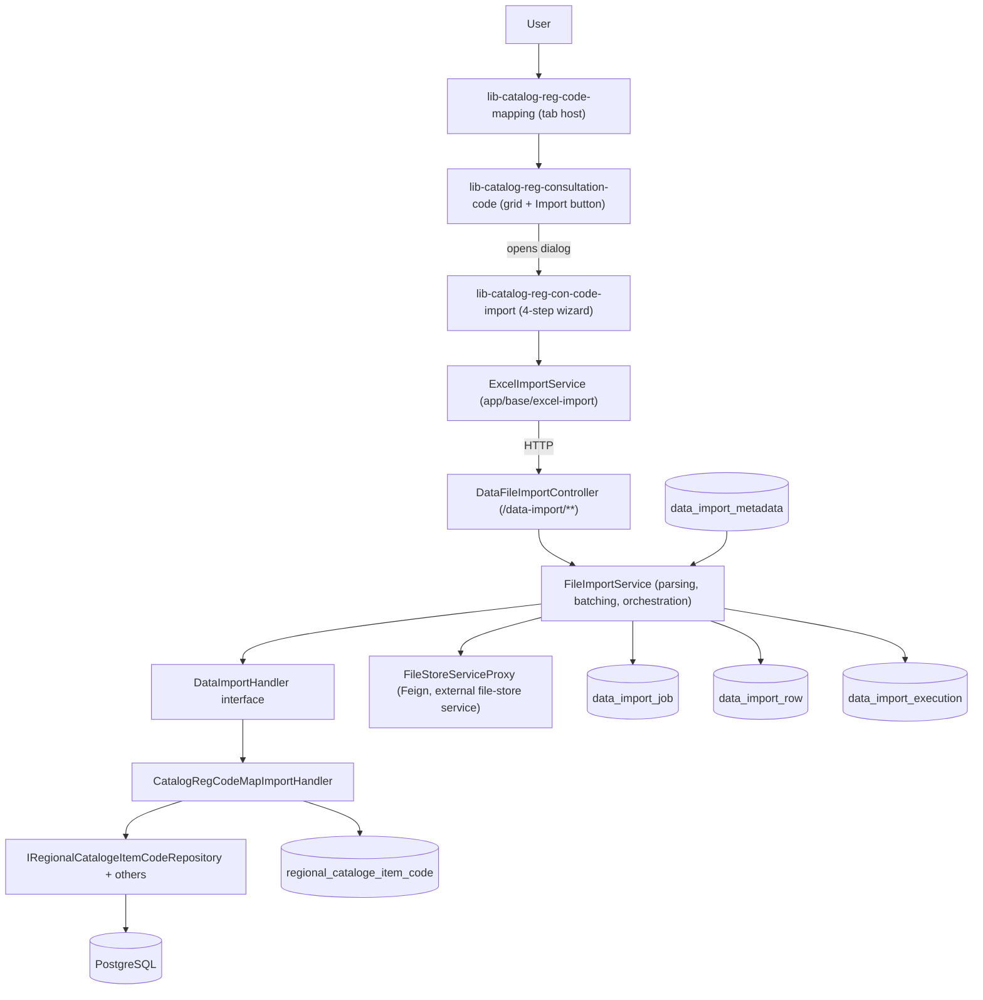
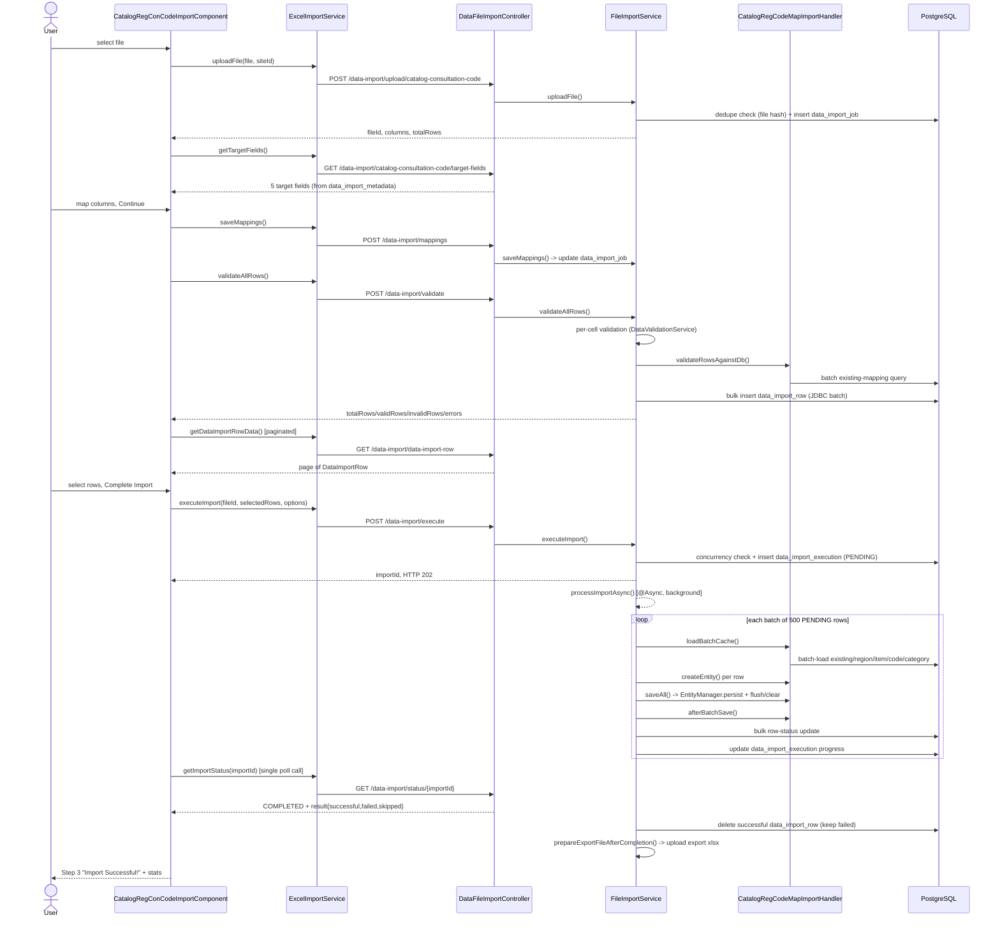

# RCM New Upload — Complete Technical Knowledge

> Generated by source-code reverse engineering. Every claim is tagged
> **CONFIRMED** (read directly from source), **INFERRED** (derived from
> multiple related files), or **NOT FOUND IN SOURCE**. No behavior is
> invented. All file paths are relative to the repository roots given in
> §3 unless a full path is shown.

---

## 1. Executive Summary

The feature the task brief calls "RCM New Upload" is, in the real
codebase, the **generic Excel/CSV Data Import Wizard** (`core/data-import/*`
REST API + `FileImportService`) wired into one specific RCM screen:
**Central Settings → Catalog Regional Code Mapping → Consultation Codes**,
via an **"Import"** button that opens an embedded 4-step wizard component
`lib-catalog-reg-con-code-import` (selector) / `CatalogRegConCodeImportComponent`.

This same generic wizard + generic backend engine (`FileImportService`,
`DataFileImportController`, `DataImportHandler<T>`) is reused, with a
different `importIdentifier`, for many other RCM imports (Activity Codes,
Formulary Codes, Preferred Med List, Auth Required List, Formulary
Procurement, Applicable Receivers, Clinician Credentials, Regional
Activity/Diagnosis codes, etc.). The document below documents the generic
engine fully (CONFIRMED from source) and uses the **Consultation Code
import** (`importIdentifier = "catalog-consultation-code"`) as the
concrete worked example end-to-end, because it is the import that the
task's two named libraries (`lib-catalog-reg-code-mapping`,
`lib-catalog-reg-consultation-code`) actually participate in.

Key correction vs. the task brief's assumptions (documented per Rule 1 —
do not hallucinate):
- There is **no class literally named `DataImportHandler` that "is" the
  upload pipeline** — `DataImportHandler<T>` is a **generic interface**
  (`core/jobs/handler/DataImportHandler.java`) implemented by many
  concrete handlers. For this feature the implementation is
  `CatalogRegCodeMapImportHandler`.
- The UI button that opens the wizard is labeled **"Import"**, not
  "New Upload" (see `catalog-reg-consultation-code.component.html:31`).
- `lib-catalog-reg-code-mapping` is a **tab-router host component**
  (Consultation / Activity / Formulary Codes tabs), not an upload
  component itself. `lib-catalog-reg-consultation-code` is the
  Consultation Codes grid page that **embeds** the actual upload wizard
  component (`lib-catalog-reg-con-code-import`) inside a PrimeNG dialog.

---

## 2. Scope

In scope (per task instructions): reverse-engineer the existing
implementation only. No code was modified, refactored, or fixed.

Out of scope but noted where relevant: a **second, structurally similar**
`RegionalCatalogeItemCode` entity exists in a separate microservice
`UI-BE\rcm-service` (`rcm.domain.entity.rcm_masters.central_settings`).
This was **not** investigated — the task named `core-service` and
`lifetrenz-core` explicitly, and the running import engine (controller +
service + handler) lives entirely in `core-service`. Flagged as
**UNKNOWN / NOT INVESTIGATED** in case `rcm-service` duplicates or
supersedes this table in some deployments.

---

## 3. Source Repositories

```text
Backend  : D:\GitLab-Workspace\UI-BE\core-service
Frontend : D:\GitLab-Workspace\UI-BE\lifetrenz-core\projects\revenue-cycle-management
```

Both confirmed to exist and were read directly (not scanned in bulk —
targeted grep/glob + full reads of the actual files in the execution
path).

---

## 4. Repository Structure (relevant subset)

**core-service** (Spring Boot, Java, package root `com.lifetrenz.lths`):
```
src/main/java/com/lifetrenz/lths/core/jobs/
  controller/DataFileImportController.java        <- generic import REST API
  service/FileImportService.java                   <- generic import engine (2423 lines)
  service/TargetFieldService.java                  <- target-field metadata lookup
  service/DataValidationService.java                <- per-field type validation
  handler/DataImportHandler.java                    <- generic handler interface
  handler/impl/CatalogRegCodeMapImportHandler.java  <- RCM catalog code mapping handler
  handler/impl/*ImportHandler.java                  <- 9 other concrete handlers (other imports)
  entity/DataImportJob.java
  entity/DataImportRow.java
  entity/DataImportExecution.java
  entity/DataImportMetadata.java
  dto/*.java                                        <- all Upload/Mapping/Validate/Execute DTOs
  repository/*.java                                 <- DataImportJob/Row/Execution/Metadata repos

src/main/java/com/lifetrenz/lths/core/rcm_masters/central_settings/
  controller/CatalogRegCodeMappingController.java   <- CRUD (non-bulk) API for the grid/"Configure" dialog
  service/CatalogRegCodeMappingService(Impl).java
  enums/CatalogRegCodeMapType.java                  <- CONSULTATION_CODE / ACTIVITY_CODE / FORMULARY_CODE

src/main/java/com/lifetrenz/lths/domain/
  entity/rcm_masters/central_settings/RegionalCatalogeItemCode.java  <- final persisted table
  repository/rcm_masters/central_settings/IRegionalCatalogeItemCodeRepository.java

src/main/resources/db/migration/V60__Insert_missing_rows_into_data_import_metadata_table.sql
```

**revenue-cycle-management** (Angular library, standalone components):
```
src/lib/central-settings/catalog-reg-code-mapping/
  catalog-reg-code-mapping/catalog-reg-code-mapping.component.ts       <- tab host ("lib-catalog-reg-code-mapping")
  catalog-reg-consultation-code/catalog-reg-consultation-code.component.ts/html  <- grid + "Import" button
  catalog-reg-con-code-import/catalog-reg-con-code-import.component.ts/html      <- THE upload wizard
  catalog-reg-activity-code/...                                         <- sibling tab (Activity Codes)
  catalog-reg-act-code-import/...                                       <- its own import wizard instance
  catalog-reg-formulary-code/...                                        <- sibling tab (Formulary Codes)
  catalog-reg-frmly-code-import/...                                     <- its own import wizard instance

src/lib/Service/central-settings/
  catalog-reg-code-mapping.service.ts     <- CRUD for grid/"Configure" dialog (not upload)
  central-excel-import.service.ts         <- template/master-data download only

src/lib/constant/central-settings-constant.ts

src/lib/central-settings/central-settings-routing.module.ts   <- route: "catalog-regional-code-mapping"
```

**Shared app-level Angular code** (`lifetrenz-core/src/app`, used by the
RCM lib — this is where the actual generic wizard's data layer lives):
```
src/app/base/excel-import/
  excel-import.service.ts        <- calls the generic core/data-import/* API
  excel-import-dto.ts
  excel-import-constant.ts
```

---

## 5. RCM Upload Architecture

**CONFIRMED.** One generic, reusable "Excel Data Importer" subsystem
serves many RCM (and non-RCM) bulk-import screens. It is *not*
RCM-specific at the backend — `core/data-import` has no RCM branding —
but is *used by* RCM screens including Consultation/Activity/Formulary
Code mapping, Preferred Med List, Auth Required List, Formulary
Procurement, Applicable Receivers, Clinician Credentials.

```
Angular screen (e.g. CatalogRegConsultationCodeComponent)
  -> embeds -> CatalogRegConCodeImportComponent (the wizard, 4 steps)
       -> ExcelImportService (src/app/base/excel-import)
            -> HTTP -> DataFileImportController (/data-import/**)
                 -> FileImportService (business engine, POI parsing, batching)
                      -> DataImportHandler<T> (strategy per import type)
                           -> CatalogRegCodeMapImportHandler (for this feature)
                                -> JPA repositories -> PostgreSQL (regional_cataloge_item_code)
```

Distinct from this bulk-import pipeline is a **separate, non-bulk
CRUD API** (`CatalogRegCodeMappingController`, `CatalogRegCodeMappingService`)
used by the same screen's "Configure" dialog to add **one region/code
pairing at a time** through form fields (not file upload). This
document focuses on the **file upload / bulk import** pipeline per the
task brief, and calls out the CRUD path only where the two interact
(they write to the same target table).

---

## 6. Complete End-to-End Upload Flow

```
1. User opens RCM > Central Settings > Catalog Regional Code Mapping
   > Consultation Codes tab  (route: /catalog-regional-code-mapping/catalog-reg-consultation-code)
2. User clicks "Import" button  -> openExcelUploadDialog() -> uploadExcelDialog=true
   -> PrimeNG dialog renders <lib-catalog-reg-con-code-import>
3. STEP 0 (Upload): user drags/selects a .xlsx/.xls/.csv file
   -> onUpload() -> uploadExcelFile() -> ExcelImportService.uploadFile(cb, "catalog-consultation-code", file, siteId)
   -> POST /data-import/upload/catalog-consultation-code?siteId={siteId}  (multipart)
   -> DataFileImportController.uploadFile() -> FileImportService.uploadFile()
      - validates extension, dedupes by SHA-256 file hash, uploads raw bytes to file-store microservice,
        parses columns (POI/SAX), counts rows, persists DataImportJob row
   -> onResult(EXCEL_UPLOAD) -> stores parsedColumns/fileId/totalRows
      -> immediately calls ExcelImportService.getTargetFields(cb, "catalog-consultation-code")
   -> GET /data-import/catalog-consultation-code/target-fields
      -> TargetFieldService.getImportMetadata() reads DataImportMetadata row (id=5) from DB
   -> onResult(GET_TARGET_FIELDS) -> auto-matches columns to fields by exact name match, activeStep=1
4. STEP 1 (Map Fields): user maps Excel columns -> 5 target fields (all required)
   -> onContinueToPreview() -> ExcelImportService.saveMappings(cb, {siteId, fileId, mappings})
   -> POST /data-import/mappings -> FileImportService.saveMappings()
      - validates every source column exists, every target field exists, all required fields mapped
      - persists ColumnMappingInfo[] onto the DataImportJob row
   -> onResult(TARGET_FIELDS_MAPPING) -> immediately calls validateAllRows(cb, {fileId})
   -> POST /data-import/validate -> FileImportService.validateAllRows()
      - re-downloads file from file-store, re-parses ALL rows
      - per-cell type/required validation (DataValidationService)
      - handler.validateRowsAgainstDb() -> DB-level duplicate check via CatalogRegCodeMapImportHandler
      - bulk-inserts one DataImportRow per row (JDBC batch, isValid + errors[] populated)
   -> onResult(VALIDATE_ALL_ROWS) -> stores validationResults, triggers loadImportData() -> activeStep=2
5. STEP 2 (Preview): GET /data-import/data-import-row?fileId=..&pageNo=..&pageSize=..
   -> paginated DataImportRow rows rendered in a p-table with per-row valid/invalid status
   -> user selects rows (default: all valid rows) via Select All/Deselect All/checkboxes,
      can filter ONLY_VALID / ONLY_INVALID / all
   -> onFinalImport() -> ExcelImportService.executeImport(cb, {fileId, selectedRows, options:{skipInvalidRows:true, updateExisting:false}})
   -> POST /data-import/execute -> FileImportService.executeImport()
      - blocks if another catalog-code import is already PENDING/PROCESSING for this customer (concurrency gate)
      - creates DataImportExecution (status=PENDING), returns importId immediately (HTTP 202)
      - kicks off @Async FileImportService.processImportAsync() in background
   -> onResult(EXECUTE_EXCEL_ROWS) -> activeStep=3, starts polling GET /data-import/status/{importId}
6. Background: processImportAsync() loops in batches of `batchSize` (default 500) PENDING rows:
   handler.loadBatchCache() -> processBatch() -> handler.createEntity()/validateEntity()
   -> handler.saveAll() (EntityManager.persist, periodic flush/clear) -> handler.afterBatchSave()
   -> bulk row-status updates (SUCCESS/FAILED/SKIPPED) -> DataImportExecution progress updated per batch
   On completion: status=COMPLETED, successful rows deleted from data_import_row (failed rows kept),
   export Excel file generated and uploaded to file-store.
7. STEP 3 (Complete): polling shows COMPLETED -> stats card (rows imported, fields mapped) shown
   -> user can "Export Results" (downloads the generated export file) or "Import Another File" (resets wizard)
8. Underlying grid (CatalogRegConsultationCodeComponent) refreshes via (importCompleted) event -> onRefresh() -> getCatalogueItem()
```

---

## 7. RCM UI Analysis

### Component: the upload wizard

- **Selector**: `lib-catalog-reg-con-code-import`
- **Class**: `CatalogRegConCodeImportComponent`
- **File**: `revenue-cycle-management/src/lib/central-settings/catalog-reg-code-mapping/catalog-reg-con-code-import/catalog-reg-con-code-import.component.ts`
- **Standalone**: true (Angular standalone component, no NgModule)
- **Route**: not routed directly — instantiated inline inside a PrimeNG `p-dialog` in the parent's template
- **Parent component**: `CatalogRegConsultationCodeComponent` (`lib-catalog-reg-consultation-code`)
- **Child components used**: `LtPaginationComponent` (`lifetrenz-lt-pagination`) for the preview-table pager
- **Output**: `@Output() importCompleted = new EventEmitter<void>()` — emitted when `executeImport` succeeds (component.ts:679), consumed by parent as `(importCompleted)="onRefresh()"` (html:349-351)

### Component: the host tab page (contains the "Import" trigger)

- **Selector**: `lib-catalog-reg-consultation-code`
- **Class**: `CatalogRegConsultationCodeComponent`
- **File**: `.../catalog-reg-consultation-code/catalog-reg-consultation-code.component.ts`
- Owns: the results grid (`catalogeItemGetData`), the "Configure" dialog (non-bulk single-row CRUD via `CatalogRegCodeMappingService`), and `uploadExcelDialog` boolean that shows/hides the wizard dialog
- "Import" button: `catalog-reg-consultation-code.component.html:26-33`, `(click)="openExcelUploadDialog()"` -> `component.ts:512-514`

### Component: the tab-router host (task's "lib-catalog-reg-code-mapping")

- **Selector**: `lib-catalog-reg-code-mapping`
- **Class**: `CatalogRegCodeMappingComponent`
- **File**: `.../catalog-reg-code-mapping/catalog-reg-code-mapping/catalog-reg-code-mapping.component.ts` (30 lines)
- Purely a PrimeNG `p-tabMenu` + `<router-outlet>` host with 3 `MenuItem`s routing to Consultation/Activity/Formulary Code child routes. **Confirmed: it does not itself participate in upload** — it only hosts the tab that leads to the screen that does.

### Route

`central-settings-routing.module.ts:39-65` (CONFIRMED):
```
/catalog-regional-code-mapping                          -> CatalogRegCodeMappingComponent (tab host)
  (redirect) -> catalog-reg-consultation-code
  /catalog-reg-consultation-code -> CatalogRegConsultationCodeComponent
  /catalog-reg-activity-code     -> CatalogRegActivityCodeComponent
  /catalog-reg-formulary-code    -> CatalogRegFormularyCodeComponent
```

### HTML (wizard) — `catalog-reg-con-code-import.component.html`

- **File input**: `<input #fileInput type="file" accept=".xlsx,.xls,.csv" style="display:none">` (line 40-46), triggered by clicking the dropzone (`fileInput.click()`, line 32)
- **Drag/drop**: yes — `(dragover)`, `(dragleave)`, `(drop)` handlers on the dropzone div (lines 28-47), calling `onDragOver`/`onDragLeave`/`onDrop` (component.ts:152-169)
- **File type restriction**: UI-level only, via the `accept` attribute — `.xlsx,.xls,.csv` (line 43). No client-side extension/size re-validation in the TypeScript.
- **Template download**: "Don't have a Template? Click Here" link (lines 76-97), calls `downloadTemplate()` (component.ts:136-146) which calls `centralExcelImportService.downloadMasterTypeData(this, ExcelImportEnum.CENTRAL_CONSULTATION_ACTIVITY_FORMULARY_CODES, "", "", customerBusinessId, 0)`
- **Submit behavior**: file selection **immediately** triggers upload (no separate "Submit" button in Step 0) — `onUpload()` calls `uploadExcelFile()` synchronously (component.ts:171-180)
- **Error display**: `ArtifactUtils.showErrorViaToast(messageService, ...)` (PrimeNG `p-toast`, `key="tst"`) on any failed API call
- **Success display**: Step 3 ("Complete") screen — checkmark icon, "Import Successful!", stat cards for Rows Imported / Fields Mapped (html:428-461)
- **Progress indicator**: `pi-spin pi-spinner` icons on the Continue/Complete Import buttons while `isSavingMapping`/`isImporting` are true; import status is also polled (`getImportStatus`) and can show percentage via `progress.percentage` (backend DTO) — **NOT rendered as a progress bar in this template** (the `ProgressBarModule` is imported at component.ts:24 but no `<p-progressBar>` element appears in the HTML — INFERRED unused/vestigial import)
- **Loading indicator**: `p-table [loading]="loading"` on the preview grid (html:326)
- **Upload history/status**: **NOT FOUND IN SOURCE** in this component — the backend does expose `GET /data-import/history` (`DataFileImportController.getImportHistory`, controller.java:506-536) but no Angular caller of it was found (`ExcelImportConstant` has no `EXCEL_IMPORT_HISTORY` entry, and `ExcelImportService` has no `getImportHistory` method). **NOT WIRED TO UI.**

### TypeScript (wizard) — key methods

| Method | Lines | Purpose |
|---|---|---|
| `onUpload` / `uploadExcelFile` | 171-198 | builds FormData, calls `ExcelImportService.uploadFile` |
| `onColumnMapChange` / `isTypeMatch` / `isTypeMismatch` | 230-320 | client-side heuristic type inference from 3 sample values per column (not authoritative — real validation is server-side) |
| `onContinueToPreview` | 321-337 | builds `SaveMappingsRequestDTO`, calls `saveMappings` |
| `onSelectAll`/`onDeselectAll`/`onRowSelect`/`onRowUnselect`/`onHeaderCheckboxToggle` | 357-413 | row-selection state machine using an "all except explicitly excluded" model (`allValidRowsSelected` + `excludedRowIndices`) so selection survives pagination without holding every row client-side |
| `onFinalImport` | 437-465 | converts selection state to `selectedRows: number[] \| null` (null = "all rows"), calls `executeImport` with `{skipInvalidRows:true, updateExisting:false}` |
| `startStatusPolling` | 467-469 | **CONFIRMED single call, not an interval** — see §24 gap |
| `loadImportData` | 486-505 | paginated fetch of `DataImportRow`s for the preview grid, supports `rowFilter` |
| `resetWizard` | 513-523 | resets all 4 steps back to Step 0 |
| `exportResults` | 525-528 | downloads the generated result Excel via `downloadImportData` |

---

## 8. UI Validation

See §33 (Complete Validation Matrix) for the full table. Summary:

- **UI validation**: file extension allow-list via `accept=".xlsx,.xls,.csv"` (browser-level filter only — not enforced in TS); required-field mapping gate (`isMappingValid` getter, component.ts:220-224) disables the "Continue" button until every `required` target field has a non-empty `mappedColumn`; row-selection gate (`Complete Import` button disabled unless at least one row selected, html:419-422).
- **Backend validation**: file non-empty, filename present, extension in `{.xlsx,.xls,.csv}`, import type configured in `data_import_metadata`, **duplicate-file rejection by SHA-256 hash** (`FileImportService.uploadFile`, lines 173-184), source-column-exists / target-field-exists / required-fields-mapped (`saveMappings`, lines 282-340), per-cell type/required validation (`DataValidationService.validateField`), **DB-level duplicate check** (`CatalogRegCodeMapImportHandler.validateRowsAgainstDb`).
- **Database validation**: `@NotNull` JPA constraints on `RegionalCatalogeItemCode.regionalCode/region/codeType/item/mapType`; `DataImportJob.fileId` is `unique`; `DataImportMetadata.importIdentifier` is `unique`; no DB-level UNIQUE constraint was found on `regional_cataloge_item_code` for the (item, region, codeType, category, mapType) tuple — **duplicate prevention is enforced entirely in application code** (handler cache + `validateRowsAgainstDb`), not by a DB constraint. **INFERRED** (no migration found adding such a unique index — see §39 Known Risks).

---

## 9. API Contract

Base path (frontend constant, `excel-import-constant.ts:1-13`) — all under **`core/data-import`** (gateway-relative; controller itself is mounted at `/data-import`, so `core` is presumably an API-gateway routing prefix not present in the controller's own `@RequestMapping`):

| # | Frontend constant | Method | Path (controller-relative) | Controller method | Purpose |
|---|---|---|---|---|---|
| 1 | `EXCEL_UPLOAD` | POST (multipart) | `/data-import/upload/{importIdentifier}?siteId={siteId}` | `uploadFile` | Upload file, parse columns |
| 2 | `GET_TARGET_FIELDS` | GET | `/data-import/{importIdentifier}/target-fields` | `getTargetFields` | Get field schema for this import type |
| 3 | `TARGET_FIELDS_MAPPING` | POST | `/data-import/mappings` | `saveMappings` | Persist column→field mapping |
| 4 | `EXCEL_DATA_PREVIEW` *(unused — commented out in FE)* | GET | `/data-import/preview` | `previewMappedData` | Ad-hoc unsaved preview (dead code path, see §39) |
| 5 | `VALIDATE_ALL_ROWS` | POST | `/data-import/validate` | `validateAllRows` | Validate + stage all rows |
| 6 | `DATA_IMPORT_ROW` | GET | `/data-import/data-import-row?pageSize=&pageNo=&fileId=&filter=` | `getDataImportRowData` | Paginated staged-row fetch (drives Preview grid) |
| 7 | `EXECUTE_EXCEL_ROWS` | POST | `/data-import/execute` | `executeImport` | Kick off async import of selected rows |
| 8 | `EXCEL_IMPORT_STATUS` | GET | `/data-import/status/{importId}` | `getImportStatus` | Poll progress/result |
| 9 | `EXPORT_IMPORT_DATA` | GET | `/data-import/{importId}/export` | `exportImportData` | Download post-import result Excel |
| — | *(not called by FE)* | POST | `/data-import/cancel/{importId}` | `cancelImport` | Cancel an in-progress import |
| — | *(not called by FE)* | GET | `/data-import/history` | `getImportHistory` | Paginated import history |
| — | *(not called by FE)* | DELETE | `/data-import/files/{fileId}` | `deleteUploadedFile` | Delete an uploaded file + all its data |

Auth: every mutating/execute/status endpoint takes `@InjectCTA CustomerTransactionAttribute cta` — a custom parameter-resolver annotation (`core/common/annotation/InjectCTA.java`) that injects `active/createdBy/createdOn/updatedBy/updatedOn/customerBusinessId/customerId/siteId` from the caller's auth context (resolver implementation itself **NOT located/read** — out of the targeted search; its *usage contract* is confirmed from the annotation's Javadoc and call sites).

---

## 10. Core Controller

- **Class**: `DataFileImportController`
- **Package**: `com.lifetrenz.lths.core.jobs.controller`
- **File**: `core-service/src/main/java/com/lifetrenz/lths/core/jobs/controller/DataFileImportController.java`
- **Base mapping**: `@RequestMapping("/data-import")` (line 58)
- **Dependencies (autowired)**: `FileImportService`, `TargetFieldService`
- **Exception handling**: every endpoint wraps its body in try/catch and returns a typed `*ResponseDTO.error(code, message)` with an appropriate `HttpStatus` — **no `@ExceptionHandler`/`@ControllerAdvice` was found in this file**; all error shaping is done per-method.
- **Multipart config**: `consumes = MediaType.MULTIPART_FORM_DATA_VALUE` on `uploadFile` (line 79); `MultipartFile file` + required `Long siteId` query param + path `importIdentifier`.
- Full endpoint-by-endpoint detail already given in §9; line-by-line business logic already excerpted in §6 and §19.

---

## 11. Core Service

- **Class**: `FileImportService`
- **Package**: `com.lifetrenz.lths.core.jobs.service`
- **File**: `core-service/src/main/java/com/lifetrenz/lths/core/jobs/service/FileImportService.java` (2423 lines — the entire import engine lives in this one class)
- **Called by**: `DataFileImportController`
- **Calls**: `FileStoreServiceProxy` (Feign client to a separate file-store microservice), `DataImportJobRepository`, `DataImportRowRepository`, `TargetFieldService`, `DataValidationService`, `DataImportExecutionRepository`, `FileImportRepository`, `Map<String,DataImportHandler<?>>` (all Spring-registered handler beans), `EntityManager`/`JdbcTemplate` directly for bulk operations.
- **Key fields**: `@Value("${data.import.batch.size:500}") private int batchSize;` (line 130-131) — externally configurable batch size, defaults to 500.
- **Public methods** (all documented individually with line numbers in §6/§9/§19/§20): `uploadFile`, `saveMappings`, `previewMappedData` (dead path, see §39), `validateAllRows`, `getDataImportRowData`, `executeImport`, `processImportAsync` (`@Async`), `getImportStatus`, `cancelImport`, `getImportHistory`, `deleteUploadedFile`, `exportImportData`, `prepareExportFileAfterCompletion`.
- **File parsing internals**: dual-path Excel reading — `.xlsx` uses a **hand-written SAX streaming reader** (`readXlsxStreaming`, lines 835-914) explicitly to avoid loading the whole workbook into heap for large files (comment: "cuts parse time from ~30s to ~3s for 50K rows"); `.xls` uses Apache POI `HSSFWorkbook` (full in-memory); `.csv` uses a hand-rolled `parseCSVFile`/`parseCSVLine` (lines 1214-1373, quote-aware).

---

## 12. DataImportHandler Deep Dive

### Purpose

`DataImportHandler<T>` (`core/jobs/handler/DataImportHandler.java`, 216
lines) is a **generic strategy interface** — one implementation per
target entity type — that lets `FileImportService` stay entity-agnostic.
`FileImportService` holds `Map<String, DataImportHandler<?>> importHandlers`
(all Spring beans of this type, auto-populated by
`@Autowired(required=false)`, line 114-115) and picks the right one at
runtime by matching `handler.getEntityClass().getName()` against
`DataImportMetadata.targetEntityClass` (`getImportHandler`, lines
1627-1635 — a linear scan over all registered handlers, not a direct map
lookup by bean name).

### Entry point

`FileImportService.processImportAsync(executionId, request, cta)`
(`@Async`, lines 1478-1612) is what actually drives a handler through a
full import run. `validateAllRows` (line 475) also calls into the
handler once, for `preloadCaches` + `validateRowsAgainstDb` (DB-level
duplicate pre-check before the async run even starts).

### Interface contract (all methods, `DataImportHandler.java`)

| Method | Required/Default | Purpose |
|---|---|---|
| `getEntityClass()` | required | identifies which `DataImportMetadata.targetEntityClass` this handler serves |
| `createEntity(rowData, cta, options)` | required | build a new (unsaved) entity from one mapped row |
| `updateEntity(existing, rowData)` | required | merge new data into an existing entity (update path) |
| `findByUniqueField(field, value, cta)` | required | single-row lookup fallback |
| `save(entity)` | required | single-entity persist (used only in the failure-recovery path) |
| `saveAll(entities)` | required | batch persist |
| `validateEntity(entity)` | required | return an error string or `null` |
| `findExistingByKeys(keys, cta)` | default (falls back to N `findByUniqueField` calls) | batch duplicate lookup |
| `buildLookupMap(entities)` | default (empty map) | build a key→entity map from a batch-loaded list |
| `extractUniqueKey(rowData, options)` | default (`options["uniqueField"]`) | compute a row's dedupe key |
| `preloadCaches(optionsMap)` | default no-op | load small reference tables ONCE for the whole import |
| `loadBatchCache(batchRowData, optionsMap)` | default no-op | load per-batch reference data (existing records, FK targets) |
| `afterBatchSave(savedEntities, optionsMap)` | default no-op | persist dependent/child entities after the parent batch is saved |
| `validateRowsAgainstDb(rowData, cta, options)` | default (empty map) | pre-import DB-constraint validation, runs during `validateAllRows` |

### Concrete implementation for this feature: `CatalogRegCodeMapImportHandler`

- **File**: `core/jobs/handler/impl/CatalogRegCodeMapImportHandler.java` (606 lines)
- **`@Component`** — Spring bean, auto-registered into `FileImportService.importHandlers`
- **`getEntityClass()` → `RegionalCatalogeItemCode.class`** — this is how it gets selected: `DataImportMetadata` row for `catalog-consultation-code` has `target_entity_class = 'com.lifetrenz.lths.domain.entity.rcm_masters.central_settings.RegionalCatalogeItemCode'` (migration V60, id=5), matching this handler's `getEntityClass().getName()`.
- **Handles 3 import identifiers with ONE handler** via `resolveMapType()` (lines 351-360): `catalog-activity-code`→`ACTIVITY_CODE`, `catalog-formulary-code`→`FORMULARY_CODE`, `catalog-consultation-code`→`CONSULTATION_CODE`. The `CatalogRegCodeMapType` enum value is stamped onto every row's `mapType` column, which is how the single `regional_cataloge_item_code` table serves 3 distinct code-mapping screens.
- **Caching strategy** (documented in the class Javadoc, lines 36-51, confirmed in code):
  - `preloadCaches` (once per import, lines 103-125): loads ALL `Region`s and ALL `CodeType`s (both by identifier and by name) into `optionsMap`.
  - `loadBatchCache` (once per batch of `batchSize` rows, lines 138-224): collects distinct `catalogueItemId`/`regionId`/`regionalClinicalCodeId`/`catalogueCategoryId` referenced in the batch, then issues exactly 4 batch queries (`findBatchForImport` for existing mappings, `findAllById` ×3 for CatalogueItem/RegionalClinicalCode/CatalogueCategory) — **zero per-row DB queries** during `createEntity`.
  - The existing-mappings cache is **accumulated across batches** (`computeIfAbsent`, line 184-185) so a record created in batch N is correctly seen as a duplicate if batch N+1 contains the same key.
- **Entity resolution is cache-ONLY** — if a referenced Region/Item/RegionalClinicalCode/Category isn't in cache, the row is **silently skipped** (`return null` + `log.warn`, lines 300-323), which `processBatch` then reports as `SKIPPED_OR_INVALID` / "Handler returned null (invalid or duplicate data)" (`FileImportService.java:1744-1749`).
- **`updateEntity` is a no-op passthrough** (`return existing;`, line 375-380) — this handler does not actually support field-level updates on an existing mapping; "update" in this handler effectively means "leave it as-is" (see §18 New vs Existing Record below).
- **`save`/`saveAll`/`afterBatchSave`** use raw `EntityManager.persist()` with periodic `flush()+clear()` every `BATCH_FLUSH_SIZE = 100` entities (line 67), specifically to bound persistence-context memory on large imports. Javadoc explicitly notes `saveAll` **cannot** use a `HashSet` for dedup because Lombok's generated `hashCode()` on `RegionalCatalogeItemCode` recurses through `CatalogueCategory.parentCategory` and can `StackOverflowError` (lines 392-397) — a documented workaround, not a bug fix opportunity for this task.

---

## 13. File Parser

Confirmed in `FileImportService.java`:

| File type | Method | Lines | Strategy |
|---|---|---|---|
| `.xlsx` | `readXlsxStreaming` | 835-914 | SAX event streaming over the raw OOXML XML (via `XSSFReader` + `SharedStringsTable`), builds `List<Map<String,String>>` incrementally — avoids loading the whole workbook object graph |
| `.xls` | inline in `readAllRowsFromFile` | 796-826 | full `HSSFWorkbook` load (legacy format, smaller files expected) |
| `.csv` | `parseCSVFile`/`parseCSVLine` | 1214-1373 | hand-written, quote-aware CSV tokenizer |

Column parsing for the Step-0 preview (`parseFileColumns` /
`parseXlsxColumnsStreaming`/`parseCSVColumns`, lines 940-1306) is a
**separate, header+3-sample-rows-only** pass — deliberately reads only
the first 4 rows for speed, per the method comment (line 938: "Only
reads the first 4 rows (header + 3 samples) — stops early").

Row counting (`countTotalRows`/`countCSVRows`, lines 1170-1330) is a
**third, separate pass** over the file purely to get a row count without
materializing row data.

**INFERRED**: the file is parsed from scratch (re-downloaded from the
file-store service and re-read) at **upload**, again at **validate**,
and — for the dead `previewMappedData` path — again at **preview**. This
is a deliberate "stateless between steps, source of truth = the stored
file" design, not a bug, but it does mean the file is parsed multiple
times over the wizard's lifetime (see §21 Performance).

---

## 14. Validation Pipeline

Two independent validation layers, both server-side:

1. **Per-cell type/required validation** — `DataValidationService.validateField(value, fieldType, required)` (`core/jobs/service/DataValidationService.java`, full file read, 157 lines). Supported `fieldType` values: `string` (no extra check), `email` (regex), `phone` (regex), `date` (tries 5 formats: `yyyy-MM-dd`, `dd/MM/yyyy`, `MM/dd/yyyy`, `dd-MM-yyyy`, `MM-dd-yyyy`), `number`/`decimal` (both just `Double.parseDouble`). Unknown types are logged and treated as always-valid (line 92-94). Called once per mapped field per row inside `validateAllRows` (`FileImportService.java:542-552`).
2. **DB-level constraint validation** — `DataImportHandler.validateRowsAgainstDb()`, called once for the whole file (not per-row) immediately after per-cell validation, inside the same `validateAllRows` transaction (`FileImportService.java:573-626`). For this feature, `CatalogRegCodeMapImportHandler.validateRowsAgainstDb` (lines 501-570) batch-queries all existing mappings for the itemIds/regionIds present in the file and flags any row whose composite key already exists with error `"Regional Code is already mapped to this item."`, tagged with pseudo-field `"DUPLICATE"`.

Both layers' errors are merged into one `ValidateAllRowsResponseDTO`
(`errors: [{rowIndex, field, value, message}]`) and also persisted
per-row onto `DataImportRow.errors` (JSONB) and `DataImportRow.isValid`.

---

## 15. Transformation / Mapping

- The user-defined column→field mapping (`SaveMappingsRequestDTO.mappings: [{sourceColumn, targetFieldId}]`) is stored **verbatim** on `DataImportJob.columnMappings` (JSONB) — no server-side auto-mapping persists beyond the client's initial exact-name auto-match heuristic (`onResult(GET_TARGET_FIELDS)`, frontend component.ts:568-582, which pre-fills `mappedColumn` when an Excel column name exactly equals a target field's `label`, purely a UX convenience, still overridable by the user).
- `applyMappings`/row transform (`FileImportService.java:756-774`, and inline in `validateAllRows` lines 529-553) is a straight `sourceColumn -> targetFieldId` string copy — **no type coercion or formatting happens at this stage**; values remain raw strings in `DataImportRow.rowData` (`Map<String,String>`).
- Real type coercion happens **inside the handler**, at `createEntity()` time: `CatalogRegCodeMapImportHandler.getLongValue()` (lines 589-599) parses via `Double.parseDouble(...).longValue()` (tolerates values like `"123.0"`), and `getStringValue()` (601-604) just trims.

---

## 16. New Record Processing

**CONFIRMED**, from `FileImportService.processBatch` (lines 1665-1865)
and `CatalogRegCodeMapImportHandler.createEntity` (lines 230-349):

- A row becomes a "new record" whenever `existingEntity` is `null` for
  its extracted unique key (or when `options.updateExisting=false` and
  `options.uniqueField=null` — the actual request the frontend sends,
  see §17).
- `handler.createEntity(rowData, cta, optionsMap)` is called, which:
  1. Resolves `mapType` from `importIdentifier`.
  2. Extracts `catalogueItemId`, `regionId`, `catalogueCategoryId`,
     `regionalClinicalCodeId`, `codeType` from the row — **all 5 are
     required**; missing any → row silently skipped (`return null`).
  3. Resolves `CodeType` from cache (by identifier, falling back to
     name lookup).
  4. Builds the composite dedupe key and checks the batch-accumulated
     existing-mappings cache — if found, **also returns `null`** (this
     is how in-batch/cross-batch and DB-level duplicates are both
     rejected at the same code path; see §17).
  5. Resolves `Region`, `CatalogueItem`, `RegionalClinicalCode`, and
     (if `catalogueCategoryId` present) `CatalogueCategory` — any cache
     miss → `return null`.
  6. Constructs a new `RegionalCatalogeItemCode` (unsaved, no `id`),
     sets all FKs + `mapType` + `customerTransactionAttribute`, adds it
     to the batch's cache (to catch a second identical row in the same
     batch) and to `PENDING_NEW_ENTITIES_KEY` for `afterBatchSave`.
- **What gets inserted**: one row in `regional_cataloge_item_code`
  per successfully-resolved, non-duplicate Excel row, via
  `EntityManager.persist()` (both in `saveAll` and in the
  `afterBatchSave` post-hook — the two are redundant safety nets; see
  §39).

---

## 17. Existing Record Processing

**CONFIRMED, and this is the most important behavioral fact to
preserve on rebuild**:

- The frontend **always** sends `updateExisting: false` and no
  `uniqueField` (`catalog-reg-con-code-import.component.ts:457-460`:
  `options: { skipInvalidRows: true, updateExisting: false }`).
- In `processBatch` (`FileImportService.java:1680`), the
  pre-load-existing-records step only runs
  `if (options.getUpdateExisting() || options.getUniqueField() != null)`
  — **for this feature's actual traffic, that condition is always
  false**, so `existingRecordsMap` stays empty and **every row always
  takes the "new record" `createEntity` branch** (line 1716-1730);
  `updateEntity` is **never invoked in production for this import**,
  even though it exists on the handler (as a no-op passthrough anyway,
  §12).
- Therefore: **"Existing record" handling for the RCM catalog-code
  imports is entirely absorbed into the duplicate check inside
  `createEntity`** (§16, step 4) — an Excel row whose
  (item, category, region, codeType, mapType, customerBusinessId) tuple
  already exists in `regional_cataloge_item_code` is **silently
  skipped** (handler returns `null`), which `processBatch` reports as a
  **FAILED** row with error type `SKIPPED_OR_INVALID` and message
  `"Handler returned null (invalid or duplicate data)"`
  (`FileImportService.java:1744-1749`) — **not** as a distinguishable
  "skipped as duplicate" status. The pre-flight `validateAllRows` step
  (§14) is what gives the user visibility into duplicates *before*
  execution, via the `"Regional Code is already mapped to this item."`
  message — but even a row the user chooses to import anyway (e.g. by
  disabling `skipInvalidRows`, which the current UI never does) would
  still be rejected again at execute-time by the same cache check.
- **Update path exists in the generic engine (`options.updateExisting`,
  `handler.findExistingByKeys`, `handler.buildLookupMap`,
  `handler.updateEntity`) but is functionally inert for this specific
  handler** — `updateEntity` just returns the existing entity unchanged.
  A rebuild must preserve this: **the wizard does not currently support
  "update existing row on match" for catalog code mappings**, even
  though the generic plumbing for it exists and works for *other*
  handlers that implement `updateEntity` meaningfully (not
  investigated — out of scope).

---

## 18. New Record Vs Existing Record — Summary Table

| Aspect | Behavior |
|---|---|
| Identifies "new" | key not present in `existingMappingsCache` (built from `findBatchForImport`, scoped to itemIds+regionIds+mapType+customerBusinessId present in the current batch/file) |
| Identifies "existing" | key present in that same cache |
| On new | `createEntity` builds & persists a new row |
| On existing (duplicate) | `createEntity` returns `null` → row marked FAILED/SKIPPED_OR_INVALID at execute time; also flagged during `validateAllRows` pre-check |
| Update supported? | Plumbing exists in `FileImportService`/`DataImportHandler`, but `CatalogRegCodeMapImportHandler.updateEntity` is a no-op and the frontend never requests `updateExisting=true` for this screen |
| Reject vs skip vs merge | **Skip** (row not inserted, marked failed with a message), never reject-the-whole-file, never merge/partial-update |

---

## 19. Duplicate Handling

### Duplicate inside the uploaded file (e.g. row 10 and row 20 both = same item/region/code)

**CONFIRMED**: handled by the **same mechanism** as DB duplicates,
because `existingMappingsCache` is written to as soon as row 10's
`createEntity` builds its (unsaved) entity (`CatalogRegCodeMapImportHandler.java:337-339`).
When row 20 is processed (same batch or a later batch — the cache is
batch-accumulated), its key is already present, so `createEntity`
returns `null` for row 20 exactly as if it were a pre-existing DB
record. **Result: first occurrence wins, later duplicates in the same
file are skipped/failed with the same generic message.**

At the pre-flight `validateAllRows` stage, **in-file duplicates are NOT
separately detected** — `validateRowsAgainstDb` only compares each row
against the DB snapshot taken at that moment (lines 501-570); it does
not check rows against each other. So two identical new rows in one
file will **both show as "valid" in the Preview step**, and only at
Execute time will the second one fail. **This is a real gap** — flagged
in §39.

### Duplicate already in the database

Flagged at `validateAllRows` time (visible to the user in Preview, via
`validateRowsAgainstDb`) **and** re-checked/enforced again at Execute
time (via the same `createEntity` cache-key check, which is fed by a
fresh `findBatchForImport` query per batch in `loadBatchCache`). Both
checks use the identical composite key
(`itemId:catId:regionId:codeTypeIdentifier:mapType:customerBusinessId`,
`buildCacheKey`, lines 369-373) — so the two layers are consistent with
each other.

---

## 20. Database Architecture

Two table families are involved:

**A. Generic import-engine tables** (own the file/mapping/staging/execution lifecycle, used by *every* import type):
- `data_import_metadata` — config/fixture table (which import types exist, their field schema, upload path template, target entity)
- `data_import_job` — one row per uploaded file
- `data_import_row` — one row per Excel data row, staged after `validateAllRows`, deleted for successful rows after execution
- `data_import_execution` — one row per "Execute" click, tracks async progress/result

**B. Target table for this feature**:
- `regional_cataloge_item_code` — the actual RCM catalog-to-regional-code mapping records the import ultimately produces

---

## 21. Database Tables

### `data_import_metadata`
```
Table:            data_import_metadata
Purpose:          Master/config table — defines each import type's field schema and behavior
Schema:            core-service default schema (PostgreSQL, inferred from jsonb usage)
Primary Key:       id (IDENTITY)
Columns:           import_identifier (varchar(100), NOT NULL, UNIQUE),
                   target_fields (jsonb, NOT NULL) — array of {id,label,type,required},
                   upload_path_template (varchar(500), NOT NULL),
                   active (boolean, NOT NULL),
                   target_entity_class (varchar(500), NOT NULL)
Written by:        migrations only (V60, and presumably earlier/later ones — not all located)
Read by:           TargetFieldService.getImportMetadata / getTargetFields, FileImportService.uploadFile
Used during upload: every step (drives target-fields, upload path, and handler selection)
```
Row relevant to this feature (migration V60, lines 45-50):
```
id=5, import_identifier='catalog-consultation-code',
target_fields=[
  {id:"catalogueItemId",        type:"number", label:"Catalogue Item Id",        required:true},
  {id:"catalogueCategoryId",    type:"number", label:"Catalogue Category Id",    required:true},
  {id:"regionId",               type:"number", label:"Region Id",                required:true},
  {id:"codeType",               type:"string", label:"Code Type",                required:true},
  {id:"regionalClinicalCodeId", type:"number", label:"Regional Clinical Code Id",required:true}
],
upload_path_template='{customerBusinessId}/imports/{importIdentifier}/{fileId}/{fileName}',
target_entity_class='com.lifetrenz.lths.domain.entity.rcm_masters.central_settings.RegionalCatalogeItemCode'
```
(Sibling rows id=3 `catalog-activity-code` and id=4 `catalog-formulary-code` are byte-identical in schema — same 5 fields, same target entity — confirming all 3 code-mapping screens share one table + one handler, differentiated only by `mapType`.)

### `data_import_job`
```
Table:      data_import_job
Purpose:    One row per uploaded file (survives across all 4 wizard steps)
PK:         id (IDENTITY)
FK:         import_metadata_id -> data_import_metadata.id (NOT NULL)
Columns:    file_id (varchar(100), NOT NULL, UNIQUE), file_name, file_path, file_size,
            file_hash (varchar(256)) — SHA-256, used for duplicate-upload detection,
            total_rows, parsed_columns (jsonb: [{name, sampleValues[]}]),
            column_mappings (jsonb: [{sourceColumn, targetFieldId}]),
            uploaded_at, export_file_path,
            + embedded CustomerTransactionAttribute (active, created_by, created_on,
              updated_by, updated_on, customer_business_id, customer_id, site_id)
Written by: uploadFile (insert), saveMappings (update column_mappings),
            prepareExportFileAfterCompletion (update export_file_path)
Read by:    saveMappings, previewMappedData, validateAllRows, executeImport, deleteUploadedFile
```

### `data_import_row`
```
Table:      data_import_row
Purpose:    Per-row staging table — one row per Excel data row after validateAllRows
PK:         id (IDENTITY)
FK:         data_import_job_id -> data_import_job.id (NOT NULL)
Indexes:    idx_data_import_row_job_id (data_import_job_id),
            idx_data_import_row_valid (is_valid),
            idx_data_import_row_job_status (data_import_job_id, processing_status)
Columns:    row_index (int, NOT NULL), row_data (jsonb, NOT NULL — mapped {targetFieldId: value}),
            is_valid (boolean, NOT NULL), errors (jsonb array, nullable),
            processing_status (varchar(20), default 'PENDING' — PENDING/PROCESSING/SUCCESS/FAILED/SKIPPED),
            error_details (jsonb, nullable), processed_at,
            + embedded CustomerTransactionAttribute
Written by: validateAllRows (bulk insert via bulkInsertImportRows — raw JDBC batch, NOT JPA saveAll,
            explicitly to bypass Hibernate's IDENTITY-strategy batch-insert limitation),
            processImportAsync (bulk status updates via bulkMarkSuccess/Failed/Skipped)
Read by:    getDataImportRowData (drives Preview grid), processImportAsync (PENDING-row batches)
Lifecycle:  successful rows DELETED after execution completes (deleteSuccessfulRows);
            failed rows PRESERVED for analysis (never auto-deleted)
```

### `data_import_execution`
```
Table:      data_import_execution
Purpose:    One row per "Execute Import" click — tracks async run progress/result
PK:         id (IDENTITY)
FK:         data_import_job_id -> data_import_job.id (NOT NULL)
Columns:    import_id (varchar(100), NOT NULL, UNIQUE — "imp-{uuid}"),
            status (varchar(50), NOT NULL enum PENDING/PROCESSING/COMPLETED/FAILED/CANCELLED),
            total_rows, processed_rows, successful_rows, failed_rows, skipped_rows (all default 0),
            started_at, completed_at, error_message (text),
            + embedded CustomerTransactionAttribute
Written by: executeImport (insert, PENDING), processImportAsync (progress updates + final status),
            cancelImport (status=CANCELLED)
Read by:    getImportStatus (polling), getImportHistory, exportImportData, deleteUploadedFile (active-import gate)
```

### `regional_cataloge_item_code` (final target table)
```
Table:      regional_cataloge_item_code
Purpose:    The actual RCM catalog↔regional-clinical-code mapping records
PK:         id (IDENTITY)
FKs:        regional_clinical_code_id + regional_clinical_code (composite, -> RegionalClinicalCode: id, code),
            region_id -> Region.id,
            code_type_id + code_type_identifier + code_type (composite, -> CodeType: id, identifier_code, name_en),
            catalogue_item_id -> CatalogueItem.id,
            catalogue_category_id -> CatalogueCategory.id (nullable)
Columns:    map_type (varchar, enum-as-string: CONSULTATION_CODE/ACTIVITY_CODE/FORMULARY_CODE),
            is_modifier_applicable (boolean, default false — unrelated Phase-1 E&M-coding flag, not set by import),
            + embedded CustomerTransactionAttribute
Constraints (as coded): @NotNull on regionalCode/region/codeType/item/mapType (JPA-level only —
            NOT FOUND: an actual DB UNIQUE constraint enforcing the dedupe tuple; app-code-only enforcement, see §39)
Filter:     @Filter("active = true") Hibernate soft-delete-style filter defined on the entity
            (filter definition present; whether it's globally enabled — NOT FOUND IN SOURCE within scope read)
Written by: CatalogRegCodeMapImportHandler.createEntity/saveAll/afterBatchSave (bulk import path)
            AND CatalogRegCodeMappingServiceImpl (separate single-row CRUD "Configure" dialog path — not part of bulk import, not deep-dived per task scope)
Read by:    CatalogRegCodeMapImportHandler (findBatchForImport, findForDuplicateCheck),
            CatalogRegCodeMappingServiceImpl / CatalogRegCodeMappingController (grid display)
```

---

## 22. Database Migrations

Located under `core-service/src/main/resources/db/migration/`, Flyway
naming convention `V{n}__{description}.sql`. Directly relevant:

- **`V60__Insert_missing_rows_into_data_import_metadata_table.sql`** — the migration that seeds/repairs `data_import_metadata`, including id=3/4/5 for `catalog-activity-code`/`catalog-formulary-code`/`catalog-consultation-code` (full contents quoted in §21). Also adds a NOT NULL constraint and (conditionally) a primary-key constraint on `data_import_metadata.id` if missing.
- **`V49__Remove_siteId_from_import_metadata_target_fields.sql`** — found by grep (title implies an earlier schema iteration had a `siteId` target field that was later removed from the JSON) — **contents not read in full**, flagged as supporting evidence only.
- **`V118__Add_Is_Modifier_Applicable_To_Catalog_Regional_Code_Mapping.sql`** — found by grep, adds the `is_modifier_applicable` column seen on the entity (§21) — confirms that column is unrelated to the import feature (added later, for E&M coding).
- **`V91__Seed_Clinician_Credential_Import_Metadata.sql`** — sibling migration seeding metadata for a *different* import type (clinician credentials) — confirms the `data_import_metadata` seeding pattern is repeated per import type across many migrations, not just V60.

The `CREATE TABLE` migrations for `data_import_job`/`data_import_row`/`data_import_execution`/`regional_cataloge_item_code` themselves were **not located within the read scope of this investigation** (search was targeted at import-identifier seed data, not full-schema DDL history) — table structure documented in §21 is taken from the **JPA entity annotations**, which is authoritative for runtime behavior (Hibernate would fail to boot on a schema mismatch) even without the original DDL migration file being read. Flagged **INFERRED (from entity, not DDL)** for exact column types/lengths beyond what JPA annotations state.

---

## 23. Transaction Behavior

| Method | Annotation | Behavior |
|---|---|---|
| `uploadFile` | `@Transactional` | single job insert; if file-store upload or DB save fails, whole method throws and rolls back — but the **remote file-store upload happens inside this transaction with no compensating action if the DB insert after it fails** (network call inside a DB transaction — a known anti-pattern, not flagged as a bug per task's "do not fix" instruction, but noted for rebuild awareness) |
| `saveMappings` | `@Transactional` | straightforward single-row update |
| `previewMappedData` | `@Transactional(readOnly=true)` | dead code path (§39) |
| `validateAllRows` | `@Transactional` | deletes old rows, downloads+parses file, validates, **bulk-inserts all `DataImportRow`s in ONE transaction** — for a 50K-row file this is one large transaction (mitigated by raw JDBC batching, not by splitting the transaction) |
| `executeImport` | `@Transactional` | only creates the `DataImportExecution` record and *kicks off* the async job — the transaction commits and returns to the HTTP caller **before** any row processing happens |
| `processImportAsync` | `@Async`, **no `@Transactional` at the method level** | Spring's `@Async` runs on a separate thread pool; the method itself does not wrap the whole run in one transaction — instead, transactional boundaries are pushed down to the handler's own `@Transactional save/saveAll/afterBatchSave` methods **per batch**, so each batch of up to `batchSize` (500) rows is its own transactional unit |
| `getImportStatus`, `getImportHistory`, `exportImportData` | `@Transactional(readOnly=true)` | read-only |
| `cancelImport`, `deleteUploadedFile` | `@Transactional` | |

### "If row 500 fails after rows 1–499 succeed, what happens?"

**CONFIRMED, directly from `processBatch`/`processImportAsync`**:
- Rows are processed **in batches of `batchSize` (default 500)**, not row-by-row transactionally. Within one batch, if `options.skipInvalidRows=true` (which is what the frontend always sends), a single row's handler exception is caught (`catch (Exception e)` around each row, lines 1757-1767), that row is marked FAILED, and processing **continues** to the next row in the batch — it does not stop the batch or the run.
- If a whole **batch save** fails with `DataIntegrityViolationException` (e.g. a DB constraint violation on the bulk `saveAll`), `handleBatchSaveFailure` (lines 1880-1929) falls back to saving each entity in that batch **individually** via `handler.save(entity)`, so a single bad row in a batch doesn't necessarily fail its 499 batch-mates — each is retried alone and marked SUCCESS/FAILED independently.
- If `options.skipInvalidRows=false` (never actually sent by this feature's UI, but is a supported code path), a single-row failure **re-throws**, which stops the current batch's loop (line 1764-1766) and — back in `processImportAsync` — the "stop condition" check `if (!options.getSkipInvalidRows() && totalFailed > 0) break;` (lines 1577-1580) halts the **whole run**, leaving remaining rows PENDING (never processed, never marked failed) and the execution ends up COMPLETED with a partial result (not FAILED — only an uncaught exception in the outer try/catch would set FAILED, line 1603-1610).
- **Net answer for the actual production configuration (`skipInvalidRows=true`)**: row 500 failing does **not** stop the import. Every row is attempted; failures are recorded per-row; the run always proceeds to completion (`COMPLETED` status) unless an exception escapes the entire `processImportAsync` try block (e.g. a DB connectivity loss), in which case `execution.status=FAILED` with `errorMessage` set and **all still-PENDING rows are left PENDING forever** (no automatic resume/retry mechanism was found — `cancelImport` only changes the status label, it does not stop the already-running async thread, see §39).

---

## 24. Error Handling

| Scenario | Detected where | Exception/path | Rollback | API response | UI behavior |
|---|---|---|---|---|---|
| Invalid/missing file | `uploadFile` | early return, no exception | n/a (nothing written) | `400`, `{success:false, error:{code:"INVALID_FILE"}}` | toast: "Failed to upload." |
| Invalid extension | `uploadFile` -> `isValidFileFormat` | early return | n/a | `400 INVALID_FILE_FORMAT` | toast |
| Duplicate file (same hash) | `uploadFile` | early return | n/a | `400 DUPLICATE_FILE` | toast |
| Import type not configured | `uploadFile` | early return | n/a | `400 IMPORT_TYPE_NOT_CONFIGURED` | toast |
| File-store upload failure | `uploadFile` | early return | transaction rolls back (nothing persisted) | `400/500 UPLOAD_FAILED` | toast |
| Invalid headers/columns | `saveMappings` | early return per check (source column / target field / required-field checks) | n/a | `400` with specific code (`INVALID_SOURCE_COLUMN`, `INVALID_TARGET_FIELD`, `REQUIRED_FIELD_MISSING`) | toast |
| Invalid row (type/required) | `validateAllRows` | collected into `errors[]`, row `isValid=false` | **not rolled back** — invalid rows are still persisted to `data_import_row` (that's the point — they need to be visible/filterable in Preview) | `200` with `invalidRows` count + `errors[]` | Preview grid shows red row + tooltip with combined errors |
| Duplicate (DB or in-file) | `validateAllRows` (pre-check) / `processBatch` (execute-time) | handled as data, not exception | n/a | pre-check: `200` with `"DUPLICATE"` pseudo-field error; execute: row marked FAILED | Preview shows warning; final stats show it under failed, not successful |
| Database failure during batch save | `processBatch` | `DataIntegrityViolationException` -> `handleBatchSaveFailure` (row-by-row retry); other `Exception` -> whole batch marked FAILED | batch-scoped only (other batches unaffected) | reflected in polled status (`failedRows` count) | polling shows failed count; no toast (async, no direct HTTP error to catch) |
| Whole async run throws unexpectedly | `processImportAsync` catch-all | `execution.status=FAILED`, `errorMessage` set | n/a (partial work already committed by completed batches stays committed) | reflected via `GET /data-import/status/{importId}` | polling stops (see §39 — the UI only unsubscribes on COMPLETED/FAILED/CANCELLED, so this does correctly stop polling), but no explicit error toast is shown for this async-failure path (`onResult(EXCEL_IMPORT_STATUS)` doesn't branch on FAILED to show a toast — component.ts:690-707) |
| Parser failure (corrupt file) | any of `uploadFile`/`validateAllRows`/`previewMappedData` | caught by the method's own outer try/catch, returns `SERVER_ERROR` | transaction rolled back | `500 SERVER_ERROR` | generic toast: "An error occurred during processing." (component.ts `onError`, lines 717-740) |
| Unexpected exception anywhere in controller | `DataFileImportController` methods | per-method catch-all | n/a | `500 SERVER_ERROR` | generic toast |

---

## 25. Security

- **Authentication**: not investigated at the gateway level (out of scope — no gateway/JWT filter code was read). All controller methods that need customer/site context receive it via `@InjectCTA CustomerTransactionAttribute cta` (§9), which is documented as being resolved "from authorization token" (Javadoc, `InjectCTA.java:10`) — **the resolver implementation itself was not located** (searched only within `core/common/annotation`, which just holds the marker annotation, not the `HandlerMethodArgumentResolver`). **NOT FOUND IN SOURCE** within this investigation's scope.
- **Authorization**: no role/permission check (`@PreAuthorize`, custom guard, etc.) was found on any `DataFileImportController` method. **INFERRED**: authorization, if any, happens upstream of this controller (gateway or a global filter) — not visible from `core-service` alone.
- **Tenant/customer context**: `cta.getCustomerBusinessId()`/`cta.getCustomerId()` are used throughout to scope data (duplicate-file check, execution lookups, import history) — **the trustworthiness of `cta` itself depends entirely on the unread resolver**; the controller/service layer does not re-validate `siteId` (query param, client-supplied) against the token — `siteId` is taken as-is from the request (`uploadFile`'s `@RequestParam("siteId") Long siteId`, controller.java:81) and is **not part of `cta`** at upload time — the org-wide `security.md` rule "never trust a tenantId from the request body without verifying it against the JWT" would flag this `siteId` query param as unverified client input if `siteId` is being used for tenant-scoping anywhere downstream (**INFERRED risk, not confirmed exploitable** — flagged for awareness only, no fix applied per task scope).
- **File type restriction**: enforced server-side by extension check only (`isValidFileFormat`) — **no MIME-type sniffing or content validation** was found; a `.xlsx`-named file with arbitrary content would pass the extension check and only fail later during POI/SAX parsing (caught generically as `SERVER_ERROR`).
- **Malicious input**: no XML External Entity (XXE) hardening was visibly configured on the SAX parser instantiation (`javax.xml.parsers.SAXParserFactory.newInstance()`, line 851, and the equivalent in `parseXlsxColumnsStreaming`/`countTotalRows`) — default POI-bundled XSSF SAX reader; whether POI's `XSSFReader`/`SharedStringsTable` internally disables external entities was **not verified** (out of scope for source-only reverse engineering, would require dependency inspection). Flagged as **UNKNOWN**, not confirmed as a vulnerability.

---

## 26. Performance

- **Batch size**: `data.import.batch.size` property, default `500` (`FileImportService.java:130-131`).
- **Insert strategy**: raw `EntityManager.persist()` (not JPA `saveAll`/Hibernate batch inserts) with manual `flush()+clear()` every `BATCH_FLUSH_SIZE=100` (handler-local constant, `CatalogRegCodeMapImportHandler.java:67`) — chosen specifically because entities use `GenerationType.IDENTITY`, which defeats Hibernate's own JDBC batching (documented rationale in code comments, e.g. `FileImportService.java:628-630`: "JDBC batch insert — bypasses Hibernate IDENTITY limitation... 50K rows → ~100 JDBC batches of 500 instead of 50K individual INSERTs").
- **Streaming file parsing**: `.xlsx` explicitly avoids full in-memory workbook parsing via SAX (§13) — stated target "~30s to ~3s for 50K rows".
- **N+1 elimination**: `preloadCaches` (once) + `loadBatchCache` (once per batch) replace what would otherwise be per-row DB lookups — documented target in the handler's Javadoc: **"25,000+ records in 60-90 seconds"** (`CatalogRegCodeMapImportHandler.java:50`), and in `processImportAsync`'s doc comment: **"20k rows in 30-60 seconds (vs 2-3 minutes before)"** (`FileImportService.java:1476`).
- **Async processing**: `executeImport` returns immediately (HTTP 202) after creating the execution record; actual row processing happens on a Spring `@Async` thread (thread-pool configuration itself not located — likely a default `SimpleAsyncTaskExecutor` or an app-wide `@EnableAsync` config not read in this investigation).
- **Progress polling**: frontend calls `GET /data-import/status/{importId}` **once** per `EXECUTE_EXCEL_ROWS` success (`startStatusPolling`, component.ts:467-469) — see §39, this is a **single fetch, not a repeating poll**, which is a functional gap against the wizard's own intent (a `statusSubscription: Subscription` field exists and is unsubscribed in `ngOnDestroy`, implying the original design intended an interval-based `Observable`, but no `interval()`/`setInterval`/`timer()` was found wiring one up).
- **Cleanup**: successful `data_import_row`s are deleted after a run completes (`deleteSuccessfulRows`); failed rows are kept indefinitely (no TTL/cleanup job found for them, nor for old `data_import_job`/`data_import_execution` rows — potential unbounded table growth, **UNKNOWN** if handled by an out-of-scope scheduled job).
- **Threading/Queue**: no explicit thread pool sizing or message queue was found in the read scope — relies on Spring's default `@Async` executor.

---

## 27. RCM Library Analysis

### 27.1 `lib-catalog-reg-code-mapping`

- **Selector**: `lib-catalog-reg-code-mapping`
- **Class**: `CatalogRegCodeMappingComponent`
- **Module/package**: `revenue-cycle-management/src/lib/central-settings/catalog-reg-code-mapping/catalog-reg-code-mapping/`
- **Role (CONFIRMED)**: a thin **tab-router host** — renders a PrimeNG `p-tabMenu` with 3 items (Consultation/Activity/Formulary Codes) each pointing at a child route, plus a `<router-outlet>` (inferred from `RouterModule` import + `children` routes in the routing module; the exact outlet markup was not read from the `.html` file, but the routing module's `children` array is definitive proof this is how the 3 sibling screens are switched).
- **Upload-related functionality**: **none directly** — it does not touch `ExcelImportService`, `FileImportService`, or any DTOs from the import pipeline. Its only involvement is being the **navigational parent** of the 3 screens (Consultation/Activity/Formulary) that each embed their own upload wizard instance.
- **Dependencies**: `CommonModule`, `TranslateModule`, `TabMenuModule` (PrimeNG), `RouterModule`.
- **How Core uses it**: not applicable — pure frontend navigation shell, no backend counterpart of its own.
- **How RCM UI relates to it**: it is the route target for `/catalog-regional-code-mapping` and is the direct parent-in-the-DOM of whichever of the 3 child screens is active.

### 27.2 `lib-catalog-reg-consultation-code`

- **Selector**: `lib-catalog-reg-consultation-code`
- **Class**: `CatalogRegConsultationCodeComponent`
- **Module/package**: `.../catalog-reg-code-mapping/catalog-reg-consultation-code/`
- **Role (CONFIRMED)**: the actual **Consultation Codes** screen — a searchable/paginated grid of catalogue items (`getCatalogueItem()`, via `CatalogRegCodeMappingService`) plus:
  1. A **"Configure" dialog** — single-record, form-based CRUD to add/remove one region↔code pairing at a time per catalogue item, via `CatalogRegCodeMappingService.getCatalogConsultationConfigList/saveCatalogRegConsultationCode/deleteCatalogConsultationConfig` (**not** the bulk import pipeline — a parallel, non-file-based write path to the **same target table** `regional_cataloge_item_code`, differentiated by not using `DataImportHandler` at all).
  2. The **bulk-upload dialog** (`uploadExcelDialog`) — embeds `<lib-catalog-reg-con-code-import>` (§7), this **is** the upload/import functionality proper.
  3. A **template/data download** ("Import"/"Export"-adjacent) via `CentralExcelImportService.downloadMasterTypeData(..., ExcelImportEnum.CENTRAL_CATALOGUE_CONSULTATION_CODE_EXCEL_DOWNLOAD, ...)`.
- **DTOs**: `CatalogRegConsultationsCodeDTO` (`@rcm/lib/Dto/central-settings/catalog-reg-code-Dtos/catalogRegConsultationsCodeDTO`) — used by the Configure-dialog save, **not** by the bulk import (bulk import uses the generic `SaveMappingsRequestDTO`/`ExecuteImportRequest` from `src/app/base/excel-import`).
- **Validators/Mappers**: none of its own for the bulk path (delegated entirely to the embedded wizard component + backend); the Configure-dialog has simple client-side `Validators.required` form validation and a client-side same-page duplicate-region check (`localAdd()`, lines 374-417).
- **Dependencies**: `CatalogRegCodeMappingService`, `CentralExcelImportService`, `SearchCoreService`/`SearchMenuService`/`SearchbarCentralConsultationCodesService` (grid search/filter bar), `AccessRightsService`, `SystemMasterData`, `RcmService`.
- **How Core uses it**: N/A (frontend-only) — but its two backend counterparts are `CatalogRegCodeMappingController` (Configure-dialog CRUD, `CentralSettingsApiConstant.CATALOGUE_REG_CONSULTATION_CODE_*` endpoints) and `DataFileImportController` (bulk import, via the embedded wizard).
- **How RCM UI relates to it**: it is the child route `catalog-reg-consultation-code`, hosted inside `lib-catalog-reg-code-mapping`.

---

## 28. Test Analysis

**Backend**: No test files were found for any part of this pipeline.
Targeted globs for `FileImportService*Test*.java`,
`DataFileImportController*Test*.java`, `DataImportHandler*Test*.java`,
and `CatalogRegCodeMap*Test*.java` all returned **zero results**.
**NOT FOUND IN SOURCE — no backend test coverage for the upload
pipeline.**

**Frontend**: `.spec.ts` files exist for the wizard components
(`catalog-reg-con-code-import.component.spec.ts`,
`catalog-reg-consultation-code.component.spec.ts`, and siblings for
Activity/Formulary) but are **unmodified Angular-CLI scaffolds** — the
only assertion is `expect(component).toBeTruthy()` (full content of
`catalog-reg-con-code-import.component.spec.ts` quoted above, §"Read"
tool output). **No behavioral test coverage.**

### Untested behavior of particular note (for a rebuild's test plan)
- Duplicate-file-hash rejection
- Required-field mapping gate
- Per-cell type validation (all 6 field types)
- DB-level duplicate detection (`validateRowsAgainstDb`)
- In-file duplicate handling (2 identical rows in one upload)
- Batch failure fallback (`handleBatchSaveFailure`)
- Async execution progress/completion/failure transitions
- Concurrency gate (`isCatalogRegCodeMapImport` blocking a 2nd concurrent import)
- Export-file generation after completion

---

## 29. Mermaid Architecture Diagram



---

## 30. Mermaid Sequence Diagram



---

## 31. Complete API Reference

See §9 for the full table. Request/response DTOs by endpoint:

- **Upload** — Request: multipart `file` + query `siteId`. Response: `FileUploadResponseDTO{success, data:{fileId,fileName,fileSize,totalRows,columns:[{name,sampleValues[]}]}, error}`.
- **Target fields** — Response: `TargetFieldsResponseDTO{success, data:{fields:[{id,label,type,required}]}, error}`.
- **Save mappings** — Request: `SaveMappingsRequestDTO{siteId,fileId,mappings:[{sourceColumn,targetFieldId}]}`. Response: `SaveMappingsResponseDTO{success,data:{mappingId,fileId,mappingsCount},error}` (mappingId format observed: `"m-" + job.getId()`, `FileImportService.java:354`).
- **Validate** — Request: `ValidateAllRowsRequestDTO{fileId}`. Response: `ValidateAllRowsResponseDTO{success,data:{fileId,totalRows,validRows,invalidRows,errors:[{rowIndex,field,value,message}]},error}`.
- **Data-import-row (preview page)** — Query: `pageSize,pageNo,sortBy(default "id"),fileId,filter(ONLY_VALID|ONLY_INVALID)`. Response: `ApplicationResponse<DataImportPagedGetDto>` (generic paged envelope, not the `*ResponseDTO.success/error` pattern used elsewhere — a genuine inconsistency in the API's response shape, noted not fixed).
- **Execute** — Request: `ExecuteImportRequestDTO{fileId, selectedRows:number[]|null, options:{skipInvalidRows,updateExisting,uniqueField?}}`. Response (HTTP 202 on success): `ExecuteImportResponseDTO{success,data:{importId,status:"processing",totalRows,message},error}`.
- **Status** — Response: `DataImportStatusResponseDTO{success,data:{importId,status,startedAt,progress?:{total,processed,successful,failed,percentage},estimatedCompletion?,result?:{total,successful,failed,skipped},completedAt?,duration?,failedRows?:[{rowIndex,error}]},error}`.
- **Export** — raw `application/octet-stream` xlsx download, `Content-Disposition: attachment; filename=export_{importId}.xlsx`.
- **History** (unused by FE) — `DataImportHistoryResponseDTO{success,data:{page,pageSize,totalItems,totalPages,items:[{importId,fileName,status,totalRows,successfulRows,failedRows,skippedRows,startedAt,completedAt,duration}]},error}`.
- **Cancel** (unused by FE) — `CancelImportResponseDTO{success,data:{importId,status:"cancelled",processedBeforeCancel},error}`.
- **Delete file** (unused by FE) — `DeleteFileResponseDTO{success,data:{fileId,message},error}`.

---

## 32. Complete File Format Specification

For `importIdentifier = "catalog-consultation-code"` (source: `data_import_metadata` row id=5, migration V60):

| # | Excel Column (target field label) | Field id | Required | Data Type | Validation | Transformation | DB Field (via handler) |
|---|---|---|---|---|---|---|---|
| 1 | Catalogue Item Id | `catalogueItemId` | Yes | number | `DataValidationService` number check; handler: must resolve to an existing `CatalogueItem` | `getLongValue` (`Double.parseDouble(...).longValue()`) | `RegionalCatalogeItemCode.item` (FK `catalogue_item_id`) |
| 2 | Catalogue Category Id | `catalogueCategoryId` | Yes (per metadata `required:true`, but handler treats it as **effectively optional** — `catId` may be `null` in the composite key/entity, `parentCategory` FK is nullable) | number | same as above | same | `RegionalCatalogeItemCode.parentCategory` (FK `catalogue_category_id`, nullable) |
| 3 | Region Id | `regionId` | Yes | number | must resolve to an existing `Region` | `getLongValue` | `RegionalCatalogeItemCode.region` (FK `region_id`) |
| 4 | Code Type | `codeType` | Yes | string | must resolve to an existing `CodeType` (by `identifierCode`, falling back to `name`) | `getStringValue` (trim); normalized to `identifierCode` | `RegionalCatalogeItemCode.codeType` (FK `code_type_id`/`code_type_identifier`/`code_type`) |
| 5 | Regional Clinical Code Id | `regionalClinicalCodeId` | Yes | number | must resolve to an existing `RegionalClinicalCode` | `getLongValue` | `RegionalCatalogeItemCode.regionalCode` (FK `regional_clinical_code_id`/`regional_clinical_code`) |

Additional format facts (CONFIRMED):
- **File extension**: `.xlsx`, `.xls`, `.csv` only (server-enforced, `isValidFileFormat`).
- **Sheet**: first sheet only (`workbook.getSheetAt(0)`, `readAllRowsFromFile:807`; SAX streaming reads `xssfReader.getSheetsData()` and takes the first via `sheets.next()`, line 907-908 — **multi-sheet files are not supported**, only sheet 1 is ever read).
- **Header row**: row 1, column names must **exactly match** either the Excel-side column header text used for mapping, or (for auto-mapping convenience only) exactly match a target field's `label` string.
- **Column order**: irrelevant — mapping is by name/user-selection, not position.
- **Blank cells**: rendered as `""` (empty string), not `null` (`cell != null ? formatter.formatCellValue(cell) : ""`, line 821; SAX path defaults similarly via `setCellValue`).
- **Case sensitivity**: header-name matching is exact/case-sensitive (`String.equals`, no `.toLowerCase()` anywhere in the mapping-validation path); `codeType` value lookup is also case-sensitive exact match against `CodeType.identifierCode`/`name`.
- **Date format**: no date fields in this specific import (all 5 fields are number/string); the generic validator supports `yyyy-MM-dd`, `dd/MM/yyyy`, `MM/dd/yyyy`, `dd-MM-yyyy`, `MM-dd-yyyy` for any import that does use `type:"date"` fields (e.g. `regional-formulary-codes`'s `licenseExpiry`).
- **Numeric format**: any string parseable by `Double.parseDouble` (so `"123"`, `"123.0"`, `"1.23e2"` all pass; non-numeric strings fail with "Expected number, got string").

---

## 33. Complete Validation Matrix

| Field/Check | Rule | UI | Backend | DB | Error Message | Blocking? |
|---|---|---|---|---|---|---|
| File extension | must be `.xlsx`/`.xls`/`.csv` | `accept` attribute (soft filter) | `isValidFileFormat` | — | "Only .xlsx, .xls, and .csv files are supported" | Yes |
| File empty | non-empty `MultipartFile` | — | `uploadFile` | — | "File is empty" | Yes |
| File name present | non-null/non-empty filename | — | `uploadFile` | — | "File name is missing" | Yes |
| Duplicate file | SHA-256 hash match within same import type + customer | — | `uploadFile` | unique index on `(import_metadata_id, file_hash, customer_business_id)` — **INFERRED from the repository method name** `findByImportMetadata_IdAndFileHashAndCustomerTransactionAttribute_CustomerBusinessId`, actual index/constraint DDL not located | "This file has already been uploaded..." | Yes |
| Import type configured | `data_import_metadata` row exists & active | — | `uploadFile`/`getTargetFields` | `data_import_metadata.active=true` filter | "Import type '...' is not configured" / "not found" | Yes |
| Source column exists | every mapped `sourceColumn` present in parsed columns | — | `saveMappings` | — | "Source column '...' not found in uploaded file" | Yes |
| Target field exists | every mapped `targetFieldId` present in metadata | — | `saveMappings` | — | "Target field '...' not found in import configuration" | Yes |
| Required field mapped | every `required:true` target field has a mapping | disables "Continue" button (`isMappingValid`) | `saveMappings` | — | "Required field '...' must be mapped" | Yes (double-enforced client+server) |
| Required cell value | non-empty for `required:true` fields | — | `DataValidationService.validateField` | — | "This field is required" | No (row marked invalid, not upload-blocking) |
| Number/decimal type | parseable as `Double` | — | `DataValidationService.validateField` | — | "Expected number, got string" / "...decimal number..." | No |
| Email type | regex match | — | `DataValidationService.validateField` | — | "Invalid email format" | No |
| Phone type | regex match | — | `DataValidationService.validateField` | — | "Invalid phone number format" | No |
| Date type | one of 5 formats parses | — | `DataValidationService.validateField` | — | "Invalid date format. Expected: yyyy-MM-dd, dd/MM/yyyy, or MM/dd/yyyy" | No |
| Referenced entity exists (Region/Item/CodeType/RegionalClinicalCode/Category) | must be present in preloaded/batch cache | — | `CatalogRegCodeMapImportHandler.createEntity` | FK constraints (implicit) | none surfaced to user — silently skipped, generic `SKIPPED_OR_INVALID` at execute time | No (row just fails at execute time, not caught at validate time!) — **gap, see §39** |
| DB duplicate mapping | composite key already exists | — | `validateRowsAgainstDb` (pre-check) + `createEntity` (execute-time re-check) | app-enforced only, no located unique constraint | "Regional Code is already mapped to this item." | No at validate; effectively yes at execute (row silently dropped) |
| In-file duplicate | 2nd occurrence of same composite key | — | `createEntity` only (execute-time) — **not caught at validate time** | same as above | none surfaced at validate; silently dropped at execute | No at validate (gap); yes at execute |
| Row selection | at least 1 row selected before Execute | disables "Complete Import" button | (implicitly — `selectedRows` could be empty/null meaning "all") | — | — | Yes (UI only) |

---

## 34. Complete Database Reference

See §21 for full per-table detail. Quick-reference ERD (textual, CONFIRMED from JPA annotations):

```
data_import_metadata (1) ──< (many) data_import_job (1) ──< (many) data_import_row
                                        │
                                        └──< (many) data_import_execution

regional_cataloge_item_code  >── Region
                              >── CodeType
                              >── CatalogueItem
                              >── CatalogueCategory (nullable)
                              >── RegionalClinicalCode
```
(`regional_cataloge_item_code` has **no FK back to `data_import_job`/`data_import_execution`** — once imported, a record is indistinguishable from one created via the "Configure" dialog CRUD path; there is no import-provenance column. **CONFIRMED absence** — the entity's field list, §21, has no such column.)

---

## 35. Behavioral Contract

For a rebuild to be behaviorally equivalent, it must preserve:

1. **Stateless multi-step wizard backed by a persisted job** — every step re-fetches/re-derives from the DB-stored `DataImportJob`/`DataImportRow`, not from in-memory wizard state alone (the file itself is re-downloaded and re-parsed at both `uploadFile` and `validateAllRows`).
2. **Duplicate-file rejection by content hash**, scoped per `(importType, customerBusinessId)`.
3. **Two-tier validation**: cheap per-cell type checks + one batch DB-duplicate check, both run during "validate", before any data is written to the target table.
4. **Async execute with per-batch (default 500-row) transactional units**, not one giant transaction and not one-row-at-a-time.
5. **New-record-only semantics for this specific handler**: duplicates (in-file or in-DB) are always skipped, never merged or updated — even though the generic engine supports an update mode, this handler doesn't use it.
6. **Skip-invalid-rows-by-default execution**: a single bad row never aborts the whole run.
7. **Successful rows are purged from staging; failed rows are kept** for post-mortem/export.
8. **One `DataImportHandler<T>` per target entity**, selected by matching `getEntityClass()` against `DataImportMetadata.targetEntityClass`, and **one metadata row (and by extension, one handler) can serve multiple `importIdentifier`s** that share a target entity, differentiated by a discriminator field the handler itself manages (here: `mapType`).
9. **Concurrency gate**: only one in-flight import per `importIdentifier`-family (activity/formulary/consultation share the same gate) per customer.
10. **Export-on-completion**: a result Excel is always generated and stored after a run finishes, independent of whether the user ever clicks "Export Results".

---

## 36. AI Rebuild Specification

### Frontend

- **Component**: a 4-step (Upload → Map Fields → Preview → Complete) wizard, driven by a single `activeStep` index and a `PrimeNG p-timeline`-style step indicator (non-clickable — steps only advance programmatically on API success, per the commented-out `(click)="setActiveStep(i)"` in the source, confirming steps are **not user-navigable backward via the timeline**, only via explicit "Back" buttons per step).
- **HTML**: drag-and-drop dropzone + hidden native file input (`accept` restricted to the 3 supported extensions); a template-download link; a 2-column mapping grid (Excel column dropdown ⟷ target field card, with live sample-value preview and a client-side heuristic type-mismatch indicator); a paginated, multi-selectable data table for preview with a summary bar (selected/total, fields mapped, valid rows, warnings, filter chips); a success screen with 2 stat tiles and Export/Import-Another actions.
- **Service**: a generic `ExcelImportService` (not RCM-specific) with exactly the 7 methods in §9's rows 1-3,5-9 — reusable by any future import screen simply by passing a different `importIdentifier` string, no service subclassing needed.
- **Models**: mirror `excel-import-dto.ts` exactly (§ "Read" output above) — `FileUploadResponseDTO`, `ColumnInfo`, `SaveMappingsRequestDTO`/`ColumnMapping`, `ValidateAllRowsRequestDTO`/`ValidationData`/`ValidationError`, `ExecuteImportRequest`/`ExecuteImportData`, `ImportStatusResponse`, `RowFilter`.
- **Validation**: required-field-mapped gate before allowing "Continue"; row-selection gate before allowing "Complete Import". No other client-side blocking validation — everything else is server round-trip.
- **Error/success handling**: single `onResult`/`onError` `ApiCallBack` pattern (a project-wide convention, not specific to this feature) branching on a request-type constant; toast notifications for all failures; explicit success screen for the terminal state.
- **Loading state**: per-step boolean flags (`isUploading`, `isSavingMapping`, `isValidating`, `isImporting`, `isDownloadDataLoading`) driving button spinners and a `p-table[loading]` flag on the preview grid.

### Backend

- **Controller**: one `@RestController` at `/data-import`, 12 endpoints (§9), all wrapped in per-method try/catch returning typed error DTOs — no global exception handler.
- **DTOs**: one Response/Request DTO pair per endpoint, all following the `{success, data, error:{code,message}}` envelope **except** `getDataImportRowData` which uses a different generic `ApplicationResponse<T>` envelope (`{status,statusCode,message,data}`) — **preserve this inconsistency only if true API-compatibility with existing frontend code is required; otherwise a clean rebuild should standardize on one envelope.**
- **Service**: one `FileImportService` orchestrating: file store upload/download (via a Feign-style proxy to an external file-store microservice — do not inline file storage), 3 independent file-format parsers (streaming XLSX/full XLS/CSV) with a separate lightweight "just get me headers + 3 samples" pass, batch-oriented validation and execution, and JDBC-level bulk operations for anything touching potentially tens of thousands of rows (do not rely on JPA `saveAll`/Hibernate batching alone if entities use `IDENTITY` generation).
- **DataImportHandler**: define as a generic `interface DataImportHandler<T>` with the 14 methods in §12's table (7 required, 7 with sensible no-op/fallback defaults) — this is the extensibility point; a new import type = one new `@Component` implementing this interface + one new `data_import_metadata` row, **no changes needed to controller/service**.
- **Parser**: separate "get columns+samples" (fast, first-N-rows-only) from "get all rows" (full parse) — both are needed at different wizard steps and have very different performance profiles.
- **Validator**: separate type-level validation (`DataValidationService`, entity-agnostic) from DB-constraint validation (handler-specific, via `validateRowsAgainstDb`) — keep these as two distinct, independently-testable layers.
- **Mapper**: keep column↔field mapping as a stored, re-appliable artifact on the job record (not re-derived every time) — it's read by both `validateAllRows` and (for the unused preview endpoint) `previewMappedData`.
- **Repository**: for any handler expecting 1000s of rows, provide a **batch lookup query** (`findAllById`/custom `IN`-clause queries) — never let a handler's `createEntity` issue a per-row `SELECT`.
- **Exception handling**: catch at the service-method boundary, translate to typed error DTOs with stable `code` strings the frontend switches on (`FILE_NOT_FOUND`, `MAPPING_REQUIRED`, `IMPORT_IN_PROGRESS`, etc.) — codes are part of the contract, not just messages.
- **Transaction**: transactional boundaries at the single-request level for upload/mappings/validate/execute-*kickoff*; per-batch transactional boundaries (via the handler's own `@Transactional` save methods) for the actual async row processing — never one transaction for an entire multi-thousand-row run.

### Database

- **Tables**: `import_metadata` (config), `import_job` (per-file), `import_row` (per-row staging, indexed on job+status and on validity), `import_execution` (per-run progress/result) — plus whatever target table(s) each handler writes to.
- **Constraints**: `import_metadata.import_identifier` unique; `import_job.file_id` unique; `import_execution.import_id` unique; consider adding an actual DB-level unique constraint on the target table's natural key if true duplicate-prevention (not just app-code best-effort) is required — the current system does **not** have one (§39).
- **Indexes**: at minimum `(job_id, status)` and `(job_id)` alone on the row-staging table, to support both the batch-processing PENDING-row query and the paginated preview query efficiently.
- **Relationships**: keep the staging tables (job/row/execution) generic/entity-agnostic (JSONB payloads), and let each handler be the only place that knows how to turn a JSONB row into a real, strongly-typed target-table record.
- **Migrations**: seed one `import_metadata` row per import type via versioned migration, as the source project does (`V60...sql`) — this is how new import types are "registered" without code deploys to the metadata layer (though the *handler* itself still requires a code deploy).

### Processing

```
File -> Parse (headers+samples, fast) -> [user maps columns]
     -> Parse (full, all rows) -> per-cell validate -> per-row DB-constraint pre-check
     -> stage all rows (valid + invalid, with error detail) -> [user reviews/selects rows]
     -> async batch loop:
          preload small reference caches (once)
          per batch: load batch-scoped reference/duplicate caches (few queries)
          per row: resolve refs from cache only, build entity, dedupe-check from cache
          batch save (raw persist + periodic flush/clear, not naive JPA saveAll)
          bulk-update row statuses
     -> on completion: purge successful staging rows, keep failed ones, generate export artifact
```

---

## 37. AI Rebuild Step-by-Step Plan

```
Phase 1  — Database: import_metadata / import_job / import_row / import_execution tables + indexes
Phase 2  — Backend DTOs: one Request/Response DTO pair per endpoint (§9/§31), consistent envelope
Phase 3  — File parser: fast header+sample reader, full-row reader, per-format (xlsx/xls/csv), row counter
Phase 4  — Validation: DataValidationService-equivalent (type/required checks) as a standalone, entity-agnostic service
Phase 5  — DataImportHandler interface + first concrete handler (mirror CatalogRegCodeMapImportHandler's
           preloadCaches/loadBatchCache/createEntity/validateRowsAgainstDb pattern)
Phase 6  — Persistence: batch save strategy (raw EntityManager.persist + periodic flush/clear for IDENTITY-keyed entities)
Phase 7  — API: controller wiring all 12 endpoints, per-method error handling, @InjectCTA-equivalent auth context
Phase 8  — UI service: generic ExcelImportService with the 7 core methods, reusable across import types
Phase 9  — UI component: 4-step wizard (Upload/Map/Preview/Complete), drag-drop, mapping grid, selectable preview table
Phase 10 — Error handling: toast-based per-step error surfacing; typed error codes end-to-end
Phase 11 — Tests: none exist today (§28) — a rebuild should add unit tests for DataValidationService,
           the handler's duplicate-detection/dedupe-key logic, and integration tests for the full
           upload->map->validate->execute->status flow, plus a genuinely-repeating status-poll test
           (the current UI's single-poll gap, §39, should NOT be replicated unless intentionally preserving it)
Phase 12 — End-to-end validation: manual run of a real .xlsx through all 4 steps against a seeded DB
```

---

## 38. AI Rebuild Acceptance Criteria

### Upload
- [ ] `.xlsx`/`.xls`/`.csv` accepted; other extensions rejected with a clear error
- [ ] Empty file rejected
- [ ] Duplicate file (same content, same import type, same customer) rejected with a specific message
- [ ] Unconfigured import type rejected

### Validation
- [ ] Every `required:true` target field must be mapped before proceeding, both client- and server-side
- [ ] Every row is validated for per-field type/required rules; invalid rows are surfaced (not silently dropped) with field-level messages
- [ ] DB-level duplicates are detected *before* execution and shown to the user, using the same key logic the execute-time dedupe uses (so validate-time and execute-time never disagree — note: the source system currently has a **gap** here for in-file duplicates, §39; decide deliberately whether to fix this in the rebuild)

### Processing
- [ ] Valid, non-duplicate rows are inserted as new target-table records
- [ ] Duplicate rows (DB or in-file) are skipped, not inserted, and reported distinctly in the final result counts (successful/failed/skipped)
- [ ] A single row's processing failure does not abort the batch or the run when "skip invalid rows" is enabled
- [ ] Batch save failures fall back to individual-row retry so one bad row doesn't fail its whole batch

### Database
- [ ] Target table writes only happen through the handler abstraction, never bypassed
- [ ] Staging rows for successful imports are cleaned up; failed rows are retained for inspection
- [ ] Execution/progress state is queryable independent of the wizard's own in-memory state (survives page refresh, in principle — though the current frontend does not actually re-hydrate wizard state from `importId` on reload; see §39)

### UI
- [ ] Loading state shown during upload/mapping/validation/execution
- [ ] Success state shown with row/field counts on completion
- [ ] Failure state shown (toast) for every failure category in §24
- [ ] Preview grid supports filtering by valid/invalid/all and bulk select/deselect that survives pagination

---

## 39. Known Risks

1. **In-file duplicates are not flagged at validate time**, only at execute time (§17, §19, §33) — a user can see "100% valid" in Preview and still end up with fewer successful rows than expected after Execute, with no distinguishing "duplicate within your own file" message (they get the same generic `SKIPPED_OR_INVALID` as a missing-reference row).
2. **Status polling is a single call, not a repeating poll** (`startStatusPolling`, `catalog-reg-con-code-import.component.ts:467-469`, calls `getImportStatus` exactly once) — the presence of an unused `statusSubscription: Subscription` field and its `unsubscribe()` in `ngOnDestroy` strongly suggests an interval-based poll was intended but never wired up (**INFERRED** design gap). In production this likely means the Step-3 "Complete" screen's live stats do not actually update after the initial call unless something else re-triggers it — **NOT FOUND IN SOURCE**: any interval/timer call. Worth confirming with the team before treating as authoritative for a rebuild (may be intentionally simplified, or may be an active bug outside this task's "do not fix" scope).
3. **No DB-level unique constraint found** enforcing the dedupe tuple on `regional_cataloge_item_code` — duplicate prevention is 100% application-code (cache-based), so any direct DB write (e.g. a data migration, another service, or the parallel "Configure" dialog CRUD path) could introduce true duplicates invisible to the import's cache-based check.
4. **`saveAll` and `afterBatchSave` both persist entities** — `saveAll` persists any entity with `id==null`, and `afterBatchSave` separately persists "pending new entities" filtered by `id==null`. Since `saveAll` already sets IDs via `entityManager.persist()` before `afterBatchSave` runs (and the code explicitly filters `pendingNewEntities` down to `e.getId() == null` at line 452-454), this **appears** safe by inspection (no double-insert), but the dual-bookkeeping (two separate lists tracking "things to persist") is a fragile pattern worth simplifying in a rebuild rather than copying verbatim.
5. **`cancelImport` does not actually stop the background thread** — it only flips the `DataImportExecution.status` to `CANCELLED`; `processImportAsync`'s batch loop has no check for a cancellation flag, so a "cancelled" import **continues processing rows in the background** and will keep updating `processedRows`/`successfulRows` etc. even after the UI/DB says CANCELLED (**INFERRED** from the absence of any status check inside the `while(true)` loop, `FileImportService.java:1542-1581`).
6. **`previewMappedData` / `EXCEL_DATA_PREVIEW` is dead code** — implemented fully in both frontend DTO/constant and backend controller/service, but the frontend service method is commented out (`excel-import.service.ts:71-83`) and no component calls it. Do not treat its existence as evidence the Preview step uses it — the Preview step actually uses `getDataImportRowData`/`DATA_IMPORT_ROW` against already-staged `data_import_row` records (§6 step 5).
7. **`siteId` is a client-supplied, unverified query parameter** at upload time (§25) — if any downstream logic trusts it for tenant/site scoping without cross-checking the auth token, this would violate the org's own `security.md` rule ("never trust a tenantId from the request body without verifying it against the JWT"). Not confirmed exploitable within this investigation's scope; flagged for the security-review process, not fixed here per task instructions.
8. **Unbounded growth of failed `data_import_row`s and historical `data_import_job`/`data_import_execution`** — no cleanup/TTL job was found in scope.

---

## 40. Missing / Unknown Information

- **`@InjectCTA`'s actual resolver implementation** (how `CustomerTransactionAttribute` is really extracted from the auth token) — NOT FOUND IN SOURCE within this investigation's targeted search.
- **Full DDL migration history** for `data_import_job`/`data_import_row`/`data_import_execution`/`regional_cataloge_item_code` (only JPA-entity-derived schema is documented; the original `CREATE TABLE` migrations were not located/read).
- **Async executor configuration** (thread pool size, queue capacity) backing `@Async` — not located.
- **Whether POI's SAX-based XLSX reader disables external entity resolution by default** — not verified (would require dependency/config inspection beyond source review).
- **The second `RegionalCatalogeItemCode` entity in `UI-BE\rcm-service`** — relationship to (or independence from) the `core-service` copy is unknown; not investigated (out of the task's named scope).
- **Whether `regional_cataloge_item_code`'s `@Filter("active = true")` is globally enabled** anywhere (e.g. via a Hibernate session filter enabler) — filter is defined on the entity but its activation point was not located.
- **Whether other `DataImportHandler` implementations' `updateEntity` are meaningfully implemented** (only `CatalogRegCodeMapImportHandler` was deep-dived, since it's the one this task's named libraries actually use) — the other 9 handler impl files listed in §4 were located by grep but **not read**.

---

## 41. Source Code References

```text
Repository: revenue-cycle-management (lifetrenz-core)
File: projects/revenue-cycle-management/src/lib/central-settings/catalog-reg-code-mapping/catalog-reg-code-mapping/catalog-reg-code-mapping.component.ts
Class: CatalogRegCodeMappingComponent
Lines: 1-30
Purpose: Tab-router host for Consultation/Activity/Formulary Code screens ("lib-catalog-reg-code-mapping")

Repository: revenue-cycle-management
File: projects/revenue-cycle-management/src/lib/central-settings/catalog-reg-code-mapping/catalog-reg-consultation-code/catalog-reg-consultation-code.component.ts
Class: CatalogRegConsultationCodeComponent
Lines: 1-807 (Import button: html:26-33; openExcelUploadDialog: ts:512-514; wizard embed: html:340-352)
Purpose: Consultation Codes grid + Configure dialog (CRUD) + hosts the upload wizard ("lib-catalog-reg-consultation-code")

Repository: revenue-cycle-management
File: projects/revenue-cycle-management/src/lib/central-settings/catalog-reg-code-mapping/catalog-reg-con-code-import/catalog-reg-con-code-import.component.ts (+ .html)
Class: CatalogRegConCodeImportComponent
Lines: 1-742 (ts), 1-487 (html)
Purpose: The actual 4-step bulk-upload wizard ("lib-catalog-reg-con-code-import")

Repository: revenue-cycle-management (app-level, shared)
File: src/app/base/excel-import/excel-import.service.ts, excel-import-dto.ts, excel-import-constant.ts
Purpose: Generic frontend client for the /data-import/* API, reused by all import screens

Repository: revenue-cycle-management
File: projects/revenue-cycle-management/src/lib/Service/central-settings/central-excel-import.service.ts
Purpose: Template/master-data Excel download (separate from the bulk-import pipeline)

Repository: revenue-cycle-management
File: projects/revenue-cycle-management/src/lib/central-settings/central-settings-routing.module.ts
Lines: 39-65
Purpose: Route registration for /catalog-regional-code-mapping and its 3 child routes

Repository: core-service
File: src/main/java/com/lifetrenz/lths/core/jobs/controller/DataFileImportController.java
Class: DataFileImportController
Lines: 1-618 (full file)
Purpose: REST API for the generic import pipeline (/data-import/**)

Repository: core-service
File: src/main/java/com/lifetrenz/lths/core/jobs/service/FileImportService.java
Class: FileImportService
Lines: 1-2423 (full file read in sections)
Purpose: The entire generic import engine — parsing, validation, batching, async execution

Repository: core-service
File: src/main/java/com/lifetrenz/lths/core/jobs/service/DataValidationService.java
Class: DataValidationService
Lines: 1-157 (full file)
Purpose: Per-cell type/required validation

Repository: core-service
File: src/main/java/com/lifetrenz/lths/core/jobs/service/TargetFieldService.java
Class: TargetFieldService
Lines: 1-103 (full file)
Purpose: Reads/falls-back target-field schema per import type

Repository: core-service
File: src/main/java/com/lifetrenz/lths/core/jobs/handler/DataImportHandler.java
Interface: DataImportHandler<T>
Lines: 1-216 (full file)
Purpose: Generic strategy interface every concrete import handler implements

Repository: core-service
File: src/main/java/com/lifetrenz/lths/core/jobs/handler/impl/CatalogRegCodeMapImportHandler.java
Class: CatalogRegCodeMapImportHandler
Lines: 1-606 (full file)
Purpose: Concrete handler for catalog-activity-code / catalog-formulary-code / catalog-consultation-code

Repository: core-service
File: src/main/java/com/lifetrenz/lths/core/jobs/entity/{DataImportJob,DataImportRow,DataImportExecution,DataImportMetadata}.java
Purpose: JPA entities for the 4 generic import-pipeline tables (full files read)

Repository: core-service
File: src/main/java/com/lifetrenz/lths/domain/entity/rcm_masters/central_settings/RegionalCatalogeItemCode.java
Class: RegionalCatalogeItemCode
Lines: 1-108 (full file)
Purpose: Final target entity for the catalog code-mapping imports

Repository: core-service
File: src/main/java/com/lifetrenz/lths/domain/repository/rcm_masters/central_settings/IRegionalCatalogeItemCodeRepository.java
Lines: 1-86 (full file)
Purpose: Batch (findBatchForImport) and single-row (findForDuplicateCheck) duplicate-detection queries

Repository: core-service
File: src/main/java/com/lifetrenz/lths/core/rcm_masters/central_settings/enums/CatalogRegCodeMapType.java
Lines: 1-23 (full file)
Purpose: CONSULTATION_CODE / ACTIVITY_CODE / FORMULARY_CODE discriminator

Repository: core-service
File: src/main/resources/db/migration/V60__Insert_missing_rows_into_data_import_metadata_table.sql
Lines: 1-101 (full file)
Purpose: Seeds data_import_metadata, including the catalog-consultation-code row (id=5, lines 45-50)

Repository: core-service
File: src/main/java/com/lifetrenz/lths/core/common/annotation/InjectCTA.java
File: src/main/java/com/lifetrenz/lths/domain/value_object/customer/CustomerTransactionAttribute.java
Purpose: Auth-context injection marker annotation + embeddable value object (full files read)
```

---

## 42. Final End-to-End Flow

```text
USER
 |
 v
RCM CONSULTATION CODES SCREEN (lib-catalog-reg-consultation-code, route
  /catalog-regional-code-mapping/catalog-reg-consultation-code, hosted by
  the lib-catalog-reg-code-mapping tab shell)
 |
 v
CLICK "Import" BUTTON -> opens p-dialog embedding lib-catalog-reg-con-code-import
 |
 v
STEP 0 — FILE SELECTION (drag-drop or click-to-browse, .xlsx/.xls/.csv only)
 |
 v
IMMEDIATE UPLOAD (no separate submit) -> ExcelImportService.uploadFile()
 |
 v
POST /data-import/upload/catalog-consultation-code?siteId=...  (multipart)
 |
 v
DataFileImportController.uploadFile() -> FileImportService.uploadFile()
   - extension check, empty check
   - SHA-256 duplicate-file check (scoped per import type + customer)
   - upload raw bytes to external file-store service
   - parse header + 3 sample rows per column (fast pass)
   - count total rows (separate fast pass)
   - INSERT data_import_job
 |
 v
IMMEDIATE FOLLOW-UP CALL: GET /data-import/catalog-consultation-code/target-fields
   -> reads data_import_metadata row (5 required fields for this import type)
 |
 v
STEP 1 — MAP FIELDS (Excel column dropdown -> target field, required fields gate "Continue")
 |
 v
POST /data-import/mappings -> FileImportService.saveMappings()
   - validates columns/fields/required-mapped -> UPDATE data_import_job.column_mappings
 |
 v
IMMEDIATE FOLLOW-UP CALL: POST /data-import/validate -> FileImportService.validateAllRows()
   - re-download + full re-parse of the file
   - per-cell type/required validation (DataValidationService)
   - DB-level duplicate pre-check (CatalogRegCodeMapImportHandler.validateRowsAgainstDb,
     batch query against regional_cataloge_item_code)
   - bulk JDBC INSERT of one data_import_row per Excel row (valid + invalid, with errors[])
 |
 v
STEP 2 — PREVIEW (paginated GET /data-import/data-import-row, filter valid/invalid/all,
   select-all-except-excluded selection model that survives pagination)
 |
 v
CLICK "Complete Import" -> POST /data-import/execute {fileId, selectedRows, options:
   {skipInvalidRows:true, updateExisting:false}}
 |
 v
FileImportService.executeImport()
   - concurrency gate (one catalog-code import per customer at a time)
   - INSERT data_import_execution (PENDING) -> returns importId immediately (HTTP 202)
   - kicks off @Async processImportAsync() on a background thread
 |
 v
BACKGROUND: processImportAsync() — loop over PENDING rows in batches of 500
   - CatalogRegCodeMapImportHandler.loadBatchCache() (4 batch queries: existing mappings,
     CatalogueItems, RegionalClinicalCodes, CatalogueCategories)
   - per row: createEntity() — cache-only FK resolution + cache-only dedupe check;
     duplicate or unresolvable reference -> row returns null -> marked FAILED/SKIPPED
   - saveAll() — raw EntityManager.persist() with flush/clear every 100 entities
   - afterBatchSave() — persists any still-pending accumulated entities
   - bulk UPDATE data_import_row processing_status (SUCCESS/FAILED/SKIPPED)
   - UPDATE data_import_execution progress counters, once per batch
 |
 v
ON COMPLETION: status=COMPLETED, DELETE successful data_import_row (keep failed ones),
   generate + upload a result .xlsx to the file-store, save its path on data_import_job
 |
 v
STEP 3 — COMPLETE: GET /data-import/status/{importId} (single call — see Known Risk #2)
   shows "Import Successful!" + Rows Imported / Fields Mapped stat cards
 |
 v
USER may click "Export Results" (GET /data-import/{importId}/export, downloads the
   generated result file) or "Import Another File" (resets wizard to Step 0)
 |
 v
importCompleted EVENT -> parent CatalogRegConsultationCodeComponent.onRefresh()
   -> re-fetches the Consultation Codes grid (getCatalogueItem())
 |
 v
USER sees the newly imported region/code mappings in the grid
```
